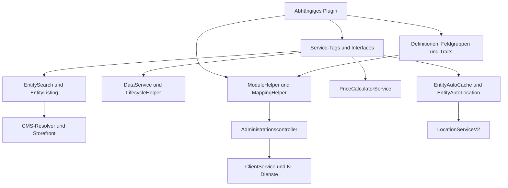

# MoorlFoundation – Architektur und vollständiges Klassenverzeichnis

Stand: 5. November 2026. Untersucht wurde Plugin-Version **1.7.112**, Git-Commit **`6a23907e`**. Grundlage sind der lokale Quellbaum und seine Service-Konfiguration. Dieser Leitfaden beschreibt Implementierung und Erweiterungsverträge; er ist keine Bestätigung einer integrierten Laufzeitprüfung.

Alle Quellverweise sind relativ zu diesem Plugin-Verzeichnis. PHP-Namespace: `MoorlFoundation\`, PSR-4-Verzeichnis: `src/`. Bei gleichnamigen Klassen ist der vollständige Pfad maßgeblich. `composer.json` verlangt `shopware/core: ~6.7.0`; das übergeordnete Entwicklungsprojekt nennt `v6.7.0.0-rc2`. Bei Anpassungen auch die tatsächlich installierte Shopware-Version berücksichtigen.

## Umfang und Orientierung

Das Verzeichnis erfasst jede benannte PHP-Klasse, jedes Interface und jeden Trait unter `src/`, einschließlich Migrationen und Demo-Datensätzen. Eigene JavaScript-Klassen in Administration, Storefront und Paint-Worklets sowie benannte PHP-Testklassen/Test-Doubles sind gesondert aufgeführt. Vue-Komponenten, Mixins und Funktionsmodule werden als eigene Architekturbausteine beschrieben; sie sind keine JavaScript-Klassendeklarationen. Mitgelieferte externe/minifizierte Bibliotheken werden nicht als eigene Foundation-Klassen gezählt.

Die abschließende Bestandsprüfung gleicht die Deklarationen mit dem Katalog ab. Eine Datei, die lediglich eine gleichnamige Klasse erwähnt, zählt dabei nicht als dokumentierte Klasse: Jeder Typ erhält eine eigene Zeile mit Quelldatei, Funktion und Zweck. Methoden werden dort aufgeführt, wo sie den Einsatz oder Erweiterungsvertrag erklären; triviale Getter und Setter werden nicht vollständig wiederholt.

Lesereihenfolge: Architektur und Integrationspunkte, Dienste/Lebenszyklus, Inhaltsmodelle/CMS/Clients, DAL/Framework und anschließend Administration/Storefront/Tests. Für eine konkrete Klasse kann nach ihrem Namen oder dem Quellpfad gesucht werden.

## Architektur und Integrationspunkte

MoorlFoundation ist eine gemeinsame Bibliothek in Form eines Shopware-Plugins. Andere moori-Plugins verwenden seine DAL-Feldgruppen und Traits, die generierte Administration, die Preis- und Listing-Erweiterungen sowie Infrastruktur für Dateninstallation, Standorte, Medien, Cache und externe Clients. Änderungen an diesen Verträgen können mehrere abhängige Plugins betreffen.

### Zentrale Dateien

| Bereich | Einstieg |
| --- | --- |
| Lebenszyklus und Datenmarker | [MoorlFoundation.php](src/MoorlFoundation.php), [PluginLifecycleHelper.php](src/Core/PluginLifecycleHelper.php) |
| Service-Registrierung und Dekoration | [services.xml](src/Resources/config/services.xml) und importierte XML-Dateien |
| Controller-Routenimporte | [routes.xml](src/Resources/config/routes.xml) |
| Plugin-Konfiguration | [config.xml](src/Resources/config/config.xml) |
| DAL-Feldgruppen und Namensauflösung | `src/Core/Framework/DataAbstractionLayer/Collection/` |
| Entity-Eigenschaften und Verhalten | `src/Core/Framework/DataAbstractionLayer/Entity*Trait.php` |
| Wiederverwendbare Erweiterungsverträge | `src/Core/System/` |
| Generierte Administration | [main.js](src/Resources/app/administration/src/main.js), `core/helper/`, `abstract/`, `component/` |
| Storefront-Einstieg | [main.js](src/Resources/app/storefront/src/main.js), `src/Resources/views/` |
| Vorhandene Prüfungen | `tests/` |

### Service-Tags für abhängige Plugins

| Tag / Shopware-Hook | Vertrag und Wirkung |
| --- | --- |
| `moorl.foundation.data` | `DataInterface`/`DataExtension`; Grund-/Demo-Daten beim DataService anmelden. Priorität ordnet den Iterator; der Pakettyp (`data`/`demo`) und die Aufrufparameter bestimmen die Auswahl. |
| `moorl.foundation.entity_search` | `EntityListingInterface`; eigene Entity für Foundation-Suche und Listing-Umschaltung anbieten. |
| `moorl.foundation.entity_suggest` | Derselbe Listing-Vertrag für Suchvorschläge. |
| `moorl.foundation.price_calculator` | `PriceCalculatorInterface`; Produktpreis-Erweiterung mit Priorität, Match und Abbruchverhalten. |
| `moorl.foundation.entity_auto_cache` | Definition mit `EntityAutoCacheInterface`; zeitabhängige Aktivierung und zugehörige Cache-Aktualisierungen. |
| `moorl.foundation.entity_auto_location` | EntityDefinition für automatische Standortermittlung nach Schreibereignissen; Adress-/Standortfelder passend zu Foundation bereitstellen. |
| `moorl.foundation.client` | `ClientInterface`; Verbindungstyp inklusive Konfigurationsformular und optionalem Adapter/HTTP-/KI-Vertrag registrieren. |
| `shopware.entity.definition` / `.extension` | DAL-Definitionen und Rückreferenzen auf Shopware-Entities. |
| `shopware.cms.data_resolver` | Datenbeschaffung für registrierte CMS-Elementtypen. |
| `shopware.entity_indexer` | Indexer für eingebettete Medien und von abhängigen Plugins verwendete Indexer-Basisklassen. |
| `shopware.scheduled.task`, `messenger.message_handler` | Task-Definitionen und deren Ausführung durch Shopwares Queue-Infrastruktur. |

Die Services werden überwiegend ausdrücklich per XML verdrahtet. Eine Datei im Quellbaum ist deshalb nicht automatisch ein registrierter Service. Dekoriert werden unter anderem Shopwares Listing-, Such- und Produktpreisrouten/-dienste, der CookieProvider und der EntityCacheKeyGenerator. Die Produkt-Listing-/Search-/Price-Dekorationen haben Priorität `-9999`.

### Konfiguration

Alle folgenden Schlüssel stehen unter `MoorlFoundation.config.`. Die Tabelle gibt die Vorgaben in `config.xml` wieder; tatsächliche Auswertung und Verkaufskanalbezug sind am jeweiligen Service/Template zu prüfen.

| Schlüssel | XML-Vorgabe / Bedeutung |
| --- | --- |
| `fontawesome`, `animate` | `false`, `true`; optionale Icon-/Animationseinbindung |
| `aiClient` | Keine Vorgabe; ausgewählte `moorl_client`-ID für KI-Funktionen |
| `advancedSearchActive`, `advancedSearchHideEmptyResults` | jeweils `true` |
| `advancedSearchNoTab`, `advancedSearchWidth` | `false`, `600px` |
| `moorlAnimationZIndex`, `moorlAnimation` | `900`; Animationskonfiguration ohne XML-Standard |
| `cmsEmptyAlert` | `false` |
| `osmCookieConsent` | `true` |
| `osmTileLayer`, `osmAttribution` | OpenStreetMap-Kachelvorlage `https://{s}.tile.openstreetmap.org/{z}/{x}/{y}.png` und zugehöriger Attributionstext |
| `osmOptions` | `dragging`, `tap`, `autoPan`, `autoClose`, `scrollTo`, `flyTo`, `fitBounds` |
| `osmCountryIds` | Keine Vorgabe; Länderauswahl für Standortsuche |
| `osmPadding`, `osmZoom`, `osmUnitOfMeasurement` | `5`, `14`, `km`; `mi` auswählbar, `nm` im Label als noch nicht unterstützt gekennzeichnet |
| `filterSearchCollapsed`, `filterRadiusCollapsed`, `filterFirstCharCollapsed` | jeweils `true` |
| `filterRadiusMyLocation` | `true` |
| `filterRadiusType`, `filterRadiusSteps` | `number`, `1,2.5,5,10,15,25,50` |
| `filterRadiusDefault`, `filterRadiusPersist` | `10`, `false` |
| `orderAutoCancel` | `false` |
| `entityAutoCacheTrigger` | `live`; alternativ `scheduled` oder `disabled` für Konsolenbetrieb |
| `entityAutoCacheMethod`, `entityAutoCacheSkip` | `update`, `false`; alternativ Methode `clear` |
| `moorlOffsetTop` | `30` |
| `fileExtensions` | `zip,rar,psd,docx,csv`; Ergänzung der Medien-Dateiendungen |
| `demoCustomerMail`, `demoCreateSalesChannel` | `test@example.com`, `false` |
| `cmpFoundationListingItem` | `true` |
| `cmpSectionFixedBackgroundIOS`, `cmpCustomerGroupCacheKeyGenerator` | jeweils `false` |
| `cmpElasticSearchMappings`, `cmpFilterPanel` | jeweils `false` |
| `cmpPriceCalculationSkip` | Keine XML-Vorgabe |

`cmp*`-Schalter sind spezifische Kompatibilitätsoptionen. Aus dem Namen allein keine allgemeine Unterstützung eines Fremdplugins ableiten. Die `moorl-support-link`-Komponenten mit Name `null` dienen der Konfigurationsoberfläche und sind keine zusätzlichen fachlichen Schalter.

## Services, Systemverträge und Plugin-Lifecycle

Die folgenden Pfade beziehen sich auf das Pluginverzeichnis. Die Services werden in [services.xml](src/Resources/config/services.xml) und den importierten XML-Dateien verdrahtet. Erweiterungen anderer Plugins gelangen über Tagged Iterators in Foundation: `moorl.foundation.client`, `moorl.foundation.data`, `moorl.foundation.entity_search`, `moorl.foundation.entity_suggest`, `moorl.foundation.entity_auto_cache`, `moorl.foundation.entity_auto_location` und `moorl.foundation.price_calculator`. Ein vorhandenes Interface oder eine Basisklasse allein registriert noch keinen Service; die jeweilige XML-Registrierung und der richtige Tag sind Teil des Vertrags.

### Klassenkatalog: Services und System

| Klasse/Interface | Aufgabe, maßgebliche Methoden und Integrationsvertrag |
| --- | --- |
| [AiChatContextService](src/Core/Service/AiChatContextService.php) | `build()` erzeugt serverseitige Developer-Instruktionen, einen skalaren Item-Snapshot, `allowedFields` und ein striktes JSON-Schema für AI-Antworten. `getEntityFields()`/`getFieldType()` lesen die tatsächliche DAL-Definition; `normalizeFields()` gleicht Browser-Metadaten mit ihr ab; `createItemSnapshot()` beschränkt Daten; `logRejectedContext()` protokolliert Ablehnungsgründe. Details zum Validierungsvertrag stehen unten. |
| [AiChatService](src/Core/Service/AiChatService.php) | Orchestriert `test()` und `chat()`. `getConfiguredAiClient()` prüft konfigurierte ID, Typ `ai` und Aktivstatus. `extractChatContext()`, `normalizeMessages()` und `normalizeImages()` validieren den Request; `extractResponse()` und `validateChanges()` machen aus Provider-JSON eine geprüfte Feld-Wert-Map. `logClientError()`/`redact()` schreiben technische Details mit API-Key-Redaktion in den Client-Logkanal. Liefert Antwort-/Fehlerarrays, schreibt selbst keine Entity. |
| [ClientService](src/Core/Service/ClientService.php) | Zentrale Auswahl der per Tag registrierten Filesystem-/API-/AI-/OAuth2-Clients. `getClient()` lädt `moorl_client`, sucht nach exakt passendem `getClientName()`, setzt die Client-Entity und cached nach ID; unbekannte Entity/Implementierung werfen Exceptions. `getOptions()` liefert Name, Label, Typ, Konfigurationsvorlage. `getClientEntities()` filtert aktive Clients nach Typ-Teilstring. `getAdapter()`/`getFilesystem()` erzeugen Adapter/Flysystem; `publicUrl()`, `temporaryUrl()`, `getSize()`, `readStream()`, `getMimetype()`, `read()`, `listContents()` und `createDir()` kapseln Speicherzugriffe. `test()` listet den Root oder delegiert `testConnection()` und normalisiert Exceptions zu Fehlerarrays. `enrichMetadata()` liest `files.xml`/`metadata.xml` und hängt XML-Metadaten an Dateien mit gleichem Basename. |
| [DataService](src/Core/Service/DataService.php) | Gemeinsamer Installer/Entferner für getaggte `DataInterface`-Pakete; arbeitet mit internem System-Context. `install()`/`remove()` sind schreibende Lifecycle-Einstiegspunkte und liefern die Zahl bearbeiteter Pakete. `getOptions()` beschreibt verfügbare Pakete. JSON-Inhalte, SQL, Assets, Medien, Konfiguration, Theme-Kompilierung, Platzhalter und Varianten werden hier zentral verarbeitet; vollständiger Ablauf und Methodengruppen stehen unten. |
| [EntityAutoCacheService](src/Core/Service/EntityAutoCacheService.php) | EventSubscriber für Haupt-Verkaufskanalrequests und `EntityWrittenContainerEvent`; verarbeitet getaggte `EntityAutoCacheInterface`-Definitionen. `scanForTimeControlledEntities()` aktualisiert zeitabhängige Datensätze oder leert den Cache. `updateEntity()` stößt unabhängig mit Fehlerlogging `updateProductStream()`, `updateCms()` und `updateEntityAssoc()` an. `getSelectIds()`, `makeId()` und `makeUpsertCommand()` ermitteln betroffene IDs/Upserts; `writeTitle()`/`writeLine()` geben CLI-/Debug-Ausgaben aus. |
| [EntityAutoLocationService](src/Core/Service/EntityAutoLocationService.php) | Subscriber für DAL-Schreibcontainer; prüft mit `testPayload()` Adress-/`autoLocation`-Änderungen der getaggten Entity-Definitionen und verarbeitet deduplizierte IDs in `handle()`. Ergänzt fehlende `country_id` aus `country_code`; schreibt bei SQL-Wert `auto_location === "1"` Lat/Lon direkt per DBAL nach erfolgreicher V2-Geocodierung. Erwartet fest benannte Adress-/Koordinatenspalten. `getSubscribedEvents()` registriert das Event. |
| [EntityEnricherService](src/Core/Service/EntityEnricherService.php) | `setContext()`/`setSalesChannelContext()` setzen Verarbeitungskontext. `enrichSalesChannelProduct()` berechnet bei vorhandenem Verkaufskanalkontext Produktpreise und bereitet Covermedien vor. `enrichMedia()` deserialisiert `mediaTypeRaw`/`thumbnailsRo`, erzeugt andernfalls eine leere Thumbnail-Collection und überspringt URL-Verarbeitung für private/fehlende Dateien. `addThumbnailUrl()` ist leer: diese Klasse erzeugt derzeit keine zusätzlichen Thumbnail-URLs. |
| [EntitySearchService](src/Core/Service/EntitySearchService.php) | `getEntityListing()` wählt einen Listing-Provider über `tab` oder über die mit `slots` bezeichneten CMS-Slottypen; entfernt `slots` sofort aus der Query zur Produktlisting-Kompatibilität. Auf `frontend.search.page` setzt es `order=score` und gibt keinen Ersatzprovider zurück. `enrich()` sucht bei aktiver erweiterter Suche zusätzliche Entity-Ergebnisse und weist sie als `moorlSearchResults` am Produktlisting zu. |
| [EntitySuggestService](src/Core/Service/EntitySuggestService.php) | Leere Unterklasse von `EntitySearchService`; übernimmt dieselbe Implementierung, wird aber mit dem Iterator `moorl.foundation.entity_suggest` separat verdrahtet. Eigenes Suggest-Verhalten entsteht durch Provider/Route-Kontext, nicht durch überschriebenen Code dieser Klasse. |
| [EntityTrackerService](src/Core/Service/EntityTrackerService.php) | Leerer Platzhalter mit TODO zum Zählen von Seitenaufrufen; besitzt keine implementierte Trackingfunktion. |
| [LocationCookieProvider](src/Core/Service/LocationCookieProvider.php) | Dekoriert Shopwares `CookieProviderInterface`. `getCookieGroups()` übernimmt Originalgruppen und ergänzt bei `osmCookieConsent` in `cookie.groupComfortFeatures` den Cookie `moorl-location-map=1` samt Snippet-Verweisen. |
| [LocationService](src/Core/Service/LocationService.php) | Ältere Geolocation-API mit `GeoPoint` als Rückgabe. `getCountryByIso()` sucht ISO/ISO3/Ländername; `getCustomerLocation()` verwendet aktive Lieferadresse. `getLocationByTerm()` zerlegt Suchtexte; `getLocationByAddress()` liest einen einstündigen DAL-Adresscache und verwendet Google bei gesetztem Google-Key, sonst Nominatim. `getCountryIso()` bestimmt Länderbegrenzung; `apiRequest()` kapselt Guzzle/JSON; `getUnitOfMeasurement()`, `getContext()` und `setContext()` liefern/setzten Basiskontext. Nicht mit V2-Rückgabetyp verwechseln. |
| [LocationServiceV2](src/Core/Service/LocationServiceV2.php) | Geocodierung als persistierte `LocationEntity`, Nominatim mit APP_URL-Referer und einer Sekunde Drosselung pro HTTP-Aufruf. `getLocationByTerm()` unterstützt Länder-PLZ-Muster und direkte `lat\|lon`; `getLocationByAddress()` cached/geocodiert, `getCustomerLocation()` nimmt Lieferadresse. `getCountryPostalCodePatterns()`, `getCountryIso()`, `getCountryByIso()`, `apiRequest()`, `getUnitOfMeasurement()` und Context-Getter/-Setter unterstützen dies. `writeLocationCache()`, `getEntityIdsByDistance()` und `clearLocationCache()` bilden den SQL-Entfernungscache. |
| [LoggerService](src/Core/Service/LoggerService.php) | PSR-Logger-Wrapper. Konstruktor liest optional eine numerische Monolog-Schwelle aus SystemConfig (Fallback Error; ohne Konfiguration Debug). `debug()`, `info()`, `notice()`, `warning()`, `error()`, `critical()`, `alert()` und `emergency()` delegieren nur ab erreichter Schwelle; generisches `log()` delegiert ohne diese Schwellenprüfung. |
| [PriceCalculatorService](src/Core/Service/PriceCalculatorService.php) | Pluginübergreifende Preis-Pipeline nach Shopwares Produktpreisberechnung. `calculate()` initialisiert/selektiert passende Rechner, sortiert Prioritäten absteigend und führt sie bis `shouldBreak()` aus. `setFixedPrice()` und `calculatePriceByFactor()` verändern Haupt-, Günstigst- und Staffelpreise mit Shopwares QuantityPriceCalculator; Quellen, Rundung, Wiederholschutz und Konfigurationsmethoden sind unten beschrieben. |
| [SortingService](src/Core/Service/SortingService.php) | `getAvailableSortings()` lädt aktive Entity-Sortierungen nach Priorität, `getFallbackSorting()` erzeugt bei Bedarf `createdAt DESC, id DESC`. `getSorting()` lädt nach ID; `addSortingCriteria()` hängt DAL-Sortierungen an. Die veralteten `enrichCmsElementResolverCriteria()`/`V2()` übertragen Slotlimit, ausgewählte IDs und Sortierung; V2 ergänzt Foreign-Key-Bezug zum Resolver-Entity oder schließt dieses aus. Für neue Resolver verweist der Code auf `FoundationListingCmsElementResolver`. |
| [DataInterface](src/Core/System/DataInterface.php) | Paketvertrag für DataService: Identität (`getType()`, `getName()`, `getPluginName()`, `getPath()`, `getCreatedAt()`), Tabellen (`getTables()`, `getShopwareTables()`, `getPluginTables()`), Cleanup/Kundenbedarf, globale/lokale Replacer, Stylesheets, SQL vor/nach Installation/Entfernung, Install-Konfiguration, `process()` und gesperrte Records. Alte Medien- und Demo-Platzhalter-Methoden bleiben als deprecated Bestandteil enthalten. |
| [DataExtension](src/Core/System/DataExtension.php) | Standardimplementierungen für Datenpakete: standard/demo, Cleanup aktiv, kein Kundenbedarf, leere Tabellen/SQL/Konfigurations-/Stylesheetlisten und leerer `process()`-Hook. `getGlobalReplacers()`/`setGlobalReplacers()` halten Platzhalter; `getReplacer()` sucht `{GROSSGESCHRIEBENER_KEY}` mit Fallback. Legacy-`getDemoPlaceholderTypes()`/-`Count()` liefern Typen und 500 IDs; `getMediaProperties()` nennt mediaId/previewMediaId. `getSeoUrlTemplateQuery()` erzeugt einen platzhalterbasierten INSERT IGNORE für ein SEO-Template. Pluginname, Pfad und CreatedAt müssen konkrete Pakete ergänzen. |
| [EntityAutoCacheInterface](src/Core/System/EntityAutoCacheInterface.php) | Liefert `getEntityName()` und `getEntityAutoCacheOptions()` für die Cache-Verfolgung. `START_TIME`/`END_TIME` akzeptieren einen Spaltennamen oder Listen von Spaltennamen; weitere Optionen beschreiben Active-Spalte, Produktstreams, CMS-Slots und Entity-Relationen. Registrierung mit `moorl.foundation.entity_auto_cache` ist erforderlich. |
| [EntityListingInterface](src/Core/System/EntityListingInterface.php) | Voller Providervertrag für Such-/Suggest-/Listing-Ergebnisse: Plugin/Entity/Title, Limit, Term, Aktivstatus, Template/Snippet/ElementConfig, Repository, Request/Event/Context/SystemConfig/Dispatcher-Setter, `inheritCriteria()`, `processCriteria()`, `processSearchResult()` sowie `listingRoute()`. Implementierungen stellen fachliche Kriterien und Darstellung bereit. |
| [EntityListingExtension](src/Core/System/EntityListingExtension.php) | Implementiert den Listingvertrag mit Standardwerten: Limit 6, eigene Kriterien, unveränderter Suchterm, leere Verarbeitungshooks/Entitynamen und keine Snippets/Templates. `setRequest()`/`setEvent()` setzen Routenkontext; `isWidget()`/`isSearch()`/`isSuggest()` unterscheiden Routen. `getConfig()` liest plugin- und verkaufskanalspezifische Search/Suggest-Konfiguration; `getElementConfig()` mischt Grid-/Suggest-Defaults. `listingLoader()` lädt IDs, Aggregationen und Entities über ein SalesChannelRepository; `listingRoute()` baut `EntityListingResult`, ElementConfig und navigationId-Filter. Konkrete Provider müssen Entity/Title, Repository und fachliche Hooks ergänzen. |
| [EntityListingFeaturesSubscriberExtension](src/Core/System/EntityListingFeaturesSubscriberExtension.php) | Wiederverwendbare Basis für Listing-Subscriber; registriert selbst keine Events. `handleListingRequest()`/`handleSearchRequest()` wenden Pagination, Filter und Sortierung an; `handleResult()` setzt aktuelle Filter, Seiten-/Limit-/Sortierungsmetadaten. `handleFlags()` steuert Aggregations-only/-none. Geschützte Filterfabriken decken Tags, Produktstreams, Hersteller, Kategorien/Unterkategorien/Navigation, Länder, Typen, Kunden, Anfangsbuchstaben, Preise und Radius ab. Konkrete Subscriber überschreiben `getFilters()` und setzen `$entityName`. |
| [EntityListingResult](src/Core/System/EntityListingResult.php) | Erweitert `ProductListingResult` um `elementConfig`; `getElementConfig()`/`setElementConfig()` machen CMS-/Suchlayoutkonfiguration im Ergebnis verfügbar. |
| [EntityMigrationInterface](src/Core/System/EntityMigrationInterface.php) | Marker-/Datenvertrag für DAL-Definitionen: `getMigrationFields()` liefert eine `FieldCollection` für die Migrationserzeugung. |
| [PriceCalculatorInterface](src/Core/System/PriceCalculatorInterface.php) | Strategie-Vertrag: `getName()`, `getPriority()`, `shouldBreak()`, `init(SalesChannelContext)`, `match(product, context)` und `calculate(product, context)`. Rechner werden mit `moorl.foundation.price_calculator` gesammelt; sie mutieren das bereits berechnete SalesChannelProductEntity. |
| [PriceCalculatorExtension](src/Core/System/PriceCalculatorExtension.php) | Basis für Preisstrategien. `init()` liest Priorität, Break-Verhalten und Preisquellen über PriceCalculatorService für den Verkaufskanal; Getter liefern diese sowie Active-Status. `getName()`, `match()` und `calculate()` werfen absichtlich `RuntimeException('Not implemented')` und müssen überschrieben werden. Die Basisklasse implementiert das Interface nicht selbst. |

### AI-Chat: Eingabe, Kontext und Änderungsvorschläge

Der erste Chat-Eintrag muss exakt ein `role=context`-Element mit einem `entity_context`-Inhalt enthalten. `AiChatContextService::build()` verlangt eine nichtleere Entitykennung, ein stringförmiges `labelProperty`, einen nichtleeren Item-Datensatz und JSON-serialisierbaren Kontext bis 20.000 Bytes. Die Browserfelder müssen Metadaten mit unterstütztem `type` und booleschem `required` liefern. Feldnamen folgen `^[A-Za-z][A-Za-z0-9_]*$`; jedes Feld muss in der serverseitigen DAL-Definition existieren und typgleich sein. Eine einzelne ungültige Feldbeschreibung verwirft den gesamten Kontext. `required` wird als Metadatum geprüft, erzeugt hier aber keine fachliche Pflichtfeldvalidierung.

Nicht zulässig sind `id`, `versionId`, Zeitstempel, `translations`, `customFields`, Computed-/WriteProtected-Felder und nicht unterstützte Feldtypen. Strings, LongText, Date, DateTime und TranslatedField werden auf string, Int auf integer, Float auf number und Bool auf boolean abgebildet. Assoziationen und verschachtelte Daten kommen nicht in die Allowlist. Der Snapshot enthält nur vorhandene erlaubte Skalar-/Nullwerte und darf 100.000 Bytes nicht überschreiten. Die Developer-Instruktionen kennzeichnen ihn als Read-only-Kontext; das Schema verlangt `message` und eine `changes`-Liste aus `{field,value}` ohne zusätzliche Eigenschaften.

Nach dem Kontexteintrag akzeptiert `AiChatService` 1–29 User-/Assistant-Nachrichten mit ausschließlich nichtleeren Textteilen und höchstens 10.000 Zeichen pro Nachricht. Es übersetzt Texttypen in `input_text`/`output_text`. Maximal ein Bild mit ausschließlich `url` und gültigem HTTPS-Schema ist erlaubt; Bilder werden nur an die erste User-Nachricht angehängt. Das ist eine URL-Formprüfung, keine Medienprüfung. Der konfigurierte Client muss aktiv und vom Typ AI sein und für Chat `ClientAiInterface` implementieren.

Die Providerantwort wird aus `output`-/`output_text`-Teilen zusammengesetzt, als JSON geparst und unabhängig vom Provider-Schema nochmals geprüft: ausschließlich `message`/`changes`, nichtleere Nachricht, erlaubte Felder, keine doppelten Felder, exakte skalare PHP-Typen und keine zusätzlichen Change-Eigenschaften. Ungültige Teile verwerfen die ganze Antwort. Erfolgreich entsteht `['message'=>..., 'changes'=>['field'=>value]]`; eine leere Änderungsliste lässt `changes` ganz entfallen. Diese Services speichern oder wenden Änderungen nicht an. Fehlerantworten bleiben generisch, während technische Details im rotierenden `moorl_foundation_client_<environment>.log` landen; API-Key und `sk-...` werden redigiert. DI und Logging: [services.xml](src/Resources/config/services.xml), [monolog.xml](src/Resources/config/monolog.xml).

### Preis-Pipeline

Der in [price-calculator.xml](src/Resources/config/core/price-calculator.xml) registrierte Produktpreis-Dekorator übergibt berechnete Produkte an `PriceCalculatorService`. Nur `SalesChannelProductEntity` wird verarbeitet. Die kommaseparierte Einstellung `MoorlFoundation.config.cmpPriceCalculationSkip` überspringt Produkte mit entsprechend benannten Extensions. `collect()` ruft je Strategie `init()`/`match()` auf und sortiert absteigend nach Priorität; `process()` führt passende Strategien aus, bis eine ihren Abbruch erklärt.

`getPriority()`, `getShouldBreak()`, `getCalculationPriceSource()`, `getListPriceSource()`, `getRoundingType()` und `getRoundingStep()` lesen `<Initiator>.config.priceCalculator...`; explizite Quellen überschreiben die Plugin-Konfiguration. `getConfigKey()` baut diese Keys. `setFixedPrice()` berechnet eine DAL-PriceCollection gemäß Währung/Steuerstatus, leitet bei vorhandenen Preisen einen Faktor ab und behandelt Nullpreise separat. `calculatePriceByFactor()` setzt optional eine Extension und den Faktor am Produkt und aktualisiert Haupt-, Cheapest- und alle Staffelpreise. Faktor 1 wird übersprungen.

`calculateItem()` kann den ursprünglichen Verkaufspreis oder Listenpreis als Basis nutzen, Listenpreisrabatte darstellen und Grundpreisdefinition/RegulationPrice erhalten. `roundToStep()` unterstützt keine Rundung, round, floor und ceil; Schritte <= 0 ändern nichts. `getCalculatedPrice()`/`buildDefinition()` führen Shopwares QuantityPriceCalculator mit Steuerregeln aus; `getPriceValue()`/`getPriceForTaxState()` berücksichtigen Brutto/Netto und gegebenenfalls Währungsfaktor. `shouldSkip()` vermeidet fremde Break-Markierungen, Nullpreis-Faktorisierung und identische Wiederholung pro Initiator/Produkt. `cacheAndAssignMainPrice()` setzt Hauptpreis, Prozesscache und gegebenenfalls Break-Markierung. Die Cache-/Skip-Daten liegen im Servicezustand; sie sind keine persistierten Preisregeln.

### Dateninstallation und Entfernung

`DataService::install(pluginName, type='data', name=null)` filtert registrierte Pakete nach Plugin/Typ und optional Name. Ohne expliziten Namen überspringt es bereits in Shopwares Migrationstabelle protokollierte Paketklassen. Es initialisiert Steuern und globale Ersetzungen, führt Pre-SQL aus, entsperrt deklarierte Records, kopiert `public/`-Assets, importiert JSON-Tabelleninhalte per DAL-Upsert, ergänzt Stylesheets, führt Post-SQL/Recordsperren aus, schreibt InstallConfig, ruft den `process()`-Hook auf, protokolliert die Paketklasse als Migration und kompiliert gegebenenfalls das ermittelte Plugin-Theme für den gesetzten Verkaufskanal. Die mitgelieferten Pakete sind vom Typ `demo` und werden vom Lifecycle-Aufruf mit Standardtyp `data` folglich nicht automatisch importiert.

`getTargetDir()`, `copyAssets()` und `addStylesheets()` schreiben Asset-Dateien in ein kleingeschriebenes Pluginverzeichnis und vermerken CSS-Links in der Plugin-Konfiguration. `initTaxes()` liest Steuern; `initGlobalReplacers()` ermittelt unter anderem Zeit-, Sprach-, Währungs-, Theme-, Kunden-, Steuer-, Regel-, Lieferzeit- und Medienordnerplatzhalter. `insertContent()` läuft Tabellen in deklarierter Reihenfolge ab, liest Inhalte und nutzt die zugehörigen DAL-Repositories. Bei DBAL-Exceptions lässt es den QueryHelper FK-Fehlercode 1451 behandeln und wiederholt den Upsert. `getContentFromFile()` bevorzugt `content/<table>.json`, akzeptiert aber auch die geschützte Variante `content/_<table>.json`.

`processReplace()` ersetzt globale Werte, PHP-Klassenkonstanten, deterministische `{ID:key}` als `md5(pluginName . key)`, `{MD5:...}`, `{BASE64:...}`, `{PRICE:...}`, `{READ_FILE:...}` und `{MEDIA_FILE:...}`. `valueFromFile()`/`mediaFromFile()` sind separate Einzelwerthelfer. `enrichData()` verarbeitet Übersetzungs-Fallbacks, Zeitstempel, Legacy-IDs/Preise/Medien, generierte Mailtemplate-Warntexte und Varianten; es entfernt vorhandene SEO-URLs, wenn neue `seoUrls` enthalten sind. `_skipEnrichData` beendet die Anreicherung des betreffenden Records. `enrichFallbackData()` ersetzt zufällige IDs, Kunden-ID und alte Medienordnermuster. `generateVariants()` gruppiert Konfiguratoroptionen nach Eigenschaftsgruppe, bildet mit `cartesianProduct()` deren Kombinationen und erzeugt deterministische Kindprodukte, Optionszuordnungen, Bestand und multiplikativ angepasste Preise.

`getMediaId()` akzeptiert vorhandene IDs, lokale Medien und HTTP-Quellen, reused Dateien nach Name/Extension und ordnet lokale Importe einem durch `getMediaFolderId()` gefundenen/erzeugten Ordner zu. `getMediaIdFromUrl()`/`fetchFileFromURL()` können Dateien herunterladen und über Shopwares MediaService/FileSaver persistieren. `enrichPriceV2()`/`enrichPrice()` erzeugen DAL-Preisarrays; die aktuelle Nettoformel ist `gross / 100 * (100 - taxRate)` und sollte bei Änderungen als vorhandenes Verhalten erkannt werden. Die Funktion ist kein Ersatz für Shopwares Steuerberechnung.

`remove()` verarbeitet nur Pakete mit `isCleanUp()`, löscht deren Inhalte und führt Remove-SQL aus; `cleanUpPluginTables()`/`cleanUpShopwareTables()` laufen rückwärts. `tryDeleteContent()` löscht ausschließlich Records mit dem paketfesten `created_at` und nur für Tabellen mit unpräfixierter Inhaltsdatei (`contentFileExists()`); Foreign-Key-Verletzungen werden geloggt. Das Unterstrichpräfix schützt Inhalte damit vor automatischem Cleanup. Danach wird der Migrationseintrag der Paketklasse entfernt. `setIo()`/`log()` steuern Konsolenausgabe; SalesChannel-/Customer-Getter/-Setter erlauben expliziten Kontext. `getOptions($type)` filtert im aktuellen Code trotz Parameter nicht nach Typ. Datenoperationen sind schreibend und dürfen zur Dokumentationsprüfung nicht ausgeführt werden.

### Suche, Listingfilter und Location

`EntitySearchService::enrich()` ist an `advancedSearchActive`, einen nichtleeren Suchbegriff und die jeweilige Provider-Aktivierung gebunden. Es reicht dem Provider Event, SystemConfig und Dispatcher, verwendet entweder die Produktkriterien (`inheritCriteria()`, nur bei vorhandenen Produktresultaten) oder neue Kriterien mit exakter Gesamtzahl/Providerlimit/Term. Es sucht über ein optionales SalesChannelRepository oder das DAL-Repository und kann leere Ergebnisse mit `advancedSearchHideEmptyResults` ausblenden. Ergebnis-Metadaten sind Snippet, Template, ElementConfig und Search-/Suggest-Aktivstatus; geerbte Suchkriterien übernehmen verfügbare Produktsortierungen. Jede Erweiterung muss ihre Kriterien/Resultate in `processCriteria()`/`processSearchResult()` fachlich ergänzen.

`EntityListingFeaturesSubscriberExtension` verwendet `moorl_limit` (Fallback 12), Seite `p` und einmaliges `ignore_page`. Filterwerte dürfen über GET oder POST kommen; `getPropIds()` zerlegt `|`-getrennte IDs. `getAggregations()` kann Aggregationen mit anderen aktiven Filtern reduzieren, während aktive Filter als Postfilter arbeiten. `getFilters()` ist in der Basis leer. Die Methoden `getTagFilter()`, `getProductStreamFilter()`, `getManufacturerFilter()`, `getCategoryFilter()`, `getChildCategoryFilter()`/`V2()`, `getNavigationFilter()`, `getCountryFilter()`, `getTypeFilter()`, `getCustomerFilter()`, `getFirstCharFilter()`, `getPriceFilter()` und `getRadiusFilter()` liefern Shopware-Filter mit passenden Aggregationen. `getNavigationId()` ermittelt Navigation aus Request/Route oder Verkaufskanal. `handlePagination()`, `getLimit()`, `getPage()`, `handleSorting()` und `getCurrentSorting()` setzen Pagination/Sortierung; `addCurrentFilters()` trägt aktive Werte und gegebenenfalls die `me`-LocationStruct am Ergebnis ein.

V2-Geocodierung verwendet `md5(serialize(normalizedPayload))` als Location-ID und einen einstündigen `updatedAt`-Cache. Direkte Koordinaten werden ohne Geocoder persistiert. Freitext wird anhand der konfigurierten Länder-PLZ-Muster, Straße, Ort und ISO zerlegt; Länderfallback sind DE/AT/CH. Nominatim-Fehlschläge lockern stufenweise die Adresse; Fehler werden kritisch geloggt. Der ältere Service verwendet `GeoPoint` und optional Google, V2 ausschließlich `LocationEntity`/Nominatim. Beide besitzen HTTP-Aufrufe mit langem Timeout; Aufrufer müssen diesen Unterschied und mögliche Latenz berücksichtigen.

`writeLocationCache()` berechnet per SQL Großkreisentfernungen für aktive Datensätze einer Entitytabelle mit `location_lat`/`location_lon` und schreibt/updatet `(location_id, entity_id)`. Der SQL-Erdradius ist fest 6371: die gespeicherten Werte sind Kilometer; die Parameter `distance`/`unit` ändern die Berechnung derzeit nicht. `getEntityIdsByDistance()` verwendet `< distance` und ignoriert derzeit `entityName`. Der Cache enthält keine Entitynamen-Spalte. `getRadiusFilter()` schreibt diesen Cache, filtert über `locationCache.distance <= distance` und Location-ID und legt die Location vorübergehend als Context-Extension ab; `handleFilters()` begrenzt anschließend die geladene Cache-Assoziation auf diese Location. `clearLocationCache()` leert die gesamte Entfernungstabelle per TRUNCATE, nicht die geocodierten Locations.

### Zeitgesteuerte und relationale Cache-Aktualisierung

Konfiguration und Services: [entity-auto-cache.xml](src/Resources/config/core/entity-auto-cache.xml), [entity-auto-location.xml](src/Resources/config/core/entity-auto-location.xml), [location.xml](src/Resources/config/core/location.xml). Bei SalesChannel-Hauptrequests arbeitet der AutoCache-Scanner nur für Trigger `live`; der ScheduledTask nur für `scheduled`; das CLI-Kommando übergibt keinen Triggerfilter. `entityAutoCacheSkip` unterdrückt die DAL-Schreibereignis-Verarbeitung. `entityAutoCacheMethod` wählt `update` (DAL-Upserts mit IDs) oder `clear` (SQL-Zeitstempel aktualisieren und am Ende CacheClearer).

Der Scanner findet aktive Records mit `updated_at IS NULL` oder einem START_TIME-/END_TIME-Wert, der nach `updated_at`, aber vor `now - 10 Sekunden` liegt. Beide Zeitoptionen unterstützen mehrere Spalten; damit können mehrere Zeitfenster je Entity geprüft werden. Er setzt keine fachlichen Aktivitätsflags, sondern erzwingt Aktualisierung/Invalidierung. Das `ACTIVE`-Optionsfeld ist optional.

Bei normalen Writes übernimmt `updateEntity()` die Folgearbeit: `PRODUCT_STREAM` baut Streamfilter und dispatcht `ProductIndexerEvent`; `CMS_SLOT` findet aktive/sichtbare Kategorien mit passenden Slottypen und optional konfigurierten Referenz-IDs und dispatcht `CategoryIndexerEvent`. `ENTITY_ASSOCIATION` beschreibt über MAIN_ENTITY/RELATED_ENTITY/MAIN_ID_FIELD/REFERENCE_ID_FIELD und optional ENTITY die SQL-Beziehung. Produkte/Kategorien bekommen Indexer-Events; andere Entities werden mit ID-Upserts aktualisiert. `updatedEntities` dient als Guard für bereits berücksichtigte Hauptentities. Fehler je Bereich werden unabhängig kritisch geloggt, sodass ein Fehler nicht alle Folgeaktualisierungen unterbindet.

### Lifecycle, Subscriber, Tasks und Command

| Klasse | Zweck und Methoden |
| --- | --- |
| [MoorlFoundation](src/MoorlFoundation.php) | Shopware-Plugin-Einstieg. Konstanten deklarieren Pluginname, Cleanup-Zeitmarker `2001-11-11 11:11:11.111`, Shopware-/Plugintabellen und leere Inheritances. `update()` benennt alte CTA-/Multislider-CMS-Blöcke samt Slots um und ruft Lifecycle-Update auf; `activate()` führt ebenfalls Lifecycle-Update aus. `uninstall()` löscht nur bei `keepUserData() === false` über den Helper und ruft anschließend Parent auf. |
| [PluginLifecycleHelper](src/Core/PluginLifecycleHelper.php) | Statische gemeinsame Lifecycle-Werkzeuge. `update()` installiert Datenpakete und Inheritances gemäß Plugin-Konstanten; `uninstall()` entfernt Plugin-FKs/-Tabellen, markierte Shopware-Daten, Inheritances, Datenpakete und Migrationseinträge. `c()` liest optionale Klassenkonstanten. `build()` lädt zusätzliche `services.xml` nur bei vorhandener Elasticsearch-Definition. `removeDir()` entfernt projektbezogene Verzeichnisse. `migrationSkipper()` markiert ältere MigrationStep-Klassen als übersprungen; `removeMigrations()` löscht nach Plugin-Namespace. `updateInheritance()`/`removeInheritance()` ergänzen/entfernen binary(16)-Spalten mit Existenzprüfung; Pluralmethoden iterieren Listen. `removePluginTables()`/`removeForeignKeys()` entfernen FKs und Tabellen rückwärts. `removePluginData()` löscht passende CreatedAt-Records mit QueryHelper-Behandlung für FK-Fehler. `renameCmsBlock()` aktualisiert referenzierte Slots anhand Mapping und danach Blocktyp; `renameCmsSlot()` ersetzt Slottypen direkt. |
| [PluginHelpers](src/Core/PluginHelpers.php) | `assignArrayByPath()` weist einen Wert über einen trennzeichenbasierten Pfad per Referenz zu. `getNestedVar()` expandiert Punktpfad-Schlüssel im bestehenden Array; `setNestedVar()` ergänzt Punktpfade für rekursive Blattwerte. `currentTimeFormatted()` liefert `Y-m-d H:i:s` in der gewählten Zeitzone (Default UTC). |
| [KernelEventSubscriber](src/Core/Subscriber/KernelEventSubscriber.php) | `getSubscribedEvents()` verbindet Kernel Request/Response. `onRequest()` stellt bei `filterRadiusPersist` Querywerte aus dem JSON-Cookie `radius-persist` wieder her. `onResponse()` speichert bei Querywert `radius-persist=true` Distance/Location für 30 Tage in einem nicht HttpOnly gesetzten Cookie und löscht ihn bei `false`. |
| [MoorlFoundationSubscriber](src/Core/Subscriber/MoorlFoundationSubscriber.php) | `getSubscribedEvents()` verbindet Medien-Whitelist und Transaktionszustände cancelled/failed. `onMediaFileExtensionWhitelist()` ergänzt kommaseparierte, getrimmte `fileExtensions`. `stateChanged()` storniert bei `orderAutoCancel` die zugehörige Bestellung über StateMachineRegistry; dies ist fachliche Zustandsänderung, nicht bloß Logging. |
| [ClearLocationCacheTask](src/Core/Task/ClearLocationCacheTask.php) | `getTaskName()` liefert `moorl_foundation.clear_location_cache`, `getDefaultInterval()` 86.400 Sekunden, `shouldRescheduleOnFailure()` true. |
| [ClearLocationCacheTaskHandler](src/Core/Task/ClearLocationCacheTaskHandler.php) | Messenger-/ScheduledTaskHandler für obige Task; Konstruktor übergibt Repository/Logger an Parent. `run()` ruft `LocationServiceV2::clearLocationCache()` auf. |
| [EntityAutoCacheTask](src/Core/Task/EntityAutoCacheTask.php) | `getTaskName()` liefert `moorl_foundation.entity_auto_cache`, `getDefaultInterval()` 300 Sekunden, `shouldRescheduleOnFailure()` true. |
| [EntityAutoCacheTaskHandler](src/Core/Task/EntityAutoCacheTaskHandler.php) | Messenger-/ScheduledTaskHandler; `run()` scannt zeitgesteuerte Entities mit Trigger `scheduled`. |
| [EntityAutoCacheCommand](src/Core/Command/EntityAutoCacheCommand.php) | Symfony-Kommando `moorl:entity-auto-cache`. `configure()` ist leer; `execute()` startet den Scanner ohne Triggerfilter mit ShopwareStyle-Ausgabe. Der aktuelle Rückgabecode ist ausdrücklich `1`, auch ohne geworfenen Fehler; Aufrufer sollten das vorhandene Verhalten kennen. |

## Demo-Datenpakete

Alle fünf Pakete erweitern `DataExtension`, implementieren `DataInterface` und werden in [core/data.xml](src/Resources/config/core/data.xml) mit `moorl.foundation.data` registriert. Gemeinsame Getter deklarieren `getPluginName() = MoorlFoundation`, `getCreatedAt() = MoorlFoundation::DATA_CREATED_AT`, `getType() = demo`, `getPath() = __DIR__`; `getTables()` führt Shopware- und Plugintabellen zusammen. `getName()` wählt das konkrete Paket. Die Paketklassen enthalten keine eigenen Importalgorithmen; DataService liest ihre `content`-JSONs und Medien.

| Klasse | Konkreter Inhalt und Tabellenvertrag |
| --- | --- |
| [DemoCmsTools](src/Demo/CmsTools/DemoCmsTools.php) | Name `cms-tools`. `getShopwareTables()` beschränkt auf cms_page/category; Pluginliste entspricht Foundation. [cms_page.json](src/Demo/CmsTools/content/cms_page.json) und [category.json](src/Demo/CmsTools/content/category.json) liefern jeweils einen Eintrag „Foundation CMS Tools“ zur Demonstration von CMS-Elementen. |
| [DemoImportExport](src/Demo/ImportExport/DemoImportExport.php) | Name `import-export`; Shopware-/Pluginlisten stammen aus den Foundation-Konstanten. [import_export_profile.json](src/Demo/ImportExport/content/import_export_profile.json) liefert ein Profil „[moori] Embedded media“ für Import/Export. |
| [DemoLegals](src/Demo/Legals/DemoLegals.php) | Name `legals`; cms_page/category als Shopwaretabellen. [cms_page.json](src/Demo/Legals/content/cms_page.json) enthält drei Seiten Impressum/AGBs/Datenschutz, [category.json](src/Demo/Legals/content/category.json) vier Kategorien einschließlich „Legals“. Texte verwenden die vom DataService bereitgestellten HTML-Platzhalter; dies sind Demo-Inhalte. |
| [DemoMarker](src/Demo/Marker/DemoMarker.php) | Name `marker`; Tabellenlisten aus Foundation. [moorl_marker.json](src/Demo/Marker/content/moorl_marker.json) enthält 16 Markerkonfigurationen (Icons/SVG/Farbvarianten), die Dateien unter `media/marker` einbinden. |
| [DemoMediaFolder](src/Demo/MediaFolder/DemoMediaFolder.php) | Name `media-folder`; Tabellenlisten aus Foundation. [media_default_folder.json](src/Demo/MediaFolder/content/media_default_folder.json) legt den Standardmedienordner für `moorl_media` samt Ordnerkonfiguration an; DataService berücksichtigt bereits vorhandene Defaultordner. |

## Migrationskatalog

Alle folgenden Klassen erweitern Shopwares `MigrationStep`. `getCreationTimestamp()` liefert den Sortierzeitstempel; `update(Connection)` führt die unten beschriebene SQL-Änderung aus. Sämtliche `updateDestructive()`-Methoden sind leer. Die neueren generierten Migrationen ab 1744278000 besitzen `OPERATION_HASH`/`PLUGIN_VERSION`, versuchen SQL zunächst als Block und anschließend mit Schema-Existenzprüfungen einzeln über `EntityDefinitionQueryHelper::tryExecuteStatement()`. Ihre privaten `additionalCustomUpdate()`-Hooks sind leer. Diese Fallbacks dürfen bei Anpassungen nicht als unbenutzter Code entfernt werden; sie dienen bereits teilweise angepassten Datenbanken.

| Migrationsklasse | Konkreter SQL-Zweck |
| --- | --- |
| [Migration1616141231](src/Migration/Migration1616141231.php) | Erstellt `moorl_cms_element_config` falls fehlend: binary-ID, Name/Typ, JSON-Konfiguration/Daten/custom_fields und Millisekunden-Zeitstempel; Primary Key id, utf8mb4/InnoDB. |
| [Migration1631631689](src/Migration/Migration1631631689.php) | Erstellt `moorl_location` falls fehlend: binary-ID, verpflichtendes JSON-Adresspayload, nullable FLOAT-Koordinaten und Zeitstempel; Basis des Geocoding-Caches. |
| [Migration1636082647](src/Migration/Migration1636082647.php) | Erstellt `moorl_sorting` (url_key, entity, unsigned priority, active Default 1, JSON fields mit JSON_VALID-Check, locked Default 0) und `moorl_sorting_translation` mit Label und zusammengesetztem Primary Key. Übersetzungs-FKs zu language/sorting kaskadieren bei Update/Delete. |
| [Migration1662306139](src/Migration/Migration1662306139.php) | Erstellt `moorl_marker` mit IDs für Normal-/Retina-/Schattenmedium, JSON marker_settings, Name/Typ und Zeitstempeln; zunächst ohne Medien-FKs. |
| [Migration1662757955](src/Migration/Migration1662757955.php) | Ergänzt `moorl_marker.class_name` als nullable VARCHAR und `svg` als nullable LONGTEXT für CSS-/SVG-Marker. |
| [Migration1663039410](src/Migration/Migration1663039410.php) | Erstellt `moorl_location_cache` mit zusammengesetztem Primary Key `(location_id, entity_id)`, FLOAT-Distanz und Zeitstempeln; Location-FK kaskadiert bei Update/Delete, Entity-ID bleibt polymorph ohne FK. |
| [Migration1676830357](src/Migration/Migration1676830357.php) | Erstellt `moorl_client`: verpflichtende type/name/active/config, JSON-Konfiguration, binary-ID und Zeitstempel für konfigurierbare externe Clients. |
| [Migration1698399427](src/Migration/Migration1698399427.php) | Migriert Clienttypnamen: local/aws-s3/ftp/nextcloud/webdav erhalten `filesystem-`-Präfix; mautic/hubspot erhalten `api-`-Präfix. |
| [Migration1733279813](src/Migration/Migration1733279813.php) | Ersetzt in `cms_slot.type` `moorl-search-hero` und `appflix-ad-hero` durch `moorl-hero-banner`. Besonderheit: `getCreationTimestamp()` gibt im vorhandenen Code `1698399427` zurück, denselben Wert wie die ältere Clienttypmigration, nicht die Zahl des Klassennamens. |
| [Migration1744278000MoorlCmsElementConfig](src/Migration/Migration1744278000MoorlCmsElementConfig.php) | Macht `moorl_cms_element_config.name`/`type` zu VARCHAR(255) NOT NULL und `created_at` zu DATETIME NOT NULL. |
| [Migration1744278001MoorlLocationCache](src/Migration/Migration1744278001MoorlLocationCache.php) | Ändert Entfernung von FLOAT zu `NUMERIC(10,2) NOT NULL` in `moorl_location_cache`. |
| [Migration1744278002MoorlSorting](src/Migration/Migration1744278002MoorlSorting.php) | Normalisiert NULL-Werte in priority/active/locked auf 0; setzt priority auf INT DEFAULT 0 NOT NULL, active auf TINYINT(1) DEFAULT 0 NOT NULL und locked auf TINYINT(1) DEFAULT 0 (nullable). |
| [Migration1744278003MoorlSortingTranslation](src/Migration/Migration1744278003MoorlSortingTranslation.php) | Macht `moorl_sorting_translation.label` zu VARCHAR(255) NOT NULL. |
| [Migration1744278004MoorlMarker](src/Migration/Migration1744278004MoorlMarker.php) | Macht Markername verpflichtend und ergänzt drei Medien-FKs für marker_id, marker_shadow_id und marker_retina_id; ON UPDATE CASCADE, ON DELETE SET NULL erhält Marker ohne gelöschte Medien. |
| [Migration1744278005MoorlClient](src/Migration/Migration1744278005MoorlClient.php) | Ersetzt NULL type/name/active durch `ftp`/`My Client`/0 und setzt entsprechende NOT-NULL-Spaltendefaults. Der hier eingesetzte Defaulttyp ist im SQL wörtlich `ftp`. |
| [Migration1746446977MoorlLocation](src/Migration/Migration1746446977MoorlLocation.php) | Ändert beide Location-Koordinaten zu `DOUBLE PRECISION DEFAULT NULL`, um höhere Genauigkeit zu speichern. |
| [Migration1746883165MoorlMedia](src/Migration/Migration1746883165MoorlMedia.php) | Erstellt `moorl_media` für Embedded Media mit Cover-/Media-IDs, active, duration, JSON config/custom_fields, background_color, embedded_id/url, technical_name, type Default auto und Zeitstempeln. Medien-FKs kaskadieren Updates und verhindern per DELETE RESTRICT das Löschen noch referenzierter Medien. |
| [Migration1746883166MoorlMediaTranslation](src/Migration/Migration1746883166MoorlMediaTranslation.php) | Erstellt Übersetzungen mit Pflichtname, nullable LONGTEXT-Beschreibung und Primary Key `(moorl_media_id,language_id)`; FKs zu Embedded Media und Sprache kaskadieren Update/Delete. |
| [Migration1746883167MoorlMediaVideo](src/Migration/Migration1746883167MoorlMediaVideo.php) | Erstellt Videoquellen mit eigener binary-ID, Pflicht-Media-/EmbeddedMedia-ID und optionalem min_width. media-FK: UPDATE CASCADE/DELETE RESTRICT; moorl_media-FK: UPDATE/DELETE CASCADE. |
| [Migration1747034800MoorlMedia](src/Migration/Migration1747034800MoorlMedia.php) | Ergänzt nullable `media_folder_id` in `moorl_media` samt FK zu `media_folder` (UPDATE CASCADE, DELETE RESTRICT) für die Embedded-Media-Ordnerzuordnung. |

## Inhaltsmodelle, CMS und Clients

Die Klassen in `Core/Content` trennen Datenhaltung (`Definition`), hydratisierte Datenobjekte (`Entity`), typisierte Sammlungen (`Collection`) und CMS-Ausgabe (`Struct`/`Resolver`). Getter und Setter verändern im Regelfall nur das Objekt; persistiert wird über DAL-Repositories oder die ausdrücklich beschriebenen Indexer. Der Namespace jedes Eintrags ergibt sich aus `MoorlFoundation\` plus dem verlinkten Pfad unter `src/` ohne `.php`.

### Datenmodell im Überblick

| Bereich | Tabellen / Zweck |
| --- | --- |
| Clients | `moorl_client`: Verbindungsprofile für Dateisysteme, API-Dienste und KI |
| CMS-Konfiguration | `moorl_cms_element_config`: wiederverwendbare Elementkonfiguration und Daten |
| Standorte | `moorl_location` und `moorl_location_cache`: Ursprungspunkte und berechnete Entity-Distanzen |
| Marker | `moorl_marker`: Kartenmarker einschließlich Medien und Leaflet-Optionen |
| Sortierungen | `moorl_sorting` und Übersetzung: entitybezogene Sortierdefinitionen |
| Eingebettete Medien | `moorl_media`, `moorl_media_translation`, `moorl_media_video`: Einbettungen und responsive eigene Videos |
| ImageMap | Vier Definitionen für Karten/Items und Übersetzungen im Quellbaum; derzeit unvollständig und nicht in den Service-XMLs registriert |
| Stücklisten / Öffnungszeiten | Wiederverwendbare Objekte ohne eigene DAL-Tabellen in diesem Bereich |

### CMS-Verträge und Erweiterung

`FoundationCmsElementResolver` ist für statische Werte und Entity-Mapping gedacht. Die konkrete Unterklasse bestimmt `getType()` und optional `getStruct()`. Falsy Konfigurationswerte werden ausgelassen; dies bei `false`, `0` und leeren Arrays berücksichtigen. Datenabhängige Resolver verwenden Shopwares `collect()`/`enrich()`-Phasen. `FoundationListingCmsElementResolver` bietet dagegen Kriterien-/Request-Aufbereitung; konkrete Plugins übernehmen ihre Entity-Auswahl und den Ladeaufruf.

Der CTA-Resolver unterstützt eigene SCSS-Kompilierung zur Laufzeit. Das Inhaltsverzeichnis setzt existierende IDs an H2–H6 voraus; es erzeugt keine Anker-IDs am ursprünglichen Inhalt. Social Links werden serverseitig auf HTTP-/HTTPS-URLs geprüft. Der Location-CMS-Resolver ist in `core/location.xml` registriert; ImageMap-Resolver und -Definitionen sind in den aktuellen Service-XMLs nicht registriert.

Die Client-Implementierungen werden mit `moorl.foundation.client` registriert. Das gespeicherte `ClientEntity.type` identifiziert die Implementierung, deren `getClientType()` wiederum eine Gruppe wie Dateisystem/API/KI bezeichnet. Nicht mit dem Anzeigenamen verwechseln. Adapter/SDKs für FTP, WebDAV, S3, HubSpot und Mautic werden teilweise erst bei Verwendung geprüft und sind nicht pauschal Composer-Pflichtabhängigkeiten des Plugins. Client-Konfigurationen können Zugangsdaten enthalten; bei Logs und Beispieldaten entsprechend mit dem tatsächlichen Codevertrag umgehen.

### Vollständiger Katalog Core/Content

Jede folgende Zeile bezeichnet eine eigene PHP-Deklaration. Bei zweimal vorhandenen Kurznamen, etwa `OpeningHoursStruct`, unterscheiden Pfad und Namespace die Typen.

#### Client

| Typ und Quelle | Funktion und Zweck |
| --- | --- |
| [ClientAiInterface](src/Core/Content/Client/ClientAiInterface.php) (interface) | KI-Client-Vertrag: liefert Request-Vorgaben und erzeugt eine Antwort aus Nachrichten über `getResponseOptions()` und `createResponse()`. |
| [ClientApiInterface](src/Core/Content/Client/ClientApiInterface.php) (interface) | Leeres Marker-Interface für API-Clients; definiert selbst keine Operationen. |
| [ClientAwsS3](src/Core/Content/Client/ClientAwsS3.php) (class) | Dateisystem-Client `filesystem-aws-s3`; baut aus Region, Zugangsdaten, Bucket und Präfix einen AsyncAws-S3-Flysystem-Adapter. Prüft optionale Adapter-Abhängigkeit. |
| [ClientChatGpt](src/Core/Content/Client/ClientChatGpt.php) (class) | KI-Client `ai-chat-gpt`: erzeugt Guzzle-Client mit API-/Organisations-/Projekt-Headern, sendet Nachrichten per POST an `responses` und testet das konfigurierte Modell per GET. Liefert Modell-, Reasoning- und Store-Vorgaben; Standardwerte im Code sind `gpt-6-luna`, `medium` und `false`. |
| [ClientCollection](src/Core/Content/Client/ClientCollection.php) (class) | Typisierte Sammlung von `ClientEntity`; `getByType()` selektiert Clients anhand ihres gespeicherten Typs. |
| [ClientDefinition](src/Core/Content/Client/ClientDefinition.php) (class) | DAL-Schema `moorl_client`: ID, Aktivstatus, Typ, Name und JSON-Konfiguration. Standard ist inaktiv mit Typ `ftp`; Zugangsdaten sind Bestandteil der Konfiguration. |
| [ClientEntity](src/Core/Content/Client/ClientEntity.php) (class) | Datenobjekt einer gespeicherten Client-Konfiguration mit Aktivstatus, Typ, Anzeigename und Konfigurationsarray. |
| [ClientExtension](src/Core/Content/Client/ClientExtension.php) (class) | Basisklasse der Client-Implementierungen: hält die Konfigurations-Entity, definiert Namen/Typ, Standard-Konfigurationsfelder und optionale Adapter-/HTTP-Client-Hooks. `prepareProviderInstance()` normalisiert OAuth-Optionen, Scopes und Redirect-URI. |
| [ClientFilesystemInterface](src/Core/Content/Client/ClientFilesystemInterface.php) (interface) | Schmaler Vertrag für Client-Implementierungen, die einen Flysystem-Adapter über `getClientAdapter()` liefern. |
| [ClientFtp](src/Core/Content/Client/ClientFtp.php) (class) | Dateisystem-Client `filesystem-ftp`; erzeugt FTP-Adapter aus Host, Root, Port, Login, SSL-, Timeout-, UTF8- und Passive-Optionen. Benötigt optional `league/flysystem-ftp`. |
| [ClientHubspot](src/Core/Content/Client/ClientHubspot.php) (class) | API-Konfiguration `api-hubspot` mit Token und Portal-ID; Verbindungstest liest Kontakte über HubSpot SDK. Kein allgemeiner HTTP-Client-Override in dieser Klasse. |
| [ClientInterface](src/Core/Content/Client/ClientInterface.php) (interface) | Gemeinsamer Client-Vertrag für Identität, Typ, Label, Konfigurationsformular, Adapter/HTTP-Client, Entity-Zuweisung, Public-URL-Freigabe und Verbindungstest. |
| [ClientLocal](src/Core/Content/Client/ClientLocal.php) (class) | Dateisystem-Client `filesystem-local`; kapselt einen lokalen Root-Pfad im LocalFilesystemAdapter und bietet eine konfigurierbare öffentliche Basis-URL. |
| [ClientMautic](src/Core/Content/Client/ClientMautic.php) (class) | API-Konfiguration `api-mautic`; testet BasicAuth mit Basis-URL, Benutzer und Passwort durch Lesen der Kontaktliste. Benötigt optional die Mautic-Bibliothek. |
| [ClientNextcloud](src/Core/Content/Client/ClientNextcloud.php) (class) | Dateisystem-Client `filesystem-nextcloud`; verwendet WebDAV unter `remote.php/dav/files/<user>/`. Unterbindet eigene Public-URL-Ausführung über `executePublicUrl() = false`. |
| [ClientOAuth2Interface](src/Core/Content/Client/ClientOAuth2Interface.php) (interface) | Vertrag für Erzeugung eines OAuth2-Providers und Aufbereitung seiner Optionen inklusive Redirect-URI; kein konkreter OAuth-Client in dieser Datei. |
| [ClientWebDAV](src/Core/Content/Client/ClientWebDAV.php) (class) | Dateisystem-Client `filesystem-webdav`; erzeugt Sabre-Client und Flysystem-WebDAV-Adapter aus URI und Login. Benötigt optional `league/flysystem-webdav`. |
#### Cms

| Typ und Quelle | Funktion und Zweck |
| --- | --- |
| [CtaBannerCmsElementResolver](src/Core/Content/Cms/CtaBannerCmsElementResolver.php) (class) | Resolver für `moorl-cta-banner`: sammelt Bild, Icon-Medium, Kategorie und Produkt samt Cover und befüllt das Banner-Struct; übernimmt optional aktiviertes individuelles SCSS. |
| [CtaBannerStruct](src/Core/Content/Cms/CtaBannerStruct.php) (class) | Erweitert Shopwares ImageStruct um Kategorie, Produkt, Icon, beliebige Entity und CSS. `setScss()` kompiliert SCSS innerhalb von `#moorl-cta-banner-<slotId>` zur gezielten Banner-Gestaltung. |
| [AddressCmsElementResolver](src/Core/Content/Cms/DataResolver/Element/AddressCmsElementResolver.php) (class) | CMS-Typ `moorl-address`; verwendet generisches Mapping mit AddressStruct für Adressdarstellung. |
| [CompanyCmsElementResolver](src/Core/Content/Cms/DataResolver/Element/CompanyCmsElementResolver.php) (class) | CMS-Typ `moorl-company`; verwendet generisches Mapping mit CompanyStruct für Unternehmensdaten. |
| [ContactCmsElementResolver](src/Core/Content/Cms/DataResolver/Element/ContactCmsElementResolver.php) (class) | CMS-Typ `moorl-contact`; verwendet generisches Mapping mit ContactStruct für Kontaktdaten. |
| [LocationCmsElementResolver](src/Core/Content/Cms/DataResolver/Element/LocationCmsElementResolver.php) (class) | CMS-Typ `moorl-location`; erzeugt LocationStruct und lädt bei aktivierter Legende ausgewählte Marker samt Bildern, nach Namen sortiert. Die Registrierung liegt in `core/location.xml`. |
| [OpeningHoursCmsElementResolver](src/Core/Content/Cms/DataResolver/Element/OpeningHoursCmsElementResolver.php) (class) | CMS-Typ `moorl-opening-hours`; bildet konfigurierte oder gemappte Öffnungszeiten auf das entsprechende CMS-Struct ab. |
| [PersonCmsElementResolver](src/Core/Content/Cms/DataResolver/Element/PersonCmsElementResolver.php) (class) | CMS-Typ `moorl-person`; stellt gemappte oder statische Personendaten im PersonStruct bereit. |
| [SocialLinksCmsElementResolver](src/Core/Content/Cms/DataResolver/Element/SocialLinksCmsElementResolver.php) (class) | CMS-Typ `moorl-social-links`; nutzt ArrayStruct und filtert Social-Link-Einträge auf passende Datentypen und gültige HTTP-/HTTPS-URLs. |
| [FoundationCmsElementResolver](src/Core/Content/Cms/DataResolver/FoundationCmsElementResolver.php) (class) | Generische CMS-Mapping-Basis: erstellt Struct, übernimmt bei Bedarf Entity-ID und schreibt statische oder gemappte Slot-Konfiguration hinein. Standard ist ArrayStruct; falsy Konfigurationswerte werden übersprungen. |
| [FoundationListingCmsElementResolver](src/Core/Content/Cms/FoundationListingCmsElementResolver.php) (class) | Erweiterbare Listing-Resolver-Basis: ermittelt Navigation, setzt Slot-/Limit-/Paging-Parameter, ausgewählte IDs, Sortierung und Fremdschlüsselfilter; ersetzt Platzhalter in Titel/Button. `getType()` verlangt eine konkrete Unterklasse; eigenes `enrich()` lädt keine Daten. |
| [HtmlTagCmsElementResolver](src/Core/Content/Cms/HtmlTagCmsElementResolver.php) (class) | Spezialisiert den Legacy-Textresolver auf CMS-Typ `moorl-html-tag`; verwendet dessen statische und Entity-gemappte Inhaltsauflösung. |
| [LegacyTextCmsElementResolver](src/Core/Content/Cms/LegacyTextCmsElementResolver.php) (class) | Resolver für Typ `text`: befüllt Shopwares TextStruct aus statischem Inhalt oder Entity-Mapping und löst Entity-Platzhalter auf. Dient auch als Basis für HTML-Tag und Inhaltsverzeichnis. |
| [AddressStruct](src/Core/Content/Cms/SalesChannel/Struct/AddressStruct.php) (class) | CMS-Ausgabedaten für Adresse über EntityAddressTrait; `__set()` erlaubt Resolver-Zuweisungen, API-Alias `cms_moorl_address`. |
| [CompanyStruct](src/Core/Content/Cms/SalesChannel/Struct/CompanyStruct.php) (class) | CMS-Ausgabedaten für Unternehmensinformationen über EntityCompanyTrait; API-Alias `cms_moorl_company`. |
| [ContactStruct](src/Core/Content/Cms/SalesChannel/Struct/ContactStruct.php) (class) | CMS-Ausgabedaten für Kontaktkanäle über EntityContactTrait; API-Alias `cms_moorl_contact`. |
| [ListingStruct](src/Core/Content/Cms/SalesChannel/Struct/ListingStruct.php) (class) | Transportiert ein EntitySearchResult und optionale Query-Parameter zum CMS-Template; API-Alias `cms_moorl_listing`. |
| [LocationStruct](src/Core/Content/Cms/SalesChannel/Struct/LocationStruct.php) (class) | CMS-Kartendaten mit EntityLocationTrait, Höhe, Legenden-IDs/Markern und überschreibbaren OSM-Optionen; API-Alias `cms_moorl_location`. |
| [OpeningHoursStruct](src/Core/Content/Cms/SalesChannel/Struct/OpeningHoursStruct.php) (class) | CMS-Ausgabedaten für Öffnungszeiten über EntityOpeningHoursTrait; API-Alias `cms_moorl_opening_hours`. Von der berechnenden gleichnamigen Klasse unter Content/OpeningHours unterscheiden. |
| [PersonStruct](src/Core/Content/Cms/SalesChannel/Struct/PersonStruct.php) (class) | CMS-Ausgabedaten für Personendetails über EntityPersonTrait; API-Alias `cms_moorl_person`. |
| [TocCmsElementResolver](src/Core/Content/Cms/TocCmsElementResolver.php) (class) | Resolver `moorl-toc`: liest aufgelösten HTML-Inhalt mit DOMDocument und erzeugt hierarchische Listenlinks für H2–H6 mit vorhandener ID und nichtleerem Text; behandelt übersprungene Ebenen und leere Ergebnisse. |
#### CmsElementConfig

| Typ und Quelle | Funktion und Zweck |
| --- | --- |
| [CmsElementConfigCollection](src/Core/Content/CmsElementConfig/CmsElementConfigCollection.php) (class) | Typisierte Sammlung gespeicherter CmsElementConfigEntity-Datensätze. |
| [CmsElementConfigDefinition](src/Core/Content/CmsElementConfig/CmsElementConfigDefinition.php) (class) | DAL-Schema `moorl_cms_element_config`: wiederverwendbare CMS-Konfiguration mit Name, Elementtyp sowie JSON-`config` und `data`. |
| [CmsElementConfigEntity](src/Core/Content/CmsElementConfig/CmsElementConfigEntity.php) (class) | Datenobjekt einer gespeicherten CMS-Elementkonfiguration; stellt ID, Name, Typ, Konfiguration und Daten bereit. |
#### EmbeddedMedia

| Typ und Quelle | Funktion und Zweck |
| --- | --- |
| [EmbeddedMediaCmsElementResolver](src/Core/Content/EmbeddedMedia/Cms/EmbeddedMediaCmsElementResolver.php) (class) | CMS-Typ `moorl-embedded-media`; sammelt gewählte EmbeddedMedia-Entity einschließlich `media` und `videos.media` und stellt sie im Slot-Struct bereit. |
| [EmbeddedMediaCmsStruct](src/Core/Content/EmbeddedMedia/Cms/EmbeddedMediaCmsStruct.php) (class) | CMS-Transportobjekt mit der ausgewählten EmbeddedMediaEntity. |
| [EmbeddedMediaIndexer](src/Core/Content/EmbeddedMedia/DataAbstractionLayer/EmbeddedMediaIndexer.php) (class) | Indexer `moorl_media.indexer`: normalisiert URLs von Datensätzen mit Typ `auto` per Regex auf YouTube-/Vimeo-Einbettung oder allgemeinen Embedded-Typ; schreibt Typ, Embedded-ID und URL direkt per SQL. Kein externer Metadatenabruf trotz Methodenname `fetchMetadata()`. |
| [EmbeddedMediaCollection](src/Core/Content/EmbeddedMedia/EmbeddedMediaCollection.php) (class) | Typisierte Sammlung von EmbeddedMediaEntity; API-Alias `moorl_media_collection`. |
| [EmbeddedMediaDefinition](src/Core/Content/EmbeddedMedia/EmbeddedMediaDefinition.php) (class) | DAL-Schema `moorl_media`: externe Einbettung oder eigenes Medium mit Cover, Medienordner, Typ/URL/ID, Dauer, Darstellungskonfiguration, Übersetzungen und responsiven Videoquellen. Standardtyp `auto`. |
| [EmbeddedMediaEntity](src/Core/Content/EmbeddedMedia/EmbeddedMediaEntity.php) (class) | Datenobjekt eingebetteter Medien mit lokalen Medien-/Cover-/Ordnerreferenzen und Videoquellen. `getConfigStruct()` weist gespeicherte Konfiguration dem EmbeddedMediaConfigStruct zu. |
| [EmbeddedMediaTranslationCollection](src/Core/Content/EmbeddedMedia/EmbeddedMediaTranslationCollection.php) (class) | Typisierte Sammlung übersetzter Embedded-Media-Texte; API-Alias `moorl_media_translation_collection`. |
| [EmbeddedMediaTranslationDefinition](src/Core/Content/EmbeddedMedia/EmbeddedMediaTranslationDefinition.php) (class) | Übersetzungsschema `moorl_media_translation` für Pflichtname und optionale lange Beschreibung des eingebetteten Mediums. |
| [EmbeddedMediaTranslationEntity](src/Core/Content/EmbeddedMedia/EmbeddedMediaTranslationEntity.php) (class) | Datenobjekt für übersetzten Namen und Beschreibung eines eingebetteten Mediums. |
| [EmbeddedMediaVideoCollection](src/Core/Content/EmbeddedMedia/EmbeddedMediaVideoCollection.php) (class) | Typisierte Sammlung responsiver Videoquellen; API-Alias `moorl_media_video_collection`. |
| [EmbeddedMediaVideoDefinition](src/Core/Content/EmbeddedMedia/EmbeddedMediaVideoDefinition.php) (class) | DAL-Schema `moorl_media_video`: Zuordnung von Shopware-Medium zu EmbeddedMedia mit optionalem `minWidth`; liefert außerdem Extension-/Collection-Namenskonstanten. |
| [EmbeddedMediaVideoEntity](src/Core/Content/EmbeddedMedia/EmbeddedMediaVideoEntity.php) (class) | Videoquellen-Datenobjekt mit Medium und übergeordnetem EmbeddedMedia. `getMinWidth()` ergänzt bei rein numerischem Wert `px`. |
| [EmbeddedMediaConfigStruct](src/Core/Content/EmbeddedMedia/Struct/EmbeddedMediaConfigStruct.php) (class) | Typisierte Wiedergabeoptionen: Cookie-Zustimmung, Pointer-Events, AutoPlay, AutoPause und Videoattribute; liefert Standards und Alias `moorl_media_config`. |
#### ImageMap

| Typ und Quelle | Funktion und Zweck |
| --- | --- |
| [ImageMapCmsElementResolver](src/Core/Content/ImageMap/Cms/ImageMapCmsElementResolver.php) (class) | Entwurf für CMS-Typ `moorl-image-map`: lädt Karte samt Items, Produkten und Kategorien, übernimmt Optionen und lädt Produktkonfiguratoren. Verwendet alte Bezeichnung `combinationDiscount`, einen im Plugin fehlenden ImageMapAvailableFilter und eine fehlende Collection-Methode; nicht im Resolver-XML registriert. |
| [ImageMapCmsStruct](src/Core/Content/ImageMap/Cms/ImageMapCmsStruct.php) (class) | Transportobjekt einer Bildkarte und zusätzlicher Optionen; hält die Karte intern noch unter `combinationDiscount`. |
| [ImageMapCollection](src/Core/Content/ImageMap/ImageMapCollection.php) (class) | Typisierte Sammlung von ImageMapEntity; Teil der unvollständigen ImageMap-Funktion. |
| [ImageMapDefinition](src/Core/Content/ImageMap/ImageMapDefinition.php) (class) | DAL-Entwurf `moorl_image_map`: aktives Bild mit übersetztem Namen/Beschreibung, JSON-Optionen und Item-Zuordnungen. Im aktuellen Service-XML nicht als Entity registriert. |
| [ImageMapEntity](src/Core/Content/ImageMap/ImageMapEntity.php) (class) | Datenobjekt für Bildkarte mit Bild, Items und Optionen; hält darüber hinaus Zeitfenster-, Produkt-, SVG- und Rabattinformationen, die nicht vollständig im aktuellen DAL-Schema vorkommen. |
| [ImageMapItemCollection](src/Core/Content/ImageMap/ImageMapItemCollection.php) (class) | Typisierte Sammlung von ImageMapItemEntity. Definiert selbst keine Methode `sortByPriority()`, obwohl der ImageMap-Resolver sie aufruft. |
| [ImageMapItemDefinition](src/Core/Content/ImageMap/ImageMapItemDefinition.php) (class) | DAL-Entwurf `moorl_image_map_item`: Bildkartenposition mit Produkt-/Stream-/Kategoriebezug, Menge, Priorität, Koordinaten und SVG-Form. Referenz zur Bildkarte heißt noch `combinationDiscountId`. |
| [ImageMapItemEntity](src/Core/Content/ImageMap/ImageMapItemEntity.php) (class) | Datenobjekt einer Bildkartenposition: Produkt/Kategorie, Stream-ID, Menge, Priorität und Position; übernimmt SVG-Formfunktionen per Trait. |
| [ImageMapItemTranslationCollection](src/Core/Content/ImageMap/ImageMapItemTranslationCollection.php) (class) | Als Item-Übersetzungssammlung benannt, erwartet im Code aber ImageMapTranslationEntity statt ImageMapItemTranslationEntity; inkonsistenter Entwurfsbestand. |
| [ImageMapItemTranslationDefinition](src/Core/Content/ImageMap/ImageMapItemTranslationDefinition.php) (class) | Als Schema `moorl_image_map_item_translation` benannt, verweist aktuell auf ImageMapDefinition und die Übersetzungs-Entity/-Collection der Hauptkarte. Enthält Name und Beschreibung; Elternbezug vor Nutzung korrigieren/prüfen. |
| [ImageMapItemTranslationEntity](src/Core/Content/ImageMap/ImageMapItemTranslationEntity.php) (class) | Separates Datenobjekt für Namen und Beschreibung einer Bildkartenposition; wird von der gleichnamigen Definition aktuell nicht als Entity-Klasse verwendet. |
| [ImageMapTranslationCollection](src/Core/Content/ImageMap/ImageMapTranslationCollection.php) (class) | Typisierte Sammlung der Übersetzungstexte einer ImageMap. |
| [ImageMapTranslationDefinition](src/Core/Content/ImageMap/ImageMapTranslationDefinition.php) (class) | Übersetzungsschema `moorl_image_map_translation` für Name und Beschreibung der Haupt-Bildkarte. |
| [ImageMapTranslationEntity](src/Core/Content/ImageMap/ImageMapTranslationEntity.php) (class) | Datenobjekt für übersetzten Namen und Beschreibung einer ImageMap. |
#### Location

| Typ und Quelle | Funktion und Zweck |
| --- | --- |
| [LocationCacheCollection](src/Core/Content/Location/LocationCacheCollection.php) (class) | Typisierte Sammlung von LocationCacheEntity; Alias `moorl_location_cache_collection`. |
| [LocationCacheDefinition](src/Core/Content/Location/LocationCacheDefinition.php) (class) | DAL-Schema `moorl_location_cache`: Distanz eines Ursprungsstandorts (`locationId`) zu einer Entity (`entityId`); beide IDs bilden den zusammengesetzten Schlüssel. |
| [LocationCacheEntity](src/Core/Content/Location/LocationCacheEntity.php) (class) | Schlankes Cache-Datenobjekt mit Distanz; enthält selbst nur EntityIdTrait und Distanz-Property, nicht alle Properties der zusammengesetzten DAL-Schlüsseldefinition. |
| [LocationCollection](src/Core/Content/Location/LocationCollection.php) (class) | Typisierte Sammlung von LocationEntity; Alias `moorl_locations_collection`. |
| [LocationDefinition](src/Core/Content/Location/LocationDefinition.php) (class) | DAL-Schema `moorl_location`: Standort-ID, JSON-Payload und Breiten-/Längengrad sowie zugehörige Distanzcache-Einträge. |
| [LocationEntity](src/Core/Content/Location/LocationEntity.php) (class) | Standort-Datenobjekt mit Payload und Koordinaten; `getGeoPoint()` erzeugt das Geometrieobjekt für Entfernungs-/Umkreissuchen. |
#### Marker

| Typ und Quelle | Funktion und Zweck |
| --- | --- |
| [MarkerCollection](src/Core/Content/Marker/MarkerCollection.php) (class) | Typisierte Markersammlung mit Typfilter und Sortierung nach Name für Auswahl und Kartenlegende. |
| [MarkerDefinition](src/Core/Content/Marker/MarkerDefinition.php) (class) | DAL-Schema `moorl_marker`: Name/Typ, SVG, CSS-Klasse, Marker-/Retina-/Schattenmedien und JSON-Abmessungen/Anker. Enthält zusätzlich ein Runtime-Feld für Standortcache. |
| [MarkerEntity](src/Core/Content/Marker/MarkerEntity.php) (class) | Marker-Datenobjekt; `getLeafletMarker()` wandelt Medien-URLs und Geometrieeinstellungen in Leaflet-Optionen einschließlich Standardmaßen um. |
#### Media

| Typ und Quelle | Funktion und Zweck |
| --- | --- |
| [DownloadListCmsElementResolver](src/Core/Content/Media/Cms/DownloadListCmsElementResolver.php) (class) | CMS-Typ `moorl-download-list`: lädt statisch ausgewählte oder Entity-gemappte Medien, wandelt Einzelmedium in Collection um und sortiert Dateinamen natürlich ohne Beachtung der Großschreibung. |
| [DownloadListStruct](src/Core/Content/Media/Cms/DownloadListStruct.php) (class) | CMS-Transportobjekt für die Download-Mediensammlung; Alias `cms_moorl_download_list`. |
| [MediaExtension](src/Core/Content/Media/MediaExtension.php) (class) | Erweitert Shopware-Medien um rückwärtige EmbeddedMedia-/Video-Assoziationen mit RestrictDelete. Zwei Hauptmedien-Assoziationen verwenden denselben Extension-Namen für `media_id` und `cover_id`; effektive Feldauflösung prüfen. |
#### MediaFolder

| Typ und Quelle | Funktion und Zweck |
| --- | --- |
| [MediaFolderExtension](src/Core/Content/MediaFolder/MediaFolderExtension.php) (class) | Erweitert Shopware-Medienordner um EmbeddedMedia-Rückreferenz mit RestrictDelete zur Absicherung verwendeter Ordner. |
#### OpeningHours

| Typ und Quelle | Funktion und Zweck |
| --- | --- |
| [OpeningHoursDefaults](src/Core/Content/OpeningHours/OpeningHoursDefaults.php) (class) | Liefert Wochenstruktur Montag–Sonntag mit auswählbaren Schließtagen und Standardzeitblöcken 09:00–12:00 sowie 13:30–22:00. |
| [OpeningHoursStruct](src/Core/Content/OpeningHours/OpeningHoursStruct.php) (class) | Berechnet in vorgegebener Zeitzone Öffnungsstatus sowie nächste Zeit und Sekunden bis Öffnung/Schließung. `isOpen()` akzeptiert expliziten Zeitpunkt oder relative Zeitangabe; Intervallgrenzen werden strikt ausgeschlossen. |
#### PartsList

| Typ und Quelle | Funktion und Zweck |
| --- | --- |
| [PartsListCollection](src/Core/Content/PartsList/PartsListCollection.php) (class) | In-Memory-Stückliste: erzeugt Einträge aus Produkten, summiert Mengen, filtert nach Gruppen/Optionen/Produkt- und Stream-IDs, liefert Produktmengen und sortiert nach `calcX`. Keine eigene DAL-Definition. |
| [PartsListEntity](src/Core/Content/PartsList/PartsListEntity.php) (class) | In-Memory-Stücklisteneintrag mit Produkt/Stream, Menge, temporärer Menge, Gruppen, Optionen und drei Kalkulationsdimensionen. `createFromProduct()` erzeugt ihn aus einer Produkt-Entity. |
#### Product

| Typ und Quelle | Funktion und Zweck |
| --- | --- |
| [ProductBuyListCmsElementResolver](src/Core/Content/Product/Cms/ProductBuyListCmsElementResolver.php) (class) | CMS-Typ `moorl-product-buy-list`: erweitert Produkt-Sliderresolver für gemappte Produktlisten; nimmt bei geladenen Kindern das erste und ergänzt fehlende Konfiguratoreigenschaften. |
| [FoundationProductListingRoute](src/Core/Content/Product/SalesChannel/Listing/FoundationProductListingRoute.php) (class) | Dekoriert Produktlisting: delegiert bei ermitteltem Foundation-Listing an dessen `listingRoute()`, sonst an Shopware. Übersetzt ProductSortingNotFoundException in Hinweis zu inkompatiblen gemischten Listings. Dekorationspriorität `-9999`. |
| [FoundationProductPriceCalculator](src/Core/Content/Product/SalesChannel/Price/FoundationProductPriceCalculator.php) (class) | Dekoriert Shopwares Produktpreisberechnung: berechnet zuerst Standardpreise, danach die Erweiterungskette des PriceCalculatorService. Erbt im installierten Shopware die reset()-Weiterleitung an den dekorierten Rechner aus AbstractProductPriceCalculator. |
| [FoundationProductSearchRoute](src/Core/Content/Product/SalesChannel/Search/FoundationProductSearchRoute.php) (class) | Dekoriert Produktsuche: bei `advancedSearchActive` und ausgewähltem Nicht-Produktlisting wird dessen Ergebnis als ProductSearchRouteResponse zurückgegeben; sonst Standardpfad. Fügt den Suchterm als aktuellen Filter hinzu. |
#### Sorting

| Typ und Quelle | Funktion und Zweck |
| --- | --- |
| [SortingCollection](src/Core/Content/Sorting/SortingCollection.php) (class) | Erweitert Shopwares ProductSortingCollection mit Alias `moorl_sorting_collection` für wiederverwendbare Entity-Sortierungen. |
| [SortingDefinition](src/Core/Content/Sorting/SortingDefinition.php) (class) | DAL-Schema `moorl_sorting`: URL-Key, Ziel-Entity, Priorität, Aktivstatus, Sortierfeldliste, gesperrter Status und übersetztes Label. |
| [SortingEntity](src/Core/Content/Sorting/SortingEntity.php) (class) | Erweitert ProductSortingEntity um den Namen der Ziel-Entity und Alias `moorl_sorting`; erlaubt Nutzung von Shopwares Sortierungsdatenmodell für andere Entitäten. |
| [SortingTranslationCollection](src/Core/Content/Sorting/SortingTranslationCollection.php) (class) | Übersetzte Sortierungslabels als spezialisierte ProductSortingTranslationCollection; Alias `moorl_sorting_translation_collection`. |
| [SortingTranslationDefinition](src/Core/Content/Sorting/SortingTranslationDefinition.php) (class) | Übersetzungsschema `moorl_sorting_translation` mit erforderlichem Label und Bezug auf SortingDefinition. |
| [SortingTranslationEntity](src/Core/Content/Sorting/SortingTranslationEntity.php) (class) | Übersetztes Sortierungslabel auf Basis der Shopware-Übersetzungsentity; Alias `moorl_sorting_translation`. |

## Core/Framework: DAL-Bausteine und Infrastruktur

Vollständiges Inventar der PHP-Deklarationen unter `src/Core/Framework`. Genannte Methoden sind unmittelbar dort deklariert; geerbte APIs kommen hinzu. Getter und Setter lesen beziehungsweise setzen die beschriebenen Daten, ohne selbst zu persistieren. Die Verknüpfungen gelten relativ zur CODEX.md im Pluginverzeichnis. Die Einbindungsspalte bezieht sich auf die XML-Dateien dieses Plugins, nicht auf mögliche registrierende Drittplugins.

### DataAbstractionLayer/Cache

| Deklaration / Quelle | Funktion und Vertrag | Eigene Methoden | Einbindung |
|---|---|---|---|
| [CustomerGroupCacheKeyGenerator](src/Core/Framework/DataAbstractionLayer/Cache/CustomerGroupCacheKeyGenerator.php) (class) | Dekoriert EntityCacheKeyGenerator; ergänzt bei aktivierter Konfiguration cmpCustomerGroupCacheKeyGenerator die aktuelle Kundengruppen-ID zum SalesChannelContext-Hash. | `__construct()`, `getDecorated()`, `getSalesChannelContextHash()` | Explizit in XML registriert. |

### DataAbstractionLayer/Collection

| Deklaration / Quelle | Funktion und Vertrag | Eigene Methoden | Einbindung |
|---|---|---|---|
| [ExtractedDefinition](src/Core/Framework/DataAbstractionLayer/Collection/ExtractedDefinition.php) (class) | Gecachter Namensadapter für Definitionen: ENTITY_NAME sowie optionale PROPERTY_NAME/COLLECTION_NAME/EXTENSION_*-Konstanten, FK-Namen und einfache Pluralbildung; explizite erweiterbare Liste versionierter Klassen. | `__construct()`, `hasClass()`, `addVersionDefinition()`, `isVersionDefinition()`, `get()`, `getExtensionPropertyName()`, `getExtensionCollectionName()`, `getCollectionName()`, `getEntityName()`, `getPropertyName()`, `getFkStorageName()`, `getFkPropertyName()`, `tryGetPluginConstant()`, `getPluralName()`, `kebabCaseToCamelCase()` | Keine eigene XML-Dienstregistrierung gefunden. |
| [FieldAddressCollection](src/Core/Framework/DataAbstractionLayer/Collection/FieldAddressCollection.php) (class) | getFieldItems(): Adressfelder, Länder-/Bundesland-FKs und Assoziationen, Suchrankings und Bearbeitungsmetadaten. | `getFieldItems()` | Keine eigene XML-Dienstregistrierung gefunden. |
| [FieldBreadcrumbCollection](src/Core/Framework/DataAbstractionLayer/Collection/FieldBreadcrumbCollection.php) (class) | getFieldItems(): übersetzte Breadcrumb-Felder; getTranslatedFieldItems(): breadcrumb_plain als LongText und breadcrumb als JSON. | `getFieldItems()`, `getTranslatedFieldItems()` | Keine eigene XML-Dienstregistrierung gefunden. |
| [FieldCompanyCollection](src/Core/Framework/DataAbstractionLayer/Collection/FieldCompanyCollection.php) (class) | getFieldItems(): Stringfelder für Unternehmens-, Bank- und Steuerdaten mit EditField-Metadaten. | `getFieldItems()` | Keine eigene XML-Dienstregistrierung gefunden. |
| [FieldContactCollection](src/Core/Framework/DataAbstractionLayer/Collection/FieldContactCollection.php) (class) | getFieldItems(): E-Mail, Telefon, Shop-/Händler-URL als bearbeitbare Strings. | `getFieldItems()` | Keine eigene XML-Dienstregistrierung gefunden. |
| [FieldCustomCollection](src/Core/Framework/DataAbstractionLayer/Collection/FieldCustomCollection.php) (class) | getFieldItems(): vier bearbeitbare Stringfelder custom1 bis custom4. | `getFieldItems()` | Keine eigene XML-Dienstregistrierung gefunden. |
| [FieldEntityCollection](src/Core/Framework/DataAbstractionLayer/Collection/FieldEntityCollection.php) (class) | getFieldItems(): erforderliche API-ID/PrimaryKey, gegebenenfalls VersionField laut ExtractedDefinition und optionale erforderliche TranslationsAssociationField. | `getFieldItems()` | Keine eigene XML-Dienstregistrierung gefunden. |
| [FieldLocationCollection](src/Core/Framework/DataAbstractionLayer/Collection/FieldLocationCollection.php) (class) | getFieldItems(): Double-Koordinaten, autoLocation, Marker-FK/-Assoziation und LocationCache-Beziehung; getDefaults(): 0/0/false. | `getFieldItems()`, `getDefaults()` | Keine eigene XML-Dienstregistrierung gefunden. |
| [FieldMappingCollection](src/Core/Framework/DataAbstractionLayer/Collection/FieldMappingCollection.php) (class) | getFieldItems(): erforderliche API-FKs als zusammengesetzter Primärschlüssel, ManyToOne mit CascadeDelete und gegebenenfalls erforderliche ReferenceVersionField-Schlüssel. | `getFieldItems()` | Keine eigene XML-Dienstregistrierung gefunden. |
| [FieldMediaCollection](src/Core/Framework/DataAbstractionLayer/Collection/FieldMediaCollection.php) (class) | getFieldItems(): mediaId-FK und media-Assoziation. | `getFieldItems()` | Keine eigene XML-Dienstregistrierung gefunden. |
| [FieldMediaGalleryMediaCollection](src/Core/Framework/DataAbstractionLayer/Collection/FieldMediaGalleryMediaCollection.php) (class) | getFieldItems(): Cover-FK/Assoziation und Galeriebeziehung; getMediaFieldItems(): Galerieeinträge mit ID, Medium, Eigentümer, Position, CustomFields und versionierten Referenzen. | `getFieldItems()`, `getMediaFieldItems()` | Keine eigene XML-Dienstregistrierung gefunden. |
| [FieldMultiEntityCollection](src/Core/Framework/DataAbstractionLayer/Collection/FieldMultiEntityCollection.php) (class) | Generische FKs und ManyToOne-/OneToMany-/ManyToMany-Assoziationen aus Definitionsklassen; berücksichtigt je Variante Versionen, Löschflags, Mappingdefinition und optionales ManyToManyIdField. | `getFieldItems()`, `getManyToOneFieldItems()`, `getOneToManyFieldItems()`, `getManyToManyFieldItems()` | Keine eigene XML-Dienstregistrierung gefunden. |
| [FieldOpeningHoursCollection](src/Core/Framework/DataAbstractionLayer/Collection/FieldOpeningHoursCollection.php) (class) | getFieldItems(): timeZone und openingHours-JSON mit moorl-opening-hours-Komponente; getDefaults(): OpeningHoursDefaults und Europe/Berlin. | `getFieldItems()`, `getDefaults()` | Keine eigene XML-Dienstregistrierung gefunden. |
| [FieldPersonCollection](src/Core/Framework/DataAbstractionLayer/Collection/FieldPersonCollection.php) (class) | getFieldItems(): Anrede-FK/-Assoziation, Titel, Vor-/Nachname und Firma. | `getFieldItems()` | Keine eigene XML-Dienstregistrierung gefunden. |
| [FieldPriceCalculationCollection](src/Core/Framework/DataAbstractionLayer/Collection/FieldPriceCalculationCollection.php) (class) | getFieldItems(): Preisoptionen und erforderliche Quellen; getDefaults(): Prozentoption 100 und Plugin-Konfigurationsquellen. | `getFieldItems()`, `getDefaults()` | Keine eigene XML-Dienstregistrierung gefunden. |
| [FieldPriceCollection](src/Core/Framework/DataAbstractionLayer/Collection/FieldPriceCollection.php) (class) | getFieldItems(): erforderliche Steuer-ID und Preisfeld plus Steuerassoziation; getDefaults(key): verknüpfter Netto-/Bruttopreis 0 für Standardwährung. | `getFieldItems()`, `getDefaults()` | Keine eigene XML-Dienstregistrierung gefunden. |
| [FieldStockCollection](src/Core/Framework/DataAbstractionLayer/Collection/FieldStockCollection.php) (class) | getFieldItems(): erforderliche versionierte Produktreferenz und sales/stock/availableStock; getDefaults(): Zähler 0. | `getFieldItems()`, `getDefaults()` | Keine eigene XML-Dienstregistrierung gefunden. |
| [FieldThingAvatarCollection](src/Core/Framework/DataAbstractionLayer/Collection/FieldThingAvatarCollection.php) (class) | getFieldItems(): API-sichtbare Avatar-ID und Media-Assoziation. | `getFieldItems()` | Keine eigene XML-Dienstregistrierung gefunden. |
| [FieldThingBannerCollection](src/Core/Framework/DataAbstractionLayer/Collection/FieldThingBannerCollection.php) (class) | getFieldItems(): API-sichtbare Banner-ID, Bannerfarbe und Media-Assoziation. | `getFieldItems()` | Keine eigene XML-Dienstregistrierung gefunden. |
| [FieldThingBaseCollection](src/Core/Framework/DataAbstractionLayer/Collection/FieldThingBaseCollection.php) (class) | getFieldItems(): übersetzte name/keywords/description; getTranslatedFieldItems(): erforderlicher Name und API-LongText, Beschreibung mit AllowHtml(false). | `getFieldItems()`, `getTranslatedFieldItems()` | Keine eigene XML-Dienstregistrierung gefunden. |
| [FieldThingCollection](src/Core/Framework/DataAbstractionLayer/Collection/FieldThingCollection.php) (class) | Komponiert aktive Inhaltsentity, übersetzten Teaser, SEO-URLs und optional Base/Page/Meta/Banner/Avatar/Media-Pakete; getTranslatedFieldItems() komponiert Übersetzungsspalten. | `getFieldItems()`, `getTranslatedFieldItems()` | Keine eigene XML-Dienstregistrierung gefunden. |
| [FieldThingMetaCollection](src/Core/Framework/DataAbstractionLayer/Collection/FieldThingMetaCollection.php) (class) | Übersetzbare SEO-Metatitel/-beschreibung/-keywords; optional Autor und Meta-Medien-FK/-Assoziation; getrennte Basis-/Übersetzungsfelder. | `getFieldItems()`, `getTranslatedFieldItems()` | Keine eigene XML-Dienstregistrierung gefunden. |
| [FieldThingPageCollection](src/Core/Framework/DataAbstractionLayer/Collection/FieldThingPageCollection.php) (class) | CMS-Seiten-FK mit ReferenceVersionField und Assoziation plus übersetztes slotConfig-JSON; getrennte Basis-/Übersetzungsfelder. | `getFieldItems()`, `getTranslatedFieldItems()` | Keine eigene XML-Dienstregistrierung gefunden. |
| [FieldTimeFrameCollection](src/Core/Framework/DataAbstractionLayer/Collection/FieldTimeFrameCollection.php) (class) | getFieldItems(): DateTime-Felder showFrom und showUntil. | `getFieldItems()` | Keine eigene XML-Dienstregistrierung gefunden. |
| [FieldTreeCollection](src/Core/Framework/DataAbstractionLayer/Collection/FieldTreeCollection.php) (class) | getFieldItems(referenceClass): Eltern-FK/-Assoziation, afterId, Kinderassoziation, Kindanzahl, Ebene und Pfad; Elternlabel breadcrumbPlain. | `getFieldItems()` | Keine eigene XML-Dienstregistrierung gefunden. |

### DataAbstractionLayer

| Deklaration / Quelle | Funktion und Vertrag | Eigene Methoden | Einbindung |
|---|---|---|---|
| [CollectionLocationTrait](src/Core/Framework/DataAbstractionLayer/CollectionLocationTrait.php) (trait) | Leaflet-Punkte aus enthaltenen Entities sammeln; Entfernungen berechnen und Collection nach ASC/DESC sortieren. | `getLeafletLocations()`, `sortByLocationDistance()` | Trait; keine eigene DI-Registrierung. |

### DataAbstractionLayer/Dbal

| Deklaration / Quelle | Funktion und Vertrag | Eigene Methoden | Einbindung |
|---|---|---|---|
| [DbalErrorContext](src/Core/Framework/DataAbstractionLayer/Dbal/DbalErrorContext.php) (class) | Öffentlicher V2-Fehlerkontext: Connection, SQL, Tabelle, Spalte, zugelassene Fehlercodes und IDs. | `__construct()` | Keine eigene XML-Dienstregistrierung gefunden. |
| [EntityDefinitionQueryHelper](src/Core/Framework/DataAbstractionLayer/Dbal/EntityDefinitionQueryHelper.php) (class) | Statische MySQL/MariaDB-Schema-/Migrationshilfe: SQL wiederholen, DBAL-Fehler reparieren, Schema/FKs prüfen/ändern, Referenzen auf NULL/Ersatz-ID setzen oder Zeilen löschen. Fehler 1265 normalisiert/kürzt Spaltendaten. | `tryExecuteStatement()`, `handleDbalException()`, `handleDataTruncatedException()`, `handleDuplicateEntryException()`, `handleBlobKeyLengthException()`, `handleIndexException()`, `handleMissingIndexOnFK()`, `handleCreateTableFailure()`, `handleDeleteWithFKViolation()`, `handleCannotChangeColumnUsedInFK()`, `removeDuplicateEntries()`, `removeForeignKeyReferences()`, `removeInvalidForeignKeys()`, `addForeignKeyFromMeta()`, `migrationExists()`, `addMigration()`, `removeMigration()`, `resolveForeignKey()`, `constraintExists()`, `columnExists()`, `tableExists()`, `isColumnNullable()`, `getForeignKeyMetaByName()`, `getAnyForeignKeyValue()`, `dropForeignKey()`, `dropIndexIfExists()`, `updateNotNullTableData()`, `addPrimaryKeys()`, `dropAndAddPrimaryKeys()`, `quote()` | Keine eigene XML-Dienstregistrierung gefunden. |
| [EntityDefinitionQueryHelperV2](src/Core/Framework/DataAbstractionLayer/Dbal/EntityDefinitionQueryHelperV2.php) (class) | Separate refaktorierte Variante mit Handlerregistry, DbalErrorContext, exponentieller Wartezeit/Jitter, parameterisierten INFORMATION_SCHEMA-Abfragen und LEFT-JOIN-FK-Prüfung; Migrations-/Schema-/Referenzreparaturen. Kein Einsatz außerhalb der eigenen Datei im Plugin gefunden. | `tryExecuteStatement()`, `handleDbalException()`, `hDuplicateEntry()`, `hBlobKeyLength()`, `hIndexProblem()`, `hMissingIndexOnFK()`, `hCreateTableFailure()`, `hDeleteWithFKViolation()`, `hNoReferencedRow()`, `hCannotChangeColumnUsedInFK()`, `removeDuplicateEntries()`, `removeForeignKeyReferences()`, `removeInvalidForeignKeys()`, `addForeignKeyFromMeta()`, `migrationExists()`, `addMigration()`, `removeMigration()`, `resolveForeignKey()`, `constraintExists()`, `columnExists()`, `tableExists()`, `primaryKeyExists()`, `isColumnNullable()`, `getForeignKeyMetaByName()`, `getFkTarget()`, `getAnyForeignKeyValue()`, `dropForeignKey()`, `dropIndexIfExists()`, `updateNotNullTableData()`, `addPrimaryKeysIfMissing()`, `dropAndAddPrimaryKeys()`, `quote()`, `assertHexUuidList()` | Keine eigene XML-Dienstregistrierung gefunden. |

### DataAbstractionLayer

| Deklaration / Quelle | Funktion und Vertrag | Eigene Methoden | Einbindung |
|---|---|---|---|
| [EntityActiveTrait](src/Core/Framework/DataAbstractionLayer/EntityActiveTrait.php) (trait) | Aktivierungszustand active (Standard false), einschließlich isActive(). | `isActive()`, `getActive()`, `setActive()` | Trait; keine eigene DI-Registrierung. |
| [EntityAddressTrait](src/Core/Framework/DataAbstractionLayer/EntityAddressTrait.php) (trait) | Adressfelder, Land-/Bundeslandreferenzen, countryCode und locationPlaceId. | `getLocationPlaceId()`, `setLocationPlaceId()`, `getCountryCode()`, `setCountryCode()`, `getZipcode()`, `setZipcode()`, `getCity()`, `setCity()`, `getStreet()`, `setStreet()`, `getStreetNumber()`, `setStreetNumber()`, `getAdditionalAddressLine1()`, `setAdditionalAddressLine1()`, `getAdditionalAddressLine2()`, `setAdditionalAddressLine2()`, `getCountryId()`, `setCountryId()`, `getCountryStateId()`, `setCountryStateId()`, `getCountry()`, `setCountry()`, `getCountryState()`, `setCountryState()` | Trait; keine eigene DI-Registrierung. |
| [EntityAvatarTrait](src/Core/Framework/DataAbstractionLayer/EntityAvatarTrait.php) (trait) | Optionale Avatar-ID und MediaEntity. | `getAvatarId()`, `setAvatarId()`, `getAvatar()`, `setAvatar()` | Trait; keine eigene DI-Registrierung. |
| [EntityBannerTrait](src/Core/Framework/DataAbstractionLayer/EntityBannerTrait.php) (trait) | Optionale Banner-ID, MediaEntity und Bannerfarbe. | `getBannerId()`, `setBannerId()`, `getBannerColor()`, `setBannerColor()`, `getBanner()`, `setBanner()` | Trait; keine eigene DI-Registrierung. |
| [EntityBreadcrumbTrait](src/Core/Framework/DataAbstractionLayer/EntityBreadcrumbTrait.php) (trait) | Breadcrumb als ID-Name-Array und Pipe-Text. | `getBreadcrumbPlain()`, `setBreadcrumbPlain()`, `getBreadcrumb()`, `setBreadcrumb()` | Trait; keine eigene DI-Registrierung. |
| [EntityCompanyTrait](src/Core/Framework/DataAbstractionLayer/EntityCompanyTrait.php) (trait) | Geschäftsführung, Erfüllungs-/Gerichtsstand, Bank- und Steuerdaten; keine Validierung. | `getExecutiveDirector()`, `setExecutiveDirector()`, `getPlaceOfFulfillment()`, `setPlaceOfFulfillment()`, `getPlaceOfJurisdiction()`, `setPlaceOfJurisdiction()`, `getBankBic()`, `setBankBic()`, `getBankIban()`, `setBankIban()`, `getBankName()`, `setBankName()`, `getTaxOffice()`, `setTaxOffice()`, `getTaxNumber()`, `setTaxNumber()`, `getVatId()`, `setVatId()` | Trait; keine eigene DI-Registrierung. |
| [EntityContactTrait](src/Core/Framework/DataAbstractionLayer/EntityContactTrait.php) (trait) | E-Mail, Telefon sowie Shop- und Händler-URL. | `getShopUrl()`, `setShopUrl()`, `getMerchantUrl()`, `setMerchantUrl()`, `getEmail()`, `setEmail()`, `getPhoneNumber()`, `setPhoneNumber()` | Trait; keine eigene DI-Registrierung. |
| [EntityCustomerGroupTrait](src/Core/Framework/DataAbstractionLayer/EntityCustomerGroupTrait.php) (trait) | Optionale Kundengruppen-ID und CustomerGroupEntity. | `getCustomerGroupId()`, `setCustomerGroupId()`, `getCustomerGroup()`, `setCustomerGroup()` | Trait; keine eigene DI-Registrierung. |
| [EntityCustomerTrait](src/Core/Framework/DataAbstractionLayer/EntityCustomerTrait.php) (trait) | Optionale Kunden-ID und CustomerEntity. | `setCustomerId()`, `getCustomerId()`, `setCustomer()`, `getCustomer()` | Trait; keine eigene DI-Registrierung. |
| [EntityCustomTrait](src/Core/Framework/DataAbstractionLayer/EntityCustomTrait.php) (trait) | Vier frei belegbare optionale Zeichenketten custom1 bis custom4. | `getCustom1()`, `setCustom1()`, `getCustom2()`, `setCustom2()`, `getCustom3()`, `setCustom3()`, `getCustom4()`, `setCustom4()` | Trait; keine eigene DI-Registrierung. |
| [EntityLocationTrait](src/Core/Framework/DataAbstractionLayer/EntityLocationTrait.php) (trait) | Koordinaten, automatische Ortung, Marker und Standortcache; Leaflet-Punkt/-Kreis-Ausgabe und Großkreisentfernung in km, nm oder Meilen. | `getLeafletLocation()`, `getLeafletCircle()`, `setLocationDistance()`, `getLocationCache()`, `setLocationCache()`, `getLocationDistanceUnit()`, `setLocationDistanceUnit()`, `getLocationDistance()`, `getMarkerId()`, `setMarkerId()`, `getMarker()`, `setMarker()`, `getAutoLocation()`, `setAutoLocation()`, `getLocationData()`, `setLocationData()`, `getLocationLat()`, `setLocationLat()`, `getLocationLon()`, `setLocationLon()` | Trait; keine eigene DI-Registrierung. |
| [EntityMediaFolderTrait](src/Core/Framework/DataAbstractionLayer/EntityMediaFolderTrait.php) (trait) | Optionale Medienordner-ID und MediaFolderEntity. | `setMediaFolderId()`, `getMediaFolderId()`, `setMediaFolder()`, `getMediaFolder()` | Trait; keine eigene DI-Registrierung. |
| [EntityOpeningHoursTrait](src/Core/Framework/DataAbstractionLayer/EntityOpeningHoursTrait.php) (trait) | Öffnungszeitenarray und Zeitzone (Standard Europe/Berlin); keine Auswertung der Öffnungszeiten. | `getTimeZone()`, `setTimeZone()`, `getOpeningHours()`, `setOpeningHours()` | Trait; keine eigene DI-Registrierung. |
| [EntityPersonTrait](src/Core/Framework/DataAbstractionLayer/EntityPersonTrait.php) (trait) | Anredeassoziation, Vor-/Nachname, Titel und Firma. | `getSalutationId()`, `setSalutationId()`, `getFirstName()`, `setFirstName()`, `getLastName()`, `setLastName()`, `getTitle()`, `setTitle()`, `getCompany()`, `setCompany()`, `getSalutation()`, `setSalutation()` | Trait; keine eigene DI-Registrierung. |
| [EntityPriceCalculationTrait](src/Core/Framework/DataAbstractionLayer/EntityPriceCalculationTrait.php) (trait) | Rabattanzeige, Optionstyp, Prozentwert, Preiscollection und Berechnungs-/Streichpreisquellen; keine eigene Berechnung. | `getShowDiscount()`, `setShowDiscount()`, `getOptionType()`, `setOptionType()`, `getCalculationPriceSource()`, `setCalculationPriceSource()`, `getListPriceSource()`, `setListPriceSource()`, `getOptionPercentage()`, `setOptionPercentage()`, `getOptionPrice()`, `setOptionPrice()` | Trait; keine eigene DI-Registrierung. |
| [EntityPriceTrait](src/Core/Framework/DataAbstractionLayer/EntityPriceTrait.php) (trait) | Steuer-ID, TaxEntity und PriceCollection; keine eigene Berechnung. | `setTaxId()`, `getTaxId()`, `setTax()`, `getTax()`, `setPrice()`, `getPrice()` | Trait; keine eigene DI-Registrierung. |
| [EntityProductManufacturerTrait](src/Core/Framework/DataAbstractionLayer/EntityProductManufacturerTrait.php) (trait) | Optionale Hersteller-ID und ProductManufacturerEntity. | `getProductManufacturerId()`, `setProductManufacturerId()`, `getProductManufacturer()`, `setProductManufacturer()` | Trait; keine eigene DI-Registrierung. |
| [EntitySalesChannelTrait](src/Core/Framework/DataAbstractionLayer/EntitySalesChannelTrait.php) (trait) | Optionale Verkaufskanal-ID und SalesChannelEntity. | `getSalesChannelId()`, `setSalesChannelId()`, `getSalesChannel()`, `setSalesChannel()` | Trait; keine eigene DI-Registrierung. |
| [EntityStockTrait](src/Core/Framework/DataAbstractionLayer/EntityStockTrait.php) (trait) | Lagerbestand, verfügbarer Bestand, Verkäufe und versionierte Produktreferenz. | `getStock()`, `setStock()`, `getAvailableStock()`, `setAvailableStock()`, `getSales()`, `setSales()`, `getProductId()`, `setProductId()`, `getProductVersionId()`, `setProductVersionId()`, `getProduct()`, `setProduct()` | Trait; keine eigene DI-Registrierung. |
| [EntitySvgShapeTrait](src/Core/Framework/DataAbstractionLayer/EntitySvgShapeTrait.php) (trait) | SVG-Formkonfiguration; getSvgShapeHTML() rendert rect/circle/ellipse mit Titel bzw. Fehlerkommentar. | `getSvgShape()`, `setSvgShape()`, `getSvgShapeHTML()` | Trait; keine eigene DI-Registrierung. |
| [EntityThingBaseTrait](src/Core/Framework/DataAbstractionLayer/EntityThingBaseTrait.php) (trait) | Name, Schlagwörter und Beschreibung. | `getName()`, `setName()`, `getKeywords()`, `setKeywords()`, `getDescription()`, `setDescription()` | Trait; keine eigene DI-Registrierung. |
| [EntityThingMetaTrait](src/Core/Framework/DataAbstractionLayer/EntityThingMetaTrait.php) (trait) | SEO-Metatitel, -beschreibung und -schlagwörter. | `getMetaTitle()`, `setMetaTitle()`, `getMetaDescription()`, `setMetaDescription()`, `getMetaKeywords()`, `setMetaKeywords()` | Trait; keine eigene DI-Registrierung. |
| [EntityThingPageTrait](src/Core/Framework/DataAbstractionLayer/EntityThingPageTrait.php) (trait) | CMS-Seitenreferenz und Slotkonfiguration. | `getCmsPageId()`, `setCmsPageId()`, `getCmsPage()`, `setCmsPage()`, `getSlotConfig()`, `setSlotConfig()` | Trait; keine eigene DI-Registrierung. |
| [EntityThingPageTranslationTrait](src/Core/Framework/DataAbstractionLayer/EntityThingPageTranslationTrait.php) (trait) | Übersetzbare CMS-Slotkonfiguration. | `getSlotConfig()`, `setSlotConfig()` | Trait; keine eigene DI-Registrierung. |
| [EntityThingTrait](src/Core/Framework/DataAbstractionLayer/EntityThingTrait.php) (trait) | Inhaltsentity mit active/visible, Name, Teaser, Beschreibung, Keywords, Metadaten, CMS-Seite, Slots und SEO-URLs. | `getSeoUrls()`, `setSeoUrls()`, `getKeywords()`, `setKeywords()`, `getVisible()`, `setVisible()`, `getActive()`, `setActive()`, `getSlotConfig()`, `setSlotConfig()`, `getName()`, `setName()`, `getTeaser()`, `setTeaser()`, `getDescription()`, `setDescription()`, `getMetaTitle()`, `setMetaTitle()`, `getMetaDescription()`, `setMetaDescription()`, `getCmsPageId()`, `setCmsPageId()`, `getCmsPage()`, `setCmsPage()` | Trait; keine eigene DI-Registrierung. |
| [EntityThingTranslationTrait](src/Core/Framework/DataAbstractionLayer/EntityThingTranslationTrait.php) (trait) | Übersetzungswerte für Name, Teaser, Beschreibung, Keywords, Metadaten einschließlich metaKeywords sowie Slots. | `getMetaKeywords()`, `setMetaKeywords()`, `getKeywords()`, `setKeywords()`, `getName()`, `setName()`, `getTeaser()`, `setTeaser()`, `getDescription()`, `setDescription()`, `getMetaTitle()`, `setMetaTitle()`, `getMetaDescription()`, `setMetaDescription()`, `getSlotConfig()`, `setSlotConfig()` | Trait; keine eigene DI-Registrierung. |
| [EntityTimeframeTrait](src/Core/Framework/DataAbstractionLayer/EntityTimeframeTrait.php) (trait) | Optionaler Sichtbarkeitsbeginn/-ende als DateTimeImmutable. | `getShowFrom()`, `setShowFrom()`, `getShowUntil()`, `setShowUntil()` | Trait; keine eigene DI-Registrierung. |
| [EntityTreeTrait](src/Core/Framework/DataAbstractionLayer/EntityTreeTrait.php) (trait) | parentId/afterId, Pfad, Kindanzahl und Ebene; keine Berechnung oder Assoziationsladung. | `getParentId()`, `setParentId()`, `getAfterId()`, `setAfterId()`, `getPath()`, `setPath()`, `getChildCount()`, `setChildCount()`, `getLevel()`, `setLevel()` | Trait; keine eigene DI-Registrierung. |

### DataAbstractionLayer/Field

| Deklaration / Quelle | Funktion und Vertrag | Eigene Methoden | Einbindung |
|---|---|---|---|
| [BicField](src/Core/Framework/DataAbstractionLayer/Field/BicField.php) (class) | StringField mit BicFieldSerializer; getSerializerClass() bindet BIC-Validierung ein. | `getSerializerClass()` | Keine eigene XML-Dienstregistrierung gefunden. |
| [DoubleField](src/Core/Framework/DataAbstractionLayer/Field/DoubleField.php) (class) | FloatField-Typmarker mit StorageAware; keine eigene Präzisionslogik. | Keine eigenen Methoden. | Keine eigene XML-Dienstregistrierung gefunden. |

### DataAbstractionLayer/Field/Flags

| Deklaration / Quelle | Funktion und Vertrag | Eigene Methoden | Einbindung |
|---|---|---|---|
| [EditField](src/Core/Framework/DataAbstractionLayer/Field/Flags/EditField.php) (class) | Deprecated Flag mit Typ-/Optionskonstanten; parse() exportiert moorl_edit_field und moorl_edit_field_options. | `__construct()`, `parse()` | Keine eigene XML-Dienstregistrierung gefunden. |
| [GridColumn](src/Core/Framework/DataAbstractionLayer/Field/Flags/GridColumn.php) (class) | Deprecated Flag; parse() exportiert moorl_grid_column=true. | `parse()` | Keine eigene XML-Dienstregistrierung gefunden. |
| [LabelProperty](src/Core/Framework/DataAbstractionLayer/Field/Flags/LabelProperty.php) (class) | Deprecated Flag; Konstruktor nimmt Labelproperty, parse() exportiert moorl_label_property. | `__construct()`, `parse()` | Keine eigene XML-Dienstregistrierung gefunden. |
| [RequiredField](src/Core/Framework/DataAbstractionLayer/Field/Flags/RequiredField.php) (class) | Deprecated Metadatenflag; parse() exportiert moorl_required=true; keine eigene Pflichtvalidierung. | `parse()` | Keine eigene XML-Dienstregistrierung gefunden. |
| [ReverseRestrictDelete](src/Core/Framework/DataAbstractionLayer/Field/Flags/ReverseRestrictDelete.php) (class) | Deprecated Metadatenflag; parse() exportiert reverse_restrict_delete=true; keine eigene Löschlogik. | `parse()` | Keine eigene XML-Dienstregistrierung gefunden. |
| [Textarea](src/Core/Framework/DataAbstractionLayer/Field/Flags/Textarea.php) (class) | Deprecated Metadatenflag; parse() exportiert moorl_textarea=true. | `parse()` | Keine eigene XML-Dienstregistrierung gefunden. |
| [Unique](src/Core/Framework/DataAbstractionLayer/Field/Flags/Unique.php) (class) | Deprecated Metadatenflag; parse() exportiert moorl_unique=true; keine eigene SQL-Indexanlage. | `parse()` | Keine eigene XML-Dienstregistrierung gefunden. |
| [UniqueKey](src/Core/Framework/DataAbstractionLayer/Field/Flags/UniqueKey.php) (class) | Schlüsselgruppen-Flag mit DEFAULT=id; parse() exportiert unique_key, getKey() liefert konfigurierte Gruppe. | `__construct()`, `parse()`, `getKey()` | Keine eigene XML-Dienstregistrierung gefunden. |
| [VueComponent](src/Core/Framework/DataAbstractionLayer/Field/Flags/VueComponent.php) (class) | Deprecated Admin-Komponentenflag; parse() exportiert moorl_vue_component und moorl_vue_component_properties. | `__construct()`, `parse()` | Keine eigene XML-Dienstregistrierung gefunden. |

### DataAbstractionLayer/Field

| Deklaration / Quelle | Funktion und Vertrag | Eigene Methoden | Einbindung |
|---|---|---|---|
| [IbanField](src/Core/Framework/DataAbstractionLayer/Field/IbanField.php) (class) | StringField mit IbanFieldSerializer; getSerializerClass() bindet IBAN-Validierung ein. | `getSerializerClass()` | Keine eigene XML-Dienstregistrierung gefunden. |
| [TocLongTextField](src/Core/Framework/DataAbstractionLayer/Field/TocLongTextField.php) (class) | LongTextField-Marker; getSerializerClass() liefert den Shopware-Standardserializer, keine TOC-Generierung. | `getSerializerClass()` | Keine eigene XML-Dienstregistrierung gefunden. |

### DataAbstractionLayer/FieldSerializer

| Deklaration / Quelle | Funktion und Vertrag | Eigene Methoden | Einbindung |
|---|---|---|---|
| [BicFieldSerializer](src/Core/Framework/DataAbstractionLayer/FieldSerializer/BicFieldSerializer.php) (class) | getConstraints() ergänzt Stringvalidierung um Symfony Bic. | `getConstraints()` | Explizit in XML registriert. |
| [IbanFieldSerializer](src/Core/Framework/DataAbstractionLayer/FieldSerializer/IbanFieldSerializer.php) (class) | getConstraints() ergänzt Stringvalidierung um Symfony Iban. | `getConstraints()` | Explizit in XML registriert. |
| [TocLongTextFieldSerializer](src/Core/Framework/DataAbstractionLayer/FieldSerializer/TocLongTextFieldSerializer.php) (class) | sanitize() delegiert unverändert an LongTextFieldSerializer; keine zusätzliche TOC-Logik. | `sanitize()` | Keine eigene XML-Dienstregistrierung gefunden. |

### DataAbstractionLayer/Filter

| Deklaration / Quelle | Funktion und Vertrag | Eigene Methoden | Einbindung |
|---|---|---|---|
| [EntityActiveFilter](src/Core/Framework/DataAbstractionLayer/Filter/EntityActiveFilter.php) (class) | Konstruktor: EqualsFilter auf prefix.active=true. | `__construct()` | Keine eigene XML-Dienstregistrierung gefunden. |
| [EntityCountryFilter](src/Core/Framework/DataAbstractionLayer/Filter/EntityCountryFilter.php) (class) | Konstruktor: prefix.countryId=null ODER angegebene ID; ohne ID leeres OR-Filter. | `__construct()` | Keine eigene XML-Dienstregistrierung gefunden. |
| [EntityCustomerGroupFilter](src/Core/Framework/DataAbstractionLayer/Filter/EntityCustomerGroupFilter.php) (class) | Konstruktor: prefix.customerGroupId=null ODER angegebene ID; ohne ID leeres OR-Filter. | `__construct()` | Keine eigene XML-Dienstregistrierung gefunden. |
| [EntityCustomerGroupsFilter](src/Core/Framework/DataAbstractionLayer/Filter/EntityCustomerGroupsFilter.php) (class) | Konstruktor: prefix.customerGroups.id=null ODER angegebene ID; ohne ID leeres OR-Filter. | `__construct()` | Keine eigene XML-Dienstregistrierung gefunden. |
| [EntityCustomersFilter](src/Core/Framework/DataAbstractionLayer/Filter/EntityCustomersFilter.php) (class) | Konstruktor: prefix.customers.id=null ODER angegebene ID; ohne ID leeres OR-Filter. | `__construct()` | Keine eigene XML-Dienstregistrierung gefunden. |
| [EntityPaymentMethodFilter](src/Core/Framework/DataAbstractionLayer/Filter/EntityPaymentMethodFilter.php) (class) | Konstruktor: prefix.paymentMethodId=null ODER angegebene ID; ohne ID leeres OR-Filter. | `__construct()` | Keine eigene XML-Dienstregistrierung gefunden. |
| [EntityRuleFilter](src/Core/Framework/DataAbstractionLayer/Filter/EntityRuleFilter.php) (class) | Konstruktor: prefix.ruleId=null ODER Regel-ID des SalesChannelContext; ohne Kontext leeres OR-Filter. | `__construct()` | Keine eigene XML-Dienstregistrierung gefunden. |
| [EntitySalesChannelFilter](src/Core/Framework/DataAbstractionLayer/Filter/EntitySalesChannelFilter.php) (class) | Konstruktor: prefix.salesChannelId=null ODER angegebene ID; ohne ID leeres OR-Filter. | `__construct()` | Keine eigene XML-Dienstregistrierung gefunden. |
| [EntitySalesChannelsFilter](src/Core/Framework/DataAbstractionLayer/Filter/EntitySalesChannelsFilter.php) (class) | Konstruktor: prefix.salesChannels.id=null ODER angegebene ID; ohne ID leeres OR-Filter. | `__construct()` | Keine eigene XML-Dienstregistrierung gefunden. |
| [EntityShippingMethodFilter](src/Core/Framework/DataAbstractionLayer/Filter/EntityShippingMethodFilter.php) (class) | Konstruktor: prefix.shippingMethodId=null ODER angegebene ID; ohne ID leeres OR-Filter. | `__construct()` | Keine eigene XML-Dienstregistrierung gefunden. |
| [EntityTimeframeFilter](src/Core/Framework/DataAbstractionLayer/Filter/EntityTimeframeFilter.php) (class) | AND aus offenem/erreichtem Beginn und offenem/nicht überschrittenem Ende; konfigurierbare Felder, Format, Zeitzone (UTC) sowie SHOW_BEFORE-/SHOW_AFTER-Stundenfenster. | `__construct()` | Keine eigene XML-Dienstregistrierung gefunden. |

### DataAbstractionLayer/Indexer/EntityBreadcrumb

| Deklaration / Quelle | Funktion und Vertrag | Eigene Methoden | Einbindung |
|---|---|---|---|
| [EntityBreadcrumbUpdater](src/Core/Framework/DataAbstractionLayer/Indexer/EntityBreadcrumb/EntityBreadcrumbUpdater.php) (class) | update() sammelt Vorfahren und alle Sprachen; updateLanguage()/buildBreadcrumb() erzeugen rekursiv übersetzte ID-Name-Breadcrumbs und optional Pipe-Text in der Translationstabelle. | `__construct()`, `update()`, `updateLanguage()`, `buildBreadcrumb()` | Explizit in XML registriert. |

### DataAbstractionLayer/Indexer

| Deklaration / Quelle | Funktion und Vertrag | Eigene Methoden | Einbindung |
|---|---|---|---|
| [EntityIndexerTrait](src/Core/Framework/DataAbstractionLayer/Indexer/EntityIndexerTrait.php) (trait) | Repository-Indexergerüst: Iteration/Zählung, Write-IDs zu Messages (über 20 asynchron), DecorationPatternException; getName() leer und handle() TODO, vom Nutzer zu konkretisieren. | `iterate()`, `getIterator()`, `getTotal()`, `getDecorated()`, `update()`, `getName()`, `handle()` | Trait; keine eigene DI-Registrierung. |

### DataAbstractionLayer/Indexer/EntityLocation

| Deklaration / Quelle | Funktion und Vertrag | Eigene Methoden | Einbindung |
|---|---|---|---|
| [EntityLocationIndexer](src/Core/Framework/DataAbstractionLayer/Indexer/EntityLocation/EntityLocationIndexer.php) (class) | Deprecated zugunsten moorl.foundation.entity_auto_location; iterate()/update() erzeugen Standort-Messages, handle() dispatcht nur EntityLocationIndexerEvent; injizierter LocationServiceV2 wird nicht aufgerufen. | `__construct()`, `getName()`, `iterate()`, `update()`, `handle()`, `getIterator()`, `getTotal()`, `getDecorated()` | Keine eigene XML-Dienstregistrierung gefunden. |
| [EntityLocationIndexerEvent](src/Core/Framework/DataAbstractionLayer/Indexer/EntityLocation/EntityLocationIndexerEvent.php) (class) | Deprecated NestedEvent mit IDs, veränderbarem Entitynamen, Kontext und Skip-Liste. | `__construct()`, `getContext()`, `getIds()`, `getSkip()`, `getEntityName()`, `setEntityName()` | Keine eigene XML-Dienstregistrierung gefunden. |
| [EntityLocationIndexingMessage](src/Core/Framework/DataAbstractionLayer/Indexer/EntityLocation/EntityLocationIndexingMessage.php) (class) | Deprecated typisierte EntityIndexingMessage für Standortindizierung, ohne eigene Methoden. | Keine eigenen Methoden. | Keine eigene XML-Dienstregistrierung gefunden. |

### DataAbstractionLayer/Indexer/EntityStock

| Deklaration / Quelle | Funktion und Vertrag | Eigene Methoden | Einbindung |
|---|---|---|---|
| [EntityStockIndexer](src/Core/Framework/DataAbstractionLayer/Indexer/EntityStock/EntityStockIndexer.php) (class) | Lagerindexer: iterate()/update() erzeugen Messages, update()/handle() rufen StockUpdater auf; handle() dispatcht EntityStockIndexerEvent. | `__construct()`, `getName()`, `iterate()`, `update()`, `handle()`, `getIterator()`, `getTotal()`, `getDecorated()` | Keine eigene XML-Dienstregistrierung gefunden. |
| [EntityStockIndexerEvent](src/Core/Framework/DataAbstractionLayer/Indexer/EntityStock/EntityStockIndexerEvent.php) (class) | NestedEvent mit IDs/Kontext und vorgesehenem Entitynamen; Konstruktor initialisiert entityName nicht, getEntityName() daher aktuell fehlerhaft. | `__construct()`, `getContext()`, `getIds()`, `getEntityName()` | Keine eigene XML-Dienstregistrierung gefunden. |
| [EntityStockIndexingMessage](src/Core/Framework/DataAbstractionLayer/Indexer/EntityStock/EntityStockIndexingMessage.php) (class) | Typisierte EntityIndexingMessage für Lagerindizierung, ohne eigene Methoden. | Keine eigenen Methoden. | Keine eigene XML-Dienstregistrierung gefunden. |
| [EntityStockUpdater](src/Core/Framework/DataAbstractionLayer/Indexer/EntityStock/EntityStockUpdater.php) (class) | Parametrisierter Order-EventSubscriber: ordnet neue Produktpositionen einem Entity-Lager zu, fordert ChangeSets an und berechnet Verfügbarkeit/Verkäufe; completed verursacht Abgang, Verlassen Rückbuchung; cancelled beeinflusst Reservierungen. enrichSalesChannelProductCriteria() ist Erweiterungshook. | `__construct()`, `getSubscribedEvents()`, `enrichSalesChannelProductCriteria()`, `lineItemWritten()`, `assignEntityStockToLineItem()`, `triggerChangeSet()`, `stateChanged()`, `update()`, `orderPlaced()`, `increaseStock()`, `decreaseStock()`, `updateAvailableStockAndSales()`, `updateStock()`, `getLineItemsOfOrder()`, `getEntityStockIdByLineItemId()` | Keine eigene XML-Dienstregistrierung gefunden. |

### DataAbstractionLayer/Indexer/EntityTree

| Deklaration / Quelle | Funktion und Vertrag | Eigene Methoden | Einbindung |
|---|---|---|---|
| [EntityTreeIndexer](src/Core/Framework/DataAbstractionLayer/Indexer/EntityTree/EntityTreeIndexer.php) (class) | Baumindexer: alte/neue Eltern und Nachfahren berücksichtigen, Tree-Messages erstellen, optional ChildCountUpdater/Shopware-TreeUpdater/BreadcrumbUpdater in RetryableTransaction; getOptions() schaltet Teilschritte. | `__construct()`, `getDecorated()`, `getName()`, `iterate()`, `update()`, `handle()`, `getOptions()`, `fetchChildren()`, `getIterator()`, `getTotal()` | Keine eigene XML-Dienstregistrierung gefunden. |
| [EntityTreeIndexingMessage](src/Core/Framework/DataAbstractionLayer/Indexer/EntityTree/EntityTreeIndexingMessage.php) (class) | Typisierte EntityIndexingMessage für Baumindizierung, ohne eigene Methoden. | Keine eigenen Methoden. | Keine eigene XML-Dienstregistrierung gefunden. |
| [EntityTreeUpdater](src/Core/Framework/DataAbstractionLayer/Indexer/EntityTree/EntityTreeUpdater.php) (class) | Deprecated eigener path/level-Updater: batchUpdate() mit TreeUpdaterBag und Chargen; für versionierte Nicht-Live-Daten rekursives singleUpdate(); Vorfahrenladung mit Tiefenlimit 100. | `__construct()`, `batchUpdate()`, `singleUpdate()`, `updateRecursive()`, `getChildren()`, `updateTree()`, `buildPathArray()`, `loadParents()`, `getFieldsToSelect()`, `makeQueryVersionAware()`, `getEntityByIdQuery()`, `loadAllParents()`, `fetchByColumn()`, `updateLevelRecursively()`, `updateEntity()`, `updatePath()` | Keine eigene XML-Dienstregistrierung gefunden. |

### DataAbstractionLayer/Indexing

| Deklaration / Quelle | Funktion und Vertrag | Eigene Methoden | Einbindung |
|---|---|---|---|
| [HtmlContentMediaFetcher](src/Core/Framework/DataAbstractionLayer/Indexing/HtmlContentMediaFetcher.php) (class) | update() verarbeitet HTML-Übersetzungsfelder der aktuellen Sprache. Importiert HTTP(S)-Bilder über MediaService/FileSaver, verwendet URL-Hash-Dateinamen und Cache, ersetzt img.src und bewahrt data-origin-src; relative URLs werden derzeit nicht aufgelöst. | `__construct()`, `update()`, `updateLanguage()`, `processContent()`, `getMediaUrl()`, `getMediaIdFromUrl()`, `fetchFileFromURL()`, `handleRelativeMediaUrl()`, `isHttpUrl()` | Explizit in XML registriert. |
| [HtmlContentUpdater](src/Core/Framework/DataAbstractionLayer/Indexing/HtmlContentUpdater.php) (class) | update() sucht AllowHtml-Storagefelder oder nutzt Feldliste; updateLanguage() schreibt Übersetzungstabelle. processContent() ergänzt h2–h6 ohne ID/data-no-id um Slug-IDs, Kollisionen erhalten UUIDs. | `__construct()`, `update()`, `updateLanguage()`, `processContent()`, `slugify()` | Explizit in XML registriert. |

### DataAbstractionLayer

| Deklaration / Quelle | Funktion und Vertrag | Eigene Methoden | Einbindung |
|---|---|---|---|
| [MoorlFoundationDuplicateEntryException](src/Core/Framework/DataAbstractionLayer/MoorlFoundationDuplicateEntryException.php) (class) | Shopware-HTTP-Ausnahme für Duplikate: Payload/Originalfehler, Fehlercode MOORL__DUPLICATE_ENTRY, HTTP 400. | `__construct()`, `getErrorCode()`, `getStatusCode()` | Keine eigene XML-Dienstregistrierung gefunden. |
| [MoorlFoundationExceptionHandler](src/Core/Framework/DataAbstractionLayer/MoorlFoundationExceptionHandler.php) (class) | DAL-ExceptionHandler mit Standardpriorität; erkennt per Regex MySQL-1062-Duplikate mit moorl_-Bezug und erzeugt MoorlFoundationDuplicateEntryException, sonst null. | `getPriority()`, `matchException()` | Explizit in XML registriert. |

### Event

| Deklaration / Quelle | Funktion und Vertrag | Eigene Methoden | Einbindung |
|---|---|---|---|
| [ClientAware](src/Core/Framework/Event/ClientAware.php) (interface) | FlowEventAware-Vertrag; getClient(): ClientEntity sowie Datenschlüssel CLIENT=client und CLIENT_ID=clientId. | `getClient()` | Vertrag; keine eigene DI-Registrierung. |

### GeoLocation

| Deklaration / Quelle | Funktion und Vertrag | Eigene Methoden | Einbindung |
|---|---|---|---|
| [BoundingBox](src/Core/Framework/GeoLocation/BoundingBox.php) (class) | Unveränderliche min/max-Koordinaten mit vier GeoPoints, Gettern und getPolygon(); fromGeoPoint() berechnet Entfernungshülle mit Pol-/Datumsgrenzenbehandlung und Koordinatenvalidierung. | `__construct()`, `fromGeoPoint()`, `getMinLongitude()`, `getMinLatitude()`, `getMaxLongitude()`, `getMaxLatitude()`, `getVertices()`, `getGeoPoints()`, `getPolygon()`, `assertCoordinatesAreValid()` | Keine eigene XML-Dienstregistrierung gefunden. |
| [Earth](src/Core/Framework/GeoLocation/Earth.php) (class) | Erdradien und Radiantgrenzen; getRadius() akzeptiert km/kilometers oder mi/miles, sonst PHP InvalidArgumentException. | `getRadius()`, `getMINLAT()`, `getMAXLAT()`, `getMINLON()`, `getMAXLON()` | Keine eigene XML-Dienstregistrierung gefunden. |

### GeoLocation/Exceptions

| Deklaration / Quelle | Funktion und Vertrag | Eigene Methoden | Einbindung |
|---|---|---|---|
| [CurlErrorException](src/Core/Framework/GeoLocation/Exceptions/CurlErrorException.php) (class) | Leere spezifische Exception-Unterklasse für cURL-Fehler; im übrigen Plugin kein Einsatz gefunden. | Keine eigenen Methoden. | Keine eigene XML-Dienstregistrierung gefunden. |
| [Exception](src/Core/Framework/GeoLocation/Exceptions/Exception.php) (class) | Lokale GeoLocation-Basisexception über PHP Exception. | Keine eigenen Methoden. | Keine eigene XML-Dienstregistrierung gefunden. |
| [InvalidArgumentException](src/Core/Framework/GeoLocation/Exceptions/InvalidArgumentException.php) (class) | GeoLocation-Ausnahme, erbt von lokaler Basisexception; BoundingBox verwendet sie für negative Entfernung/ungültigen Radius. | Keine eigenen Methoden. | Keine eigene XML-Dienstregistrierung gefunden. |
| [InvalidBoundingBoxCoordinatesException](src/Core/Framework/GeoLocation/Exceptions/InvalidBoundingBoxCoordinatesException.php) (class) | Ausnahme für nicht endliche/außerhalb des Bereichs liegende oder vertauschte Breitengradgrenzen. | Keine eigenen Methoden. | Keine eigene XML-Dienstregistrierung gefunden. |
| [NoApiKeyException](src/Core/Framework/GeoLocation/Exceptions/NoApiKeyException.php) (class) | Ausnahme mit voreingestelltem Erklärungstext für fehlenden Google-Geocoding-Key. | Keine eigenen Methoden. | Keine eigene XML-Dienstregistrierung gefunden. |
| [OutOfBoundsException](src/Core/Framework/GeoLocation/Exceptions/OutOfBoundsException.php) (class) | Ausnahme für GeoPoints außerhalb der Erdkoordinatengrenzen. | Keine eigenen Methoden. | Keine eigene XML-Dienstregistrierung gefunden. |
| [UnexpectedResponseException](src/Core/Framework/GeoLocation/Exceptions/UnexpectedResponseException.php) (class) | Ausnahme für unbrauchbare Google-Geocoding-Antworten. | Keine eigenen Methoden. | Keine eigene XML-Dienstregistrierung gefunden. |

### GeoLocation

| Deklaration / Quelle | Funktion und Vertrag | Eigene Methoden | Einbindung |
|---|---|---|---|
| [GeoLocation](src/Core/Framework/GeoLocation/GeoLocation.php) (class) | Älteres Kugelmodell mit Grad-/Radiant-Fabriken, Distanz, boundingCoordinates(), Einheitenkonvertierung und Stringausgabe; getGeocodeFromGoogle() liefert decodierte cURL-API-Rohantwort. | `__construct()`, `fromDegrees()`, `fromRadians()`, `checkBounds()`, `distanceTo()`, `getLatitudeInDegrees()`, `getLongitudeInDegrees()`, `getLatitudeInRadians()`, `getLongitudeInRadians()`, `getAngular()`, `__toString()`, `boundingCoordinates()`, `getEarthsRadius()`, `getGeocodeFromGoogle()`, `MilesToKilometers()`, `KilometersToMiles()` | Keine eigene XML-Dienstregistrierung gefunden. |
| [GeoPoint](src/Core/Framework/GeoLocation/GeoPoint.php) (class) | Grad/Radiant-Konstruktion, Bereichsprüfung, distanceTo(), boundingBox(), inPolygon() und Koordinatengetter/-setter; fromAddress() nutzt Google-Geocoding mit Pflicht-Key. | `__construct()`, `boundingBox()`, `distanceTo()`, `inPolygon()`, `getLatitude()`, `getLongitude()`, `getRadLat()`, `setRadLat()`, `getRadLon()`, `setRadLon()`, `getDegLat()`, `setDegLat()`, `getDegLon()`, `setDegLon()`, `checkBounds()`, `fromAddress()` | Keine eigene XML-Dienstregistrierung gefunden. |

### GeoLocation/Interfaces

| Deklaration / Quelle | Funktion und Vertrag | Eigene Methoden | Einbindung |
|---|---|---|---|
| [BoundingBoxInterface](src/Core/Framework/GeoLocation/Interfaces/BoundingBoxInterface.php) (interface) | Älterer veränderbarer Boxvertrag mit Konstruktor, Punkt-/Einheit-/Distanz-Settern und calculate(); aktuelle BoundingBox implementiert ihn nicht. | `__construct()`, `setGeoPoint()`, `setUnit()`, `setDistance()`, `calculate()` | Vertrag; keine eigene DI-Registrierung. |
| [GeoLocationInterface](src/Core/Framework/GeoLocation/Interfaces/GeoLocationInterface.php) (interface) | Älterer Vertrag für Grad-/Radiant-Fabriken/-Getter und Einheitenkonvertierung; GeoLocation implementiert ihn nicht. | `fromDegrees()`, `fromRadians()`, `getLatitudeInDegrees()`, `getLongitudeInDegrees()`, `getLatitudeInRadians()`, `getLongitudeInRadians()`, `MilesToKilometers()`, `KilometersToMiles()` | Vertrag; keine eigene DI-Registrierung. |
| [GeoPointInterface](src/Core/Framework/GeoLocation/Interfaces/GeoPointInterface.php) (interface) | Älterer Vertrag für inPolygon(Polygon) und distanceTo(GeoPoint, Einheit); GeoPoint implementiert ihn nicht. | `inPolygon()`, `distanceTo()` | Vertrag; keine eigene DI-Registrierung. |
| [Polygon](src/Core/Framework/GeoLocation/Interfaces/Polygon.php) (interface) | Älterer Vertrag mit Array-Konstruktor und surroundsGeoPoint(); aktuelle Polygon-Klasse implementiert ihn nicht und hat andere API. | `__construct()`, `surroundsGeoPoint()` | Vertrag; keine eigene DI-Registrierung. |

### GeoLocation

| Deklaration / Quelle | Funktion und Vertrag | Eigene Methoden | Einbindung |
|---|---|---|---|
| [Polygon](src/Core/Framework/GeoLocation/Polygon.php) (class) | GeoPoint-Sammlung; addVertex()/fromArray(), containsGeoPoint()/pointInPolygon() verwenden Ray-Casting mit bccomp; getGeoPoints()/getVertices() liefern dieselben Punkte. | `addVertex()`, `fromArray()`, `containsGeoPoint()`, `pointInPolygon()`, `getGeoPoints()`, `getVertices()` | Keine eigene XML-Dienstregistrierung gefunden. |

### Plugin/Exception

| Deklaration / Quelle | Funktion und Vertrag | Eigene Methoden | Einbindung |
|---|---|---|---|
| [TypePatternException](src/Core/Framework/Plugin/Exception/TypePatternException.php) (class) | ShopwareHttpException für unzulässiges getType() an Basisklasse; Konstruktor nennt Klasse, getErrorCode() liefert String 500. | `__construct()`, `getErrorCode()` | Keine eigene XML-Dienstregistrierung gefunden. |

### Twig

| Deklaration / Quelle | Funktion und Vertrag | Eigene Methoden | Einbindung |
|---|---|---|---|
| [AnimatedExtension](src/Core/Framework/Twig/AnimatedExtension.php) (class) | Twig-Funktionen moorl_animated/moorl_random_bg/moorl_element_animation/moorl_animation/moorl_block_behaviour für Animationsattribute/-JSON, Zufallsfarbe und responsive Bootstrap-Klassen; ältere Methoden als deprecated kommentiert. | `getFunctions()`, `blockBehaviour()`, `animated()`, `randomBg()`, `elementAnimation()`, `animation()` | Explizit in XML registriert. |
| [ListingExtension](src/Core/Framework/Twig/ListingExtension.php) (class) | moorl_replace_from_entity ersetzt Prozentplatzhalter durch übersetzte Stringwerte; moorl_format_bytes formatiert B/KiB/MiB/GiB/TiB. | `getFunctions()`, `replaceFromEntity()`, `getFilters()`, `formatBytes()` | Explizit in XML registriert. |
| [VersionCompareExtension](src/Core/Framework/Twig/VersionCompareExtension.php) (class) | Twig-Funktionen moorl_sw_version_compare/moorl_php_version_compare über version_compare(); Shopware-Version als Containerparameter. | `__construct()`, `getFunctions()`, `swVersionCompare()`, `phpVersionCompare()` | Explizit in XML registriert. |

### Validator/Constraint

| Deklaration / Quelle | Funktion und Vertrag | Eigene Methoden | Einbindung |
|---|---|---|---|
| [TaxIdNumber](src/Core/Framework/Validator/Constraint/TaxIdNumber.php) (class) | Symfony-Constraint mit Meldungsschlüsseln für Format/VIES-Ausfall/ungültige Nummer/fehlendes SOAP; online=true, failOnMissingSoap=false, countryPropertyPath=null. | Keine eigenen Methoden. | Keine eigene XML-Dienstregistrierung gefunden. |
| [TaxIdNumberValidator](src/Core/Framework/Validator/Constraint/TaxIdNumberValidator.php) (class) | validate() ignoriert null/leere Werte, verlangt String, entfernt Nicht-Alphanumerisches, prüft grobes Länderpräfixformat und optional Landespfad; online: SOAP-Verfügbarkeit/VIES prüfen und Constraint-Verletzungen erzeugen. | `__construct()`, `validate()` | Explizit in XML registriert. |

### Vies

| Deklaration / Quelle | Funktion und Vertrag | Eigene Methoden | Einbindung |
|---|---|---|---|
| [SoapViesClient](src/Core/Framework/Vies/SoapViesClient.php) (class) | ViesClientInterface über SoapClient mit Online-EU-WSDL und HTTP-Timeout (Standard 4 Sekunden); checkVat() liefert valid als bool. | `__construct()`, `checkVat()` | Explizit in XML registriert. |
| [ViesClientInterface](src/Core/Framework/Vies/ViesClientInterface.php) (interface) | Vertrag checkVat(string cc, string num): bool für Länderkennung und Umsatzsteuer-ID ohne Länderpräfix. | `checkVat()` | Vertrag; keine eigene DI-Registrierung. |

Erfasste Deklarationen: **126**. Zusätzlich liegt [checkVatService.wsdl](src/Core/Framework/Validator/Constraint/checkVatService.wsdl) vor; SoapViesClient verwendet diese lokale Ressource derzeit nicht.

### Architektur und Arbeitsregeln für DAL-Erweiterungen

Die Feldpakete sind statische Fabriken über Shopwares `FieldCollection`, keine Entity-Collections. Definitionen komponieren deren `getFieldItems()`-Arrays; Übersetzungsdefinitionen müssen die zugehörigen `getTranslatedFieldItems()` übernehmen. Bei Paketen mit `flag` unterdrückt `false` die Felder. Die gleichnamigen Entity-Traits ergänzen nur PHP-Zustand und Zugriffsmethoden: Felddefinition, Trait, Migration und Assoziationen müssen zusammenpassen. Insbesondere erzeugt ein Trait weder Tabellen noch Containerdienste. [FieldThingCollection](src/Core/Framework/DataAbstractionLayer/Collection/FieldThingCollection.php) zeigt die Komposition; [EntityThingTrait](src/Core/Framework/DataAbstractionLayer/EntityThingTrait.php) ist die Datenseite.

[ExtractedDefinition](src/Core/Framework/DataAbstractionLayer/Collection/ExtractedDefinition.php) leitet Namen aus `ENTITY_NAME` und optionalen Namenskonstanten ab und cached Instanzen statisch. Die Pluralregel behandelt lediglich ein abschließendes `y` als `ies`, sonst wird `s` angehängt. Versionierung wird über eine explizite Klassenliste beziehungsweise `addVersionDefinition()` erkannt, nicht durch einen generischen Aufruf von `isVersionAware()`. Bei neuen versionierten Definitionen deshalb diese Liste oder Registrierung prüfen. [FieldMultiEntityCollection](src/Core/Framework/DataAbstractionLayer/Collection/FieldMultiEntityCollection.php) nimmt für ManyToOne Tupel aus Klasse/FK-Flags/Assoziationsflags und für ManyToMany Klasse/Mapping/Flags/optionalem ID-Feld. Die kommentierten Auto-Fix-Regeln fügen aktuell keine Löschflags hinzu.

Die älteren Administrationsflags sind vielfach `@deprecated`. Ihr `parse()` exportiert Metadaten, führt aber selbst weder Validierung noch Schemaänderungen aus. Für echte Pflichtwerte und Löschregeln verwendet der Code Shopware-Flags wie `Required`, `CascadeDelete` oder `SetNullOnDelete`. `UniqueKey` exportiert dagegen die Schlüsselgruppe für die Schemaerzeugung. [Flags](src/Core/Framework/DataAbstractionLayer/Field/Flags/UniqueKey.php), [FieldMappingCollection](src/Core/Framework/DataAbstractionLayer/Collection/FieldMappingCollection.php).

Die Filter für Land, Kundengruppe, Kunde, Verkaufskanal, Zahlung und Versand erlauben bei vorhandener ID jeweils auch die nicht eingeschränkte `null`-Variante. Ohne ID wird ein leerer OR-Filter konstruiert; daraus keine zusätzliche Zugriffssperre ableiten. Der [EntityTimeframeFilter](src/Core/Framework/DataAbstractionLayer/Filter/EntityTimeframeFilter.php) behandelt offene Intervallenden und vergleicht inklusive (`LTE`/`GTE`); `SHOW_BEFORE` verschiebt den Beginnvergleich nach vorn, `SHOW_AFTER` den Endvergleich zurück.

### Indizierung und direkte Schreibzugriffe

Die generischen Indexer benötigen ein konkretes Repository und passende Dienste vom konsumierenden Plugin. In den XML-Dateien von MoorlFoundation sind `EntityBreadcrumbUpdater`, `HtmlContentUpdater` und `HtmlContentMediaFetcher` registriert, die allgemeinen Stock-/Tree-/Legacy-Location-Indexer dagegen nicht eigenständig. `EntityIndexerTrait` ist ein unvollständiges Gerüst mit leerem Namen und leerem `handle()`. Die Message-Unterklassen besitzen keine eigene Logik. [Indexer-Trait](src/Core/Framework/DataAbstractionLayer/Indexer/EntityIndexerTrait.php), [Dienstregistrierung](src/Resources/config/services.xml).

[EntityTreeIndexer](src/Core/Framework/DataAbstractionLayer/Indexer/EntityTree/EntityTreeIndexer.php) orchestriert ChildCount, den **Shopware**-`TreeUpdater` und Breadcrumbs in einer wiederholbaren Transaktion. Er injiziert nicht den ebenfalls vorhandenen, als deprecated markierten [EntityTreeUpdater](src/Core/Framework/DataAbstractionLayer/Indexer/EntityTree/EntityTreeUpdater.php). Bei Elternänderungen wird der TreeUpdater vor der Message-Erzeugung aufgerufen; trotz nullable Konstruktorargument wird an dieser Stelle kein Nullcheck ausgeführt. `fetchChildren()` nutzt den übergebenen Versionswert derzeit nicht und liest per `fetchNumeric()` lediglich die erste Ergebniszeile. Diese Details bei Fehlern in verschobenen Bäumen gezielt prüfen.

[EntityBreadcrumbUpdater](src/Core/Framework/DataAbstractionLayer/Indexer/EntityBreadcrumb/EntityBreadcrumbUpdater.php) berechnet Pfade aus übersetzten Namen für jede Sprache und schreibt unmittelbar per SQL in die Translationstabelle. Für die Sprachiteration erstellt er einen neuen Systemkontext mit **Live-Version**, auch wenn der Aufrufer einen anderen Versionskontext übergab. Fehlende Pfadeinträge lösen eine `CategoryNotFoundException` aus, obwohl die Klasse für beliebige Baum-Entities konzipiert ist.

[EntityStockUpdater](src/Core/Framework/DataAbstractionLayer/Indexer/EntityStock/EntityStockUpdater.php) verlangt konfigurierbare Tabellen-/Propertynamen und eine korrespondierende Produkt-Extension sowie Spalte an `order_line_item`. Beim ersten Zuordnen wird bei Varianten auf das Elternprodukt zurückgegriffen, optional `sortByAvailableStock()` aufgerufen und der erste Lagerdatensatz genommen. Die Standardmethode `enrichSalesChannelProductCriteria()` ist leer. In Live-Daten gilt `available_stock = stock - open_quantity`, bei Feld `pseudoSales` zusätzlich minus `pseudo_sales`; abgeschlossene Mengen zählen als Verkäufe, stornierte Bestellungen werden ausgeschlossen. Die Subscription enthält auch Löschereignisse, `lineItemWritten()` verarbeitet jedoch nur INSERT-Ergebnisse. [EntityStockIndexerEvent](src/Core/Framework/DataAbstractionLayer/Indexer/EntityStock/EntityStockIndexerEvent.php) nimmt zwar `entityName` entgegen, weist ihn aber nicht zu: `getEntityName()` liest dadurch eine uninitialisierte readonly-Property. Das ist dokumentierter Istzustand, keine in dieser Dokumentationsaufgabe korrigierte Implementierung.

[HtmlContentUpdater](src/Core/Framework/DataAbstractionLayer/Indexing/HtmlContentUpdater.php) und [HtmlContentMediaFetcher](src/Core/Framework/DataAbstractionLayer/Indexing/HtmlContentMediaFetcher.php) arbeiten an konventionell benannten `*_translation`-Tabellen mit `*_id` und `language_id`. Die SQL-Auswahl/-Updates enthalten keine Versionsbedingung. Beide bearbeiten nur die aktuelle Sprache; beim Updater steht die weitere Sprachiteration nach einem `return` und wird nie erreicht. Der Updater generiert Überschriftenanker, kein Inhaltsverzeichnis; vorhandene IDs und `data-no-id` bleiben erhalten. Beim Medienimport werden nur geänderte Inhalte gespeichert, das Original-src gesichert und temporäre Dateien bereinigt; Importfehler werden abgefangen und angelegte Medien nach Möglichkeit entfernt. Relative URLs bleiben mangels aktiver Basisauflösung unverändert.

[EntityDefinitionQueryHelper](src/Core/Framework/DataAbstractionLayer/Dbal/EntityDefinitionQueryHelper.php) und [V2](src/Core/Framework/DataAbstractionLayer/Dbal/EntityDefinitionQueryHelperV2.php) sind **schreibende Reparaturwerkzeuge**. Ihre Fehlerbehandlung kann Daten kürzen, Referenzen umhängen, Zeilen löschen und Indizes/FKs umbauen; eine bloße Leseprüfung sind diese Aufrufe nicht. `PRIVACY_PROTECTED_TABLES` verhindert lediglich die Wahl einer beliebigen Ersatz-Kunden-ID, nicht sämtliche Datenänderungen. Die ursprüngliche Variante unterstützt Fehler 1265, die V2-Registry enthält diesen Handler nicht. V2 ergänzt unter anderem echte Existenzprüfungen beim Indexentfernen und ein `fetchOne()` für `migrationExists()`; die Originalvariante verwendet hierfür `executeStatement()` und schreibt in `addMigration()` den Klassennamen statt des übergebenen Meldungstextes in die `message`-Spalte. V2 ist derzeit kein automatisch eingebundener Ersatz der ursprünglichen Klasse.

### Geometrie, Twig und Umsatzsteuerprüfung

Es bestehen zwei Koordinatenmodelle: [GeoLocation](src/Core/Framework/GeoLocation/GeoLocation.php) ist die ältere Fabrik-/Rohantwort-API, [GeoPoint](src/Core/Framework/GeoLocation/GeoPoint.php) mit [BoundingBox](src/Core/Framework/GeoLocation/BoundingBox.php) die objektbasierte Punkt-/Box-API. Die vier Interfaces unter `GeoLocation/Interfaces` werden von diesen konkreten Klassen nicht implementiert und beschreiben teilweise eine andere API. Deshalb nicht aus ähnlich klingenden Namen auf Austauschbarkeit schließen. `GeoPoint`-Setter synchronisieren Grad und Radiant nicht gegenseitig und prüfen die Grenzen nicht erneut; konsistente Werte durch den Konstruktor erzeugen. Google-Geocoding nutzt cURL, Polygonprüfung nutzt `bccomp()` und benötigt damit BCMath.

Die Box erlaubt bei Datumsgrenzenüberschreitung `minLon > maxLon`. Ihre Vertexreihenfolge lautet `(minLat,minLon)`, `(minLat,maxLon)`, `(maxLat,minLon)`, `(maxLat,maxLon)`; `getPolygon()` übernimmt sie unverändert, also nicht als umlaufend sortierte Rechteckkontur voraussetzen. Die eigenständige Polygonklasse erwartet eine sinnvolle geordnete, nicht leere Punktliste und enthält keinen Schutz für leere Polygone. [BoundingBox](src/Core/Framework/GeoLocation/BoundingBox.php), [Polygon](src/Core/Framework/GeoLocation/Polygon.php).

Der [EntityLocationTrait](src/Core/Framework/DataAbstractionLayer/EntityLocationTrait.php) verwendet eine eigene Entfernungsformel. Bei Breitengrad oder Längengrad `0` überspringt er die Berechnung wegen Truthiness-Prüfung. `getLeafletCircle()` multipliziert die Entfernung stets mit 1000, auch wenn zuvor Meilen oder nautische Meilen gewählt wurden. Der deprecated [EntityLocationIndexer](src/Core/Framework/DataAbstractionLayer/Indexer/EntityLocation/EntityLocationIndexer.php) dispatcht lediglich das Event; der Code empfiehlt stattdessen das Tag `moorl.foundation.entity_auto_location`.

Alle drei Twig-Extensions sind mit `twig.extension` registriert; [VersionCompareExtension](src/Core/Framework/Twig/VersionCompareExtension.php) erhält `%kernel.shopware_version%`. [AnimatedExtension](src/Core/Framework/Twig/AnimatedExtension.php) enthält ältere als deprecated kommentierte Helfer. `elementAnimation()` liest beim konfigurierten `animateOutSpeed` tatsächlich `animateInSpeed`; außerdem werden beim frühen Prüfen teilweise Config-Einträge ohne einzelne Nullprüfung dereferenziert. Die SVG-Ausgabe im [EntitySvgShapeTrait](src/Core/Framework/DataAbstractionLayer/EntitySvgShapeTrait.php) interpoliert Formwerte und Titel direkt in HTML; sie enthält kein eigenes Escaping.

[TaxIdNumberValidator](src/Core/Framework/Validator/Constraint/TaxIdNumberValidator.php) ist als `validator.constraint_validator` registriert und erhält explizit [SoapViesClient](src/Core/Framework/Vies/SoapViesClient.php); das Interface besitzt hier keinen eigenen XML-Alias. Der Formatcheck erfolgt **vor** einer möglichen Länderübernahme aus `countryPropertyPath`: Eine ausschließlich numerische Nummer ohne Präfix wird somit bereits zuvor abgelehnt. Der Offline-Modus prüft nur das grobe Format. Fehlendes SOAP wird standardmäßig toleriert; mit `failOnMissingSoap` entsteht eine Verletzung. Netzwerk-/VIES-Fehler beim `checkVat()` werden als `messageUnavailable` gemeldet. Der konkrete SOAP-Client lädt die externe WSDL bereits im Konstruktor; diese Konstruktion liegt außerhalb des `validate()`-Try/Catch. [Validator-Dienste](src/Resources/config/core/validator.xml).

## Administration und Storefront

Alle Quellenpfade beziehen sich auf das Pluginverzeichnis. Registrierte Vue-Komponentenobjekte sind keine JavaScript-Klassen; der Klassenkatalog trennt sie von den tatsächlich deklarierten Klassen.

### PHP: Administration (4 Klassen)

| Klasse / Quelle | Funktion und Zweck |
|---|---|
| [AdminHelperController](src/Administration/Controller/AdminHelperController.php) | `layoutAdoptChildren` überträgt die CMS-Seite einer Kategorie per SQL-Pfadvergleich auf Nachfahren; `layoutAdoptSiblings` auf Kategorien mit gleicher Eltern-ID. Beide liefern `affected_rows`. Diese GET-Endpunkte verändern Daten. |
| [AiChatController](src/Administration/Controller/AiChatController.php) | `test` prüft den zentral konfigurierten KI-Client über `AiChatService`. `chat` dekodiert JSON und übergibt Nachrichten, Item-Snapshot und Bilder. Fehlende/ungültige Arraywerte werden zu leeren Arrays. Der Browser wählt dabei keinen Client per ID aus. |
| [FileExplorerController](src/Administration/Controller/FileExplorerController.php) | Brücke zu `ClientService`: `listContents` listet Verzeichnisse, `createDir` legt Ordner an, `read` liefert Download mit MIME-Typ/Größe, `readStream` überträgt und schließt einen Stream. |
| [SettingsController](src/Administration/Controller/SettingsController.php) | `clientTest` prüft Clients; `clientOptions`/`demoDataOptions` liefern Konfigurationen. `demoDataInstall` setzt optional den Verkaufskanal, entfernt bestehende Daten und installiert den Datensatz erneut. `demoDataRemove` entfernt ihn. |

Alle vier Controller verwenden `_routeScope: api`. Sie deklarieren keine eigenen `_acl`-Privilegien oder anonymen Authentifizierungsausnahmen; die normale Admin-API-Authentifizierung bleibt maßgeblich. UI-Routenprivilegien des `ModuleHelper` sind davon getrennt.

| HTTP | Pfad | Aktion |
|---|---|---|
| GET | `/api/moorl-foundation/admin-helper/layout-adopt-children/{categoryId}` | `AdminHelperController::layoutAdoptChildren` |
| GET | `/api/moorl-foundation/admin-helper/layout-adopt-siblings/{categoryId}` | `AdminHelperController::layoutAdoptSiblings` |
| POST | `/api/moorl-foundation/ai/test` | `AiChatController::test` |
| POST | `/api/moorl-foundation/ai/chat` | `AiChatController::chat` |
| POST | `/api/moorl-foundation/file-explorer/list-contents` | `FileExplorerController::listContents` |
| POST | `/api/moorl-foundation/file-explorer/create-dir` | `FileExplorerController::createDir` |
| POST | `/api/moorl-foundation/file-explorer/read` | `FileExplorerController::read` |
| POST | `/api/moorl-foundation/file-explorer/read-stream` | `FileExplorerController::readStream` |
| GET | `/api/moorl-foundation/settings/client/test/{clientId}` | `SettingsController::clientTest` |
| GET | `/api/moorl-foundation/settings/client/options` | `SettingsController::clientOptions` |
| GET | `/api/moorl-foundation/settings/demo-data/options` | `SettingsController::demoDataOptions` |
| POST | `/api/moorl-foundation/settings/demo-data/install` | `SettingsController::demoDataInstall` |
| POST | `/api/moorl-foundation/settings/demo-data/remove` | `SettingsController::demoDataRemove` |

### PHP: Storefront (9 Klassen)

| Klasse / Quelle | Funktion und Zweck |
|---|---|
| [CustomerUploadController](src/Storefront/Controller/CustomerUploadController.php) | Loginpflichtiger Bilderupload: bestätigt Kunde/Entity nach `CustomerUploadEvent`, prüft in `validateFiles()` Typ, MIME/Inhalt, Menge, Dateigröße und Bilddimensionen und bereitet alle Dateinamen vor Schreibzugriffen vor. Erstellt ausschließlich neue Medien mit eindeutigen Namen; bestehende Medien-IDs werden abgelehnt. Danach folgt `CustomerUploadDoneEvent` einschließlich Privat-Flag. Liefert Bild-HTML oder Action-Weiterleitung; räumt Medienplatzhalter bei Speicherfehlern auf. Ordnerauflösung besitzt einen endlichen Produktordner-Fallback. |
| [HoverCardController](src/Storefront/Controller/HoverCardController.php) | `hoverCard` validiert UUID und Entity-Whitelist (`product`, `category`), lädt Produkte im Verkaufskanal und Kategorien über DAL, rendert anschließend die Hovercard. |
| [ModalController](src/Storefront/Controller/ModalController.php) | `mediaModal` validiert UUID/Existenz eines `moorl_media`-Datensatzes und rendert Embedded-Media-HTML in einem großen Modal mit übersetztem Namen. |
| [ProductBuyListController](src/Storefront/Controller/ProductBuyListController.php) | `switch`/`switchV2` ermitteln anhand gewählter Optionen die Variante, behalten bei `ProductNotFoundException` die bisherige Produkt-ID und laden Produkt/Konfigurator im Verkaufskanal. V1 rendert mit Anzeige-Flags, V2 mit Produkt/Menge und JSON-Templateoptionen. |
| [CustomerUploadEvent](src/Storefront/Event/CustomerUploadEvent.php) | Veränderbarer Kontext vor dem Upload: Verkaufskanal, Request, Dateien, Initiator, Entity-ID/-Objekt, Dateinamentemplate und Unterordner. Getter/Setter erlauben die Anreicherung durch Erweiterungen. `EVENT_NAME`: `moorl.foundation.customer-upload`. |
| [CustomerUploadFilenameEvent](src/Storefront/Event/CustomerUploadFilenameEvent.php) | Veränderbare Entscheidung vor Speicherung einer Datei: Dateiname, Initiator, Schlüssel, Entity, Medien-ID und Privat-Flag. Der CustomerUploadController erlaubt jetzt nur neue Medien und lehnt gesetzte bestehende IDs ab; dem Namen wird nach dem Event eine zufällige UUID vorangestellt. `EVENT_NAME`: `moorl.foundation.customer-upload-filename`. |
| [CustomerUploadDoneEvent](src/Storefront/Event/CustomerUploadDoneEvent.php) | Kontext nach Anlage eines neuen Mediums: Dateiname, Initiator, Schlüssel, Medien-ID/-Objekt, Entity und optionale `entityMedia`-Verknüpfung für die HTML-Ausgabe; zusätzlich Privat-Getter/Setter. `EVENT_NAME`: `moorl.foundation.customer-upload-done`. |
| [ProductListingResultSubscriber](src/Storefront/Subscriber/ProductListingResultSubscriber.php) | Registriert Suggest-/Suchergebnis-Events und delegiert an `EntitySuggestService::enrich` bzw. `EntitySearchService::enrich`. |
| [SalesChannelContextResolvedSubscriber](src/Storefront/Subscriber/SalesChannelContextResolvedSubscriber.php) | Registriert `SalesChannelContextResolvedEvent` und injiziert Konfiguration/CMS-Repository; der Handler ist derzeit leer. |

Die Controller verwenden `_routeScope: storefront`; alle folgenden Routen erlauben `XmlHttpRequest`. Der CustomerUploadController verlangt `_loginRequired` und prüft auch im Methodenaufruf einen angemeldeten Kunden ohne Gaststatus. Die anderen Controller dieser Tabelle deklarieren keine eigene Login-Pflicht. Eigene `_acl`-Prüfungen sind hier nicht registriert.

Der Upload-Subscriber muss den Initiator erkennen, den Zugriff auf die angefragte Entity prüfen und diese per `CustomerUploadEvent::setEntity()` bestätigen. Ohne Entity wird der Upload mit 403 abgewiesen; eine übermittelte Entity-ID muss zum bestätigten Objekt passen. Kundenobjekte und Entities mit `getCustomerId()` werden zusätzlich gegen den aktuellen Kunden geprüft. Die vom Event zurückgegebene Dateiliste wird berücksichtigt. Damit funktionieren die bestehenden AppflixCustomerMarket-Subscriber für Avatar und eigene Anzeige weiter.

Dieser Kundenendpunkt akzeptiert JPEG, PNG, GIF, WebP und AVIF mit passender Dateiendung, serverseitig erkanntem MIME-Typ und passendem Bildheader. SVG, HTML, Dokumente und ausführbare Inhalte sind hier nicht zugelassen. Grenzen: zehn Dateien, zehn MiB je Datei, zwanzig MiB pro Anfrage und vierzig Millionen Pixel pro Bild. Shopwares allgemeine Medien-Allowlist bleibt eine zusätzliche Prüfung beim Speichern; sie ersetzt die engere Kundenupload-Policy nicht.

Die frühere globale Suche nach `fileName` und das Überschreiben gefundener Medien entfallen. Jeder Upload erhält neue ID und zufälliges Dateinamenpräfix; Dateinamen werden vor Datenbankzugriffen mit Shopwares FileNameValidator geprüft. Neue Medien lösen immer das Done-Event aus. Ein Avatarwechsel aktualisiert dadurch die Kundenreferenz, lässt das vorherige Medium aber bestehen. Eine spätere Bereinigung muss Eigentum und sonstige Referenzen prüfen; fremde Medien dürfen nicht anhand eines übermittelten Dateinamens gelöscht oder ersetzt werden.

| HTTP | Pfad | Route / Aktion |
|---|---|---|
| POST | `/moorl/customer-upload` | `moorl.customer-upload.send` → `upload` |
| GET | `/moorl-hover-card/{entityName}/{entityId}` | `frontend.moorl-hover-card` → `hoverCard` |
| GET | `/moorl-modal/embedded-media/{embeddedMediaId}` | `frontend.moorl-modal.embedded-media` → `mediaModal` |
| GET | `/moorl-product-buy-list/{productId}/switch` | `moorl.product.buy.list.switch` → `switch` |
| GET | `/moorl-product-buy-list-v2/{productId}/switch` | `moorl.product.buy.list.v2.switch` → `switchV2` |

### JavaScript: Administration (10 Klassen)

[main.js](src/Resources/app/administration/src/main.js) lädt Core, Store, API-Service, Mixins, abstrakte Komponenten, Komponenten, Shopware-Erweiterungen und Module. [core/moorl-foundation.js](src/Resources/app/administration/src/core/moorl-foundation.js) stellt die neun Helper und Fieldsets unter `window.MoorlFoundation` bereit und löst `MoorlFoundationReady` aus. Der [Service-Provider](src/Resources/app/administration/src/init/foundation-api-service.init.js) registriert `foundationApiService` mit Shopwares HTTP-/Login-Service.

| Klasse / Quelle | Funktion und Zweck |
|---|---|
| [FoundationApiService](src/Resources/app/administration/src/core/foundation-api.service.js) | Erweitert Shopwares `ApiService`: `get`/`post` ergänzen Basispfad/Auth-Header und normalisieren Antworten. `download` lädt per POST mit Daten oder GET ohne Daten einen Blob und stößt den Download mit Dateiname aus `Content-Disposition` an. |
| [ModuleHelper](src/Resources/app/administration/src/core/helper/module.helper.js) | `registerModule` erzeugt Listen-/Detail-/Anlegerouten, Navigation und Ableitungen abstrakter Komponenten, registriert Custom-Field- und optionale Suchunterstützung. UI-Routen erhalten `${entity}:read`. Registriert optionale CMS-Seitentypen/-Elemente und cached Mapping, Plugin-Konfiguration und Labelfeld. Getter erschließen Entity-/Seitentypdaten; doppelte Mappingfelder werden mit Warnung ignoriert. |
| [CmsElementHelper](src/Resources/app/administration/src/core/helper/cms-element.helper.js) | Vereinigt Fieldsets/individuelles Mapping, bestimmt abstrakte Basiskomponente und Standardconfig; registriert CMS-Elemente beim `cmsService` und cached Metadaten. Vereinheitlicht Entity-Daten für Titel/Beschreibung/Medium und stellt Vorschau-/Platzhaltertexte und -medien bereit. |
| [ConditionHelper](src/Resources/app/administration/src/core/helper/condition.helper.js) | `isVisible`/`evaluate` prüfen UND-verknüpfte Feldbedingungen mit optionalen Wertfunktionen/Rückrufen. `_compare` unterstützt Gleichheit, Zahlen, Mengen und String-Inhalte, bei CMS-Objekten über `value`. Fehlende linke Werte gelten derzeit als erfüllt. |
| [FormBuilderHelper](src/Resources/app/administration/src/core/helper/form-builder.helper.js) | Baut aus DAL-Properties oder `masterMapping` Tabs/Cards/Felder. Vereinigt globale/Entity-Mappings inklusive relativer Reihenfolge, ignoriert technische/berechnete Felder, verarbeitet verschachteltes JSON und automatische Feld-/Komponentenregeln. Ergänzt Labels/Hilfe/Platzhalter und sortiert die Struktur. `getInstanceParameters` liefert den Regelkontext. Standardmäßig werden ab zehn Spalten Tabs verwendet. |
| [ItemHelper](src/Resources/app/administration/src/core/helper/item.helper.js) | Ermittelt benötigte Assoziationen, Labelfeld und SEO-Unterstützung einer Detailseite. `getAiContext` liefert erlaubte skalare Felder ohne technische/berechnete/schreibgeschützte Werte; `getAiPromptSuggestions` vereinigt und filtert Prompt-Mappings; `getAiImageUrls` sammelt eindeutige direkte Medien-URLs. |
| [ListHelper](src/Resources/app/administration/src/core/helper/list.helper.js) | Initialisiert asynchron über `ready` Listenmetadaten mit begrenztem Warten auf Modulregistrierung. Bestimmt Sortierung, Assoziationen, Medienvorschau, Spalten, Routerlinks, Inline-Edit-Typen sowie Datums-/Währungs-/Sprach-/Snippetfelder. `overrideItems` wendet Overrides an; Overrides/Snippets verhindern Inline-Edit. `createNestedObject` bildet aus Punktpfaden einen Baum. |
| [MappingHelper](src/Resources/app/administration/src/core/helper/mapping.helper.js) | `enrichMapping` entfernt versteckte Felder und ergänzt Typ/Default/Relation. `getCmsDefaultConfig` erzeugt CMS-Konfiguration aus Quelle/Wert/Entity; `getEntityCriteria` ergänzt konfigurierte bzw. Standard-Medienassoziationen. |
| [RouteHelper](src/Resources/app/administration/src/core/helper/route.helper.js) | `getRouterLinkByEntity` leitet eine Zielroute aus dem registrierten Listenpfad ab; ohne Listenpfad kein Link. |
| [TranslationHelper](src/Resources/app/administration/src/core/helper/translation.helper.js) | Löst Snippets über verkürzte Komponentennamen und Foundation-/Select-Fallbacks auf, übersetzt zusammengesetzte Feldpfade und sammelt fehlende Snippets für Diagnose. `get`/`getNotification` verwenden denselben Mechanismus ohne Fehlermeldung. |

Zusätzliche Funktionen ohne Klasse: [applyAutoConfiguration](src/Resources/app/administration/src/core/helper/util/auto-config.util.js) prüft Funktions-/Alias-/Negationsbedingungen, mutiert den Regelkontext und endet bei passender Regel ohne Alias. [buildImportExportProfile](src/Resources/app/administration/src/core/helper/util/import-export-profile.util.js) erzeugt geordnete CSV-Mappings aus DAL-Feldern, flacht ausgewählte Many-to-one-Felder einmal ab und verwendet `translations.DEFAULT` bei übersetzbaren Feldern.

### Administrative Komponenten und Registrierung

[main.js](src/Resources/app/administration/src/main.js) registriert Bereiche für `moorl_client`, `moorl_cms_element_config`, `moorl_marker`, `moorl_sorting`, `moorl_media`; `moorl_media_video` erhält Listenmetadaten ohne eigenes Modul. Weitere Aufrufe ordnen Shopware-Entities vorhandene Routerpfade/Labels zu. Fieldsets und Regeln unter [core/config](src/Resources/app/administration/src/core/config) bilden den deklarativen Vertrag für automatische Formulare und CMS-Elemente.

| Einstieg | Zweck |
|---|---|
| [abstract/page](src/Resources/app/administration/src/abstract/page/index.js) | Wiederverwendbare Entity-Listen/-Detailseiten; Create leitet Detail ab. Detail verwaltet Laden/Speichern und validierte KI-Änderungsübernahme. |
| [component/ai-chat](src/Resources/app/administration/src/component/ai-chat/index.js) | Sidebar mit verstecktem Entity-Kontext, Item-Snapshot und höchstens einem HTTPS-Bild bei erster Anfrage; Nachrichtenverlauf, Prompts, Sende-/Testzustand und `apply-changes`-Event. Änderungen werden am Item angewendet, die Speicherung erfolgt im normalen Detailablauf. |
| [component/form](src/Resources/app/administration/src/component/form/index.js) | Formulardarstellung und Feldrenderer für `FormBuilderHelper`-Strukturen. |
| [component/field](src/Resources/app/administration/src/component/field/index.js) | Felder für Animation, Bootstrap-Konfiguration, CMS-Typ, Embedded-URL, Entitydefinition/-auswahl, Produktauswahl, Datei-Explorer, Icon, SVG-Shape, Liste, Medien/-galerie, Öffnungszeiten, Preis, Properties, Select-Sets und Übersetzung. |
| [component/grid](src/Resources/app/administration/src/component/grid/index.js) | Entity-Grid v2 samt Aktionsmenüs, CSV-Import/-Export, Parameter-/Flow-CRM-Raster und Sprachspalten. Import berücksichtigt erforderliche Fremdschlüssel, feste Gridvorgaben und importweite Defaults. |
| [component/card](src/Resources/app/administration/src/component/card/index.js) | Karten für Verhalten, Client-Konfiguration, CMS-Slot, Entity-Grid, Layout, Standort, Marker und Sortierkriterien. |
| [component/cms](src/Resources/app/administration/src/component/cms/index.js), [abstract/cms](src/Resources/app/administration/src/abstract/cms/index.js) | Abschnitts-/Rasterkonfiguration, Blockverhalten und Elementanimation; abstrakte Base-, CTA- und Listingelemente mit Vorschau/Konfiguration. |
| [component/config](src/Resources/app/administration/src/component/config/index.js), [component/fieldset](src/Resources/app/administration/src/component/fieldset/index.js) | Editoren für Animationen, Listing und Optionen kombinierter Elemente. |
| [component/helper](src/Resources/app/administration/src/component/helper/index.js) | Demoaktionen, Feature-Freischaltung, Standort/Karte, Support-/Routerlinks und Template-Mapping-Hilfe. |
| [component/page](src/Resources/app/administration/src/component/page/index.js), [component/modal](src/Resources/app/administration/src/component/modal/index.js), [component/layout](src/Resources/app/administration/src/component/layout/index.js) | Detailseitenrahmen, Detailmodal und Collapse-Layout. |
| [mixin](src/Resources/app/administration/src/mixin/index.js) | Gemeinsames `moorl-form`-, `moorl-listing`-, `moorl-component-config`-, `moorl-flow-action-helper`- und `moorl-abstract-cms-element`-Verhalten. |
| [store](src/Resources/app/administration/src/store/moorl-foundation.store.js) | Pinia-Store `moorlFoundationState` für Freischaltung, Hinweisstatus und Pluginliste; `reset` ist leer. |
| [module/demo-data](src/Resources/app/administration/src/module/demo-data/index.js) | Auswahl, Installation und Entfernung von Demodaten. |
| [module/sw-cms](src/Resources/app/administration/src/module/sw-cms/index.js) | Spaltenlayouts, 17 Rasterlayouts und interaktiver Slider mit Vorschauen sowie spezielle Komponenten für Default, Replacer, Produktkaufliste, USP und Social Links. Weitere Foundation-Elemente werden deklarativ in `main.js` registriert. |
| [extension](src/Resources/app/administration/src/extension/index.js) | Overrides für Desktop, Datagrid, Import-/Exportprofil, Kategorie-Layout und CMS-Editor (Seitenformular/-detail, Slot, Sidebar, Abschnittsauswahl, Abschnitte/Aktionen/Konfiguration, Blockkonfiguration). Kategorie-Layout ergänzt CMS-Übertragung an Kinder/Geschwister. |

### JavaScript: Storefront (27 Klassen)

[main.js](src/Resources/app/storefront/src/main.js) registriert dynamisch importierte Plugins im `PluginManager`. `window.moorlAnimation` ermöglicht zusätzliche Selektoren/Optionen. Twig unter [views](src/Resources/views) liefert Markup/Data-Attribute; SCSS gestaltet Komponenten. Die meisten Klassen verwenden `window.PluginBaseClass`; AJAX-Widget importiert die Basis direkt, die Filter erweitern `FilterBasePlugin`.

| Klasse / Quelle | Registrierung / Selektor | Funktion und Zweck |
|---|---|---|
| [MoorlFoundation](src/Resources/app/storefront/src/moorl-foundation/moorl-foundation.js) | `MoorlFoundation`, global | Alter Modalmechanismus für `[data-moorl-foundation-modal]`: lädt/zeigt HTML, initialisiert Plugins, leert nach Schließen; bei alten Buttons auch globale Modal-Hilfsfunktion. |
| [MoorlFoundationForm](src/Resources/app/storefront/src/moorl-foundation-form/moorl-foundation-form.js) | `MoorlFoundationForm`, `[data-moorl-foundation-form]` | Serialisiert/sendet Formulare per AJAX und lädt bei JSON-`reload` neu. |
| [MoorlAnimation](src/Resources/app/storefront/src/moorl-animation/moorl-animation.js) | `MoorlAnimation`, `[data-moorl-animation]` | Ein-/Aus-/Hoveranimationen mit Verzögerung, Dauer, Z-Index und Sichtbarkeitsbedingungen; reagiert auf Scroll, Maus und Animationsende. |
| [MoorlLocationPlugin](src/Resources/app/storefront/src/location/location.plugin.js) | `MoorlLocation`, `[data-moorl-location]` | Leaflet-Karte mit optionalem Consent, GestureHandling, Legende, Markern/Kreisen/Popups; synchronisiert Listingdaten, aktive Einträge und Kartenfokus auch nach Listing-AJAX. |
| [MoorlRelativeTimePlugin](src/Resources/app/storefront/src/relative-time/relative-time.plugin.js) | `MoorlRelativeTime`, `[data-moorl-relative-time]` | Aktualisiert Text/Tooltip mit relativer Zeit; optional Action-URL mit Weiterleitung/Reload bei Ablauf. |
| [MoorlCountdownPlugin](src/Resources/app/storefront/src/countdown/countdown.plugin.js) | `MoorlCountdown`, `[data-moorl-countdown]` | Tages-/Stunden-/Minuten-/Sekundenanzeige bis Zieldatum; nach Ablauf Action oder Reload. |
| [MoorlProductBuyListPlugin](src/Resources/app/storefront/src/product-buy-list/product-buy-list.plugin.js) | `MoorlProductBuyList`, `[data-moorl-product-buy-list]` | Auswahl/Mengen, Variantenwechsel per AJAX, Summen/Vollauswahlrabatt, Warenkorb-Line-Item-Felder und Sammelkaufbutton. |
| [MoorlPartsListPlugin](src/Resources/app/storefront/src/parts-list/parts-list.plugin.js) | `MoorlPartsList`, `[data-moorl-parts-list]` | Platzhalter mit leeren Methoden; keine implementierte Stücklistenlogik. |
| [MoorlProductPartsListPlugin](src/Resources/app/storefront/src/parts-list/product-parts-list.plugin.js) | Keine Registrierung in `main.js` | Zweiter Stücklisten-Platzhalter mit leeren Methoden. |
| [MoorlTocPlugin](src/Resources/app/storefront/src/toc/toc.plugin.js) | `MoorlToc`, `[data-moorl-toc]` | Beobachtet CMS-Überschriften h2–h6 und markiert beim Scrollen passenden TOC-Link samt übergeordneten Listeneinträgen. |
| [MoorlGridPlugin](src/Resources/app/storefront/src/grid/grid.plugin.js) | `MoorlGrid`, `[data-moorl-grid]` | Sticky-Unterstützung durch sichtbaren Abschnitts-Overflow und scrollabhängigen oberen Innenabstand. |
| [MoorlPaintPlugin](src/Resources/app/storefront/src/paint/paint.plugin.js) | `MoorlPaint`, `.moorl-paint` | Lädt Paint-Worklets und setzt CSS-Mauskoordinaten. Fordert `generateddots.js` an, obwohl die gelieferte Quelldatei `generated-dots.js` heißt. |
| [MoorlFoundationFilterRadiusPlugin](src/Resources/app/storefront/src/listing/filter-radius.plugin.js) | `MoorlFoundationFilterRadius`, `[data-moorl-foundation-filter-radius]` | Ort-/Distanzfilter mit verzögerter Validierung, Fehlern, Labels, URL-Synchronisierung, Reset und optionalem Einlesen persistierter Cookiewerte. |
| [MoorlFoundationFilterSearchPlugin](src/Resources/app/storefront/src/listing/filter-search.plugin.js) | `MoorlFoundationFilterSearch`, `[data-moorl-foundation-filter-search]` | Suchtextfilter mit Verzögerung, Labels, URL-Werten und Reset. Unter vier Zeichen Fehlerpfad; dieser greift derzeit zusätzlich auf nicht initialisiertes `_inputDistance` zu. |
| [MoorlCustomerUploadPlugin](src/Resources/app/storefront/src/customer-upload/customer-upload.plugin.js) | `MoorlCustomerUpload`, `[data-moorl-customer-upload]` | Dropzone-Upload; ersetzt Bildcontainer, ergänzt Dateimarkup oder lädt nach Erfolg neu. |
| [MoorlHoverCardPlugin](src/Resources/app/storefront/src/hover-card/hover-card.plugin.js) | `MoorlHoverCard`, `[data-moorl-hover-card]` | Bootstrap-Popover mit lokalem Template oder geladenem HTML, Klick/Hover, Cache und verzögertem Schließen; initialisiert enthaltene Plugins. |
| [MoorlCookieBoxPlugin](src/Resources/app/storefront/src/cookie-box/cookie-box.plugin.js) | `MoorlCookieBox`, `[data-moorl-cookie-box]` | Consentoverlay, Cookie setzen, Reload oder freigegebenes HTML einsetzen; reagiert auf Cookie-Konfigurationsänderungen. |
| [MoorlModal](src/Resources/app/storefront/src/modal/modal.plugin.js) | `MoorlModal`, `[data-moorl-modal]` | Lädt HTML in `#moorlFoundationModal`, öffnet Bootstrap-Modal, initialisiert Plugins, räumt nach Schließen auf. |
| [MoorlCharCounterPlugin](src/Resources/app/storefront/src/char-counter/char-counter.plugin.js) | `MoorlCharCounter`, `[data-moorl-char-counter]` | Zeichenlänge/maximale Länge eines Inputs, optional farbige Fortschrittsanzeige. |
| [MoorlCopyPlugin](src/Resources/app/storefront/src/copy/copy.plugin.js) | `MoorlCopy`, `[data-moorl-copy]` | Kopiert Elementtext in Zwischenablage und setzt kurz CSS-Erfolgsstatus. |
| [MoorlSharePlugin](src/Resources/app/storefront/src/share/share.plugin.js) | `MoorlShare`, `[data-moorl-share]` | Native Webfreigabe mit Titel/URL/Text; ohne API verborgen, Abbruch/Ablehnung behandelt. |
| [MoorlSelectSearchPlugin](src/Resources/app/storefront/src/select-search/select-search.plugin.js) | `MoorlSelectSearch`, `[data-moorl-select-search]` | TomSelect-Auswahl; Desktop-/Mobiloptionen werden derzeit nicht ausgewertet. |
| [MoorlSvgLoaderPlugin](src/Resources/app/storefront/src/svg-loader/svg-loader.plugin.js) | `MoorlSvgLoader`, `[data-moorl-svg-loader]` | Lädt SVG-/HTML-Text und setzt Elementinhalt; deklarierte `attributes` werden nicht angewendet. |
| [MoorlInputLocationPlugin](src/Resources/app/storefront/src/input-location/input-location.plugin.js) | `MoorlInputLocation`, `[data-moorl-input-location]` | Standortbutton schreibt Browser-Geolocation als `latitude\|longitude` ins Feld und löst `input` aus. |
| [MoorlAjaxWidgetPlugin](src/Resources/app/storefront/src/ajax-widget/ajax-widget.plugin.js) | `MoorlAjaxWidget`, `[data-moorl-ajax-widget]` | Fetch-HTML mit optionalem Ladeindikator, Ersetzen/Ergänzen, Plugininitialisierung im Container und `widgetContentLoaded`-Event. |
| [MoorlFbSignaturePlugin](src/Resources/app/storefront/src/fb-signature/fb-signature.plugin.js) | `MoorlFbSignature`, `[data-moorl-fb-signature]` | SignaturePad-Canvas mit Input-Data-URL, Laden vorhandener Unterschrift, Speichern bei Strichende und Leeren per Button. |
| [MoorlScrollTo](src/Resources/app/storefront/src/scroll-to/scroll-to.plugin.js) | `MoorlScrollTo`, global | Scrollt anhand Queryparameter `scrollTo` sofort und nach 300 ms zur Element-ID mit oberem Abstand. |

### Öffentliche Paint-Worklets (4 Klassen)

Diese lesbaren Worklet-Quellen unter `public` sind selbst implementierter Code. Kompilierte Bundles und Drittbibliotheken bilden keine weiteren selbst implementierten Klassen.

| Klasse / Quelle | Funktion und Zweck |
|---|---|
| [CheckerboardPainter](src/Resources/public/storefront/js/paint/checkerboard.js) | `paint` zeichnet 32-Pixel-Kacheln rot/grün/blau; registriert als `checkerboard`. |
| [Dots](src/Resources/public/storefront/js/paint/dots.js) | CSS-Eingangsvariablen und `paint` für Hintergrund/Punktraster, dessen Farbe/Größe auf Mausabstand reagiert; registriert als `dots`. |
| [GeneratedDots](src/Resources/public/storefront/js/paint/generated-dots.js) | Zufällige farbige Punkte auf Raster vor hellem Hintergrund; CSS-Eingangsvariablen und Registrierung `generateddots`. |
| [Twinkle](src/Resources/public/storefront/js/paint/twinkle.js) | `initializePointList` erzeugt flächenabhängig zufällige Punkte; `paint` zeichnet sie derzeit schwarz. Farb-/Tickwerte und Verzögerungen sind vorgesehen, werden aber nicht zur Animation eingesetzt. Registrierung `twinkle`. |

### Testklassen und JavaScript-Suiten

Unter `tests` stehen **11 benannte PHP-Testklassen** und **5 anonyme PHP-Hilfsklassen**: HTTP-Testableitung von `ClientChatGpt`, kontrollierter `AiChatContextService`, zwei `EntityDefinition`-Testdefinitionen sowie ein Uploadcontroller mit isolierter Testausgabe. JavaScript-Tests verwenden zusätzlich anonyme leere Criteria-/Pluginbasisklassen als Stubs.

| Testklasse / Quelle | Geprüftes Verhalten |
|---|---|
| [AiChatControllerTest](tests/Administration/Controller/AiChatControllerTest.php) | Zentraler Clienttest, dekodierte Nachrichten/Item/Bilder und leere Arrays bei fehlerhaftem JSON. |
| [CustomerUploadControllerTest](tests/Storefront/Controller/CustomerUploadControllerTest.php) | Login-/Gastschutz, Subscriber-Freigabe und Entitybindung, keine fremden Medienüberschreibungen, neue IDs bei gleichen Dateinamen, MIME-/Inhaltsprüfung, PHP-Uploadfehler, Mengen-/Größen-/Pixelgrenzen, Batchprüfung vor Writes, Dateifilterung, Privat-Flag, Fehlerbereinigung und endlicher Ordnerfallback ohne Mutation des Produktordners. |
| [ClientChatGptTest](tests/Core/Content/Client/ClientChatGptTest.php) | Modell/Reasoning, Credentials, Responses-Payload, Store-Option und Weitergabe erzeugter Optionen; anonyme Ableitung ersetzt HTTP-Client. |
| [SocialLinksCmsElementResolverTest](tests/Core/Content/Cms/SocialLinksCmsElementResolverTest.php) | Reihenfolge, gültige Links, escaped Labels, fortlaufende Nummern und leere Ausgabe ohne Daten. |
| [TocCmsElementResolverTest](tests/Core/Content/Cms/TocCmsElementResolverTest.php) | Gültige Überschriften trotz übersprungener Ebenen, kein TOC ohne nutzbare Links/Titel. |
| [FieldMultiEntityCollectionTest](tests/Core/Framework/DataAbstractionLayer/Collection/FieldMultiEntityCollectionTest.php) | Reference-Version-Felder erben Fremdschlüssel-, aber keine Assoziationsflags; unversionierte Referenzen ohne Versionsfeld. |
| [HtmlContentMediaFetcherTest](tests/Core/Framework/DataAbstractionLayer/Indexing/HtmlContentMediaFetcherTest.php) | Erhalt unveränderter/leerer HTML-Fragmente, keine unnötigen Writes, selektive Feldänderungen, Temp-Datei-Bereinigung bei Downloadfehlern. |
| [AiChatContextServiceTest](tests/Core/Service/AiChatContextServiceTest.php) | Skalare Felder, Schema/Instruktionen, Kontext-/Größenlimits, übersetzte Texte, direkte Snapshots und Logging ohne Iteminhalt; zwei anonyme DAL-Definitionen. |
| [AiChatServiceTest](tests/Core/Service/AiChatServiceTest.php) | Clientvalidierung, kontrollierte Fehler/Redaktion, Nachrichten-/Kontextprüfung, Textnormalisierung, HTTPS-Bilder, Patchprüfung, Providerantwort/-fehler; anonyme Kontext-Service-Testableitung. |
| [DataServiceTest](tests/Core/Service/DataServiceTest.php) | Englischer Testwarnhinweis in jeder Demo-Mailtemplate-Übersetzung. |
| [IconTemplateTest](tests/Storefront/IconTemplateTest.php) | Alte Font-Awesome-Packs rendern zugehörige Font-Awesome-7-SVGs. |

| JavaScript-Suite / Quelle | Geprüftes Verhalten |
|---|---|
| [AiChatModalTest.mjs](tests/Administration/AiChatModalTest.mjs) | Isolierter Chatkomponententest für Kontext, Snapshot, Payload, Prompts und UI-Aktionen; historischer Dateiname, aktuelle Komponente ist Sidebar. |
| [DetailAiChangesTest.mjs](tests/Administration/DetailAiChangesTest.mjs) | Ungültige KI-Patches verändern Item nicht und erzeugen keine Erfolgsmeldung. |
| [DetailAiSidebarTest.mjs](tests/Administration/DetailAiSidebarTest.mjs) | Sidebar/Breitenweitergabe, Sperre während Laden, auch neue Items, kein Modalmarkup. |
| [ItemHelperTest.mjs](tests/Administration/ItemHelperTest.mjs) | KI-Kontext, erlaubte Felder, Prompt-Mappings/-Overrides und Medien-URLs. |
| [CsvImportTest.mjs](tests/Administration/CsvImportTest.mjs) | Fremdschlüssel, unveränderte Schemata, Priorität Gridvorgaben/Defaults/CSV, leere Defaults, ungültige IDs, Fortsetzung nach Fehlern und Wizardselektoren bis Payload. |
| [EntityGridTest.mjs](tests/Administration/EntityGridTest.mjs) | Keine Filterakkumulation in Criteria, explizite Menüoptionen und Sperre/Freigabe asynchroner Aktionen. |
| [EntityGridLayoutTest.mjs](tests/Administration/EntityGridLayoutTest.mjs) | Breite Tabellen scrollen innerhalb der Karte; kompiliert Shopware-SCSS/Sass und prüft lokalen Browser. Ohne gefundenen Browser übersprungen; `CHROME_BIN` kann ihn vorgeben. |
| [share.plugin.test.mjs](src/Resources/app/storefront/src/share/share.plugin.test.mjs) | Native Freigabewerte, verhinderte Navigation, Ausblenden ohne API, behandelte Abbrüche. |
| [toc.plugin.test.mjs](src/Resources/app/storefront/src/toc/toc.plugin.test.mjs) | Beobachtung aller Überschriften h2–h6. |

Das Plugin enthält kein eigenes `phpunit.xml` und keine Composer-Testskripte. PHP-Tests benötigen Projekt-Autoloading: aus dem Shopware-Stamm `php vendor/bin/phpunit --bootstrap vendor/autoload.php custom/plugins/MoorlFoundation/tests`, sofern projektseitiges PHPUnit verfügbar/kompatibel ist.

JavaScript verwendet Node-Assertions/`node:test`: aus dem Pluginverzeichnis `node --test tests/Administration/*.mjs src/Resources/app/storefront/src/share/share.plugin.test.mjs src/Resources/app/storefront/src/toc/toc.plugin.test.mjs`. Administrationstests benötigen teilweise installierte Shopware-Administrationspakete; der Layouttest zusätzlich Sass und einen Browser. [Storefront-package.json](src/Resources/app/storefront/package.json) deklariert Dropzone, Leaflet, GestureHandling, PapaParse, SignaturePad und TomSelect, aber keine Build-/Testskripte; Builds laufen über die Shopware-Umgebung.

## Anonyme Testhilfsklassen

Anonyme Klassen besitzen keinen stabilen Klassennamen. Die folgende Tabelle identifiziert jede über Datei und Deklarationsstelle; sie gehört nicht zur Anzahl benannter Produktivtypen.

| Hilfsklasse / Quelle | Funktion und Zweck |
| --- | --- |
| [Anonyme ClientChatGpt-Ableitung](tests/Core/Content/Client/ClientChatGptTest.php#L200) | Ersetzt `getClient()` durch den injizierten Guzzle-Testclient, um Requests und Responses ohne externe API zu prüfen. |
| [Anonyme AiChatContextService-Ableitung](tests/Core/Service/AiChatServiceTest.php#L422) | Liefert kontrollierten Testkontext für die AiChatService-Prüfungen, ohne eine vollständige DAL-Umgebung aufzubauen. |
| [Erste anonyme EntityDefinition](tests/Core/Service/AiChatContextServiceTest.php#L141) | Testdefinition `studygood_test_question` mit übersetztem `content` und ganzzahligem `points`; prüft die Aufnahme übersetzbarer Texte in den KI-Kontext. |
| [Zweite anonyme EntityDefinition](tests/Core/Service/AiChatContextServiceTest.php#L232) | Testdefinition `moorl_example` mit String-, Int-, Float- und Bool-Feld für den Abgleich von Browser-Metadaten und tatsächlichen DAL-Typen. |
| [Anonymer Uploadcontroller im Test](tests/Storefront/Controller/CustomerUploadControllerTest.php) | Ersetzt ausschließlich Twig-Rendering durch eine JSON-Ausgabe der gespeicherten Medien-ID; Autorisierung, Validierung, Events und Controller-Verzweigungen laufen als echte Implementierung. |
| [Anonyme EntityCollection auf Array-Basis](tests/Administration/CsvImportTest.mjs#L12) | Minimaler Shopware-Collection-Ersatz für den isolierten CSV-Importtest. |
| [Anonyme Criteria-Klasse](tests/Administration/DetailAiChangesTest.mjs#L6) | Leerer Shopware-Stub zur Auswertung der Detailkomponente im KI-Änderungstest. |
| [Anonyme PluginBaseClass für Share](src/Resources/app/storefront/src/share/share.plugin.test.mjs#L9) | Minimale Plugin-Elternklasse, um die Storefront-Shareklasse ohne vollständige Shopware-Pluginumgebung zu laden. |
| [Anonyme PluginBaseClass für TOC](src/Resources/app/storefront/src/toc/toc.plugin.test.mjs#L8) | Minimale Plugin-Elternklasse für den isolierten Inhaltsverzeichnis-Test. |

## Vorgehen bei Änderungen

1. Den betroffenen Vertrag bestimmen: DAL-Komposition, Administration, Datenpaket, Preisstrategie, Listing, Standort-/Cacheverarbeitung, Client oder Storefront-Plugin. Die Tabellen nennen den konkreten Einstieg und dessen Registrierung.
2. Bei Entity-Feldern Definition, Feldsammlung, Entity/Trait, Migration und Administrationsmapping gemeinsam anpassen. Bei Übersetzungen beide Seiten der Feldsammlung beachten; bei Versionierung Referenzversionen und `ExtractedDefinition` prüfen.
3. Für eigene Administration `ModuleHelper.registerModule()` und bestehende Mappings/Komponenten nutzen. UI-Sichtbarkeit und Routenprivilegien ersetzen keine serverseitige Autorisierung im Controller.
4. Bei einem neuen Client Name, Gruppentyp, Konfigurationsformular und Service-Tag gemeinsam festlegen. Für KI zusätzlich `ClientAiInterface` beachten; Antwortvorschläge werden getrennt vom späteren Speichern behandelt.
5. Bei Preisänderungen Standardpreis, Listenpreis, Staffel-/Cheapest-Preis, Mengen, Steuerstatus, Währung, Rundung und wiederholte Berechnung prüfen. Die gewählte Strategie muss sich mit Priorität und `shouldBreak()` anderer Plugins vertragen.
6. Bei Listingänderungen Suche, Suggest, CMS-Slot-Auswahl, Pagination/Sortierung und die Standard-Produktpfade einbeziehen. Foundation-Listen verwenden Produktlisting-Infrastruktur auch für andere Entities.
7. Bei Standortänderungen ursprünglichen Location-Cache, Entfernungscache, Einheiten, Ländergrenzen und Aufrufzeitpunkt unterscheiden. Aktuelle Geocodierung kann im DAL-Schreibpfad synchron externe Requests auslösen. Der bestehende Entwurf unter `docs/superpowers/` ist keine Garantie einer bereits umgesetzten asynchronen Verarbeitung.
8. Bei Lifecycle/Migrationen frische Installation und Upgrade mit vorhandenen Daten getrennt prüfen. Der CreatedAt-Marker und die Tabellenlisten sind funktionaler Bestandteil der Bereinigung. Reparaturhelper und Demo-Installer verändern Daten; für reine Lesediagnosen stattdessen Schema/Quelltext untersuchen.

Quellen in `src/Resources/app/` und `src/Resources/views/` bearbeiten. Generierte Administration-/Storefront-Bundles und `node_modules` sind keine geeigneten Stellen für fachliche Änderungen. Für UI-/SCSS-Änderungen die projektspezifischen Shopware-Builds verwenden, etwa `bash bin/build-administration.sh` und `bash bin/build-storefront.sh` aus dem übergeordneten Shopware-Projekt mit eingerichteter Bash-/Node-Umgebung.

## Vollständigkeits- und Prüfstand

| Bereich | Erfasste Deklarationen |
| --- | --- |
| PHP unter `src/` | **295**: 249 Klassen, 16 Interfaces, 30 Traits |
| Davon `Core/Content` | 95 |
| Davon `Core/Framework` | 126 |
| Davon Dienste/System/Lifecycle/Tasks/Commands/Demo/Migration | 61, darunter 20 Migrationsklassen |
| Davon Administration und Storefront | 13 |
| Eigene benannte JavaScript-Klassen | **41**: 10 Administration, 27 Storefront, 4 Paint-Worklets |
| Benannte PHP-Testklassen | **11** |
| Anonyme Hilfsklassen in Tests | 5 PHP und 4 JavaScript |
| Beschriebene JavaScript-Testsuiten | 9 |

Die Inventarprüfung vergleicht jede benannte Deklaration mit einer eigenen Tabellenzeile aus Typname und Quellpfad. Quellenlinks, UTF-8 und nachgestellte Leerzeichen werden zusätzlich geprüft. Externe Abhängigkeiten unter `node_modules` und generierte/minifizierte Bibliotheken gehören nicht zum Inventar eigener Klassen.

Bei der ursprünglichen Dokumentationsaufgabe wurden Quelltext, Konfiguration und Testfälle gelesen sowie Inventar und Links geprüft. Die anschließende Absicherung des Kundenuploads ist oben eingearbeitet und besitzt eigene Regressionstests. Builds, Datenbankmigrationen, Installer sowie externe Geocoder-/KI-Requests wurden hierfür nicht ausgeführt.

Uploadtests aus dem Projektstamm: `php -d extension=fileinfo vendor/bin/phpunit custom/plugins/MoorlFoundation/tests/Storefront/Controller/CustomerUploadControllerTest.php --do-not-cache-result`. Der Zusatz aktiviert die für echte MIME-Erkennung benötigte Erweiterung in der lokalen Windows-CLI. Die vollständige PHP-Suite hat bereits vor der Uploadänderung einen unabhängigen Fehler: `ClientChatGptTest::testProvidesOpenAiModelAndReasoningConfiguration` erwartet `Nein`/`Ja`, während die Client-Konfiguration `No`/`Yes` liefert.

Bei Beginn waren `.shopware-extension.yml` geändert und `docs/superpowers/` unversioniert. Diese vorhandenen Arbeiten wurden beibehalten.
